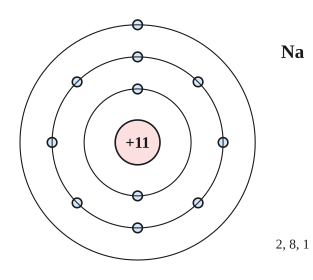
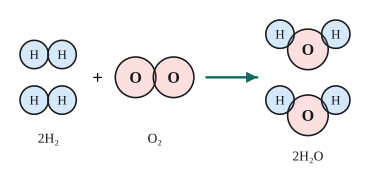

# Chủ đề 1. Nguyên tử, phân tử, mol và phản ứng hóa học

> **Level Cơ bản** (mục I, các bài gắn nhãn *Cơ bản*) bám sát SGK KHTN 7 – 8. **Level Nâng cao** (mục II, các bài gắn nhãn *Nâng cao*) dành cho ôn thi học sinh giỏi và thi vào lớp 10 chuyên Hóa.
>
> Thể tích mol khí ở điều kiện chuẩn (đkc: 25 °C, 1 bar) là 24,79 L/mol. Nguyên tử khối: H = 1, C = 12, N = 14, O = 16, Na = 23, Mg = 24, Al = 27, P = 31, S = 32, Cl = 35,5, K = 39, Ca = 40, Fe = 56, Cu = 64, Zn = 65.

## I. Kiến thức cơ bản

### 1. Nguyên tử
- Nguyên tử gồm **hạt nhân** mang điện dương ở tâm và **vỏ electron** mang điện âm. Hạt nhân gồm **proton** (p, điện tích +1) và **neutron** (n, không mang điện). Electron (e) có điện tích −1.
- Nguyên tử trung hòa về điện: **số p = số e**. Số p (cũng là số đơn vị điện tích hạt nhân $Z$) quyết định nguyên tử thuộc **nguyên tố** nào.
- Electron chuyển động quanh hạt nhân và sắp xếp thành từng **lớp**: lớp 1 chứa tối đa 2 electron, lớp 2 tối đa 8 electron, lớp 3 (với 20 nguyên tố đầu) chứa tối đa 8 electron.
- Khối lượng nguyên tử tập trung ở hạt nhân (electron rất nhẹ). **Khối lượng nguyên tử** tính bằng amu: $m \approx$ số p + số n (amu).

### 2. Nguyên tố hóa học, đơn chất, hợp chất, phân tử
- **Nguyên tố hóa học** là tập hợp các nguyên tử cùng số proton, được biểu diễn bằng **kí hiệu hóa học** (H, O, Na, Fe, ...).
- **Đơn chất** tạo nên từ một nguyên tố (O₂, Fe, Cu); **hợp chất** tạo nên từ hai nguyên tố trở lên (H₂O, NaCl).
- **Phân tử** là hạt đại diện cho chất, gồm một số nguyên tử liên kết với nhau. **Khối lượng phân tử** bằng tổng khối lượng các nguyên tử trong phân tử. Ví dụ $\ce{H2SO4}$: $2\cdot1 + 32 + 4\cdot16 = 98$ amu.

### 3. Hóa trị và công thức hóa học
- **Hóa trị** là con số biểu thị khả năng liên kết của nguyên tử nguyên tố này với nguyên tử nguyên tố khác (lấy hóa trị của H là I, của O là II).
- **Quy tắc hóa trị:** trong hợp chất $\ce{A_xB_y}$ với hóa trị $a$, $b$: $x\cdot a = y\cdot b$.
- **Lập công thức:** từ $\frac xy = \frac ba$, chọn $x$, $y$ là các số nguyên tối giản. Ví dụ Al (III) và O (II): $\frac xy = \frac23$, nên công thức là $\ce{Al2O3}$.
- Một số hóa trị cần nhớ: Na, K, Ag (I); Mg, Ca, Ba, Zn, Cu (II); Al (III); Fe (II, III); nhóm $\ce{OH}$, $\ce{NO3}$, $\ce{Cl}$ (I); nhóm $\ce{SO4}$, $\ce{CO3}$ (II); nhóm $\ce{PO4}$ (III).
- **Phần trăm khối lượng nguyên tố** trong $\ce{A_xB_y}$: $\%A = \frac{x\cdot M_A}{M_{A_xB_y}}\cdot100\%$.

### 4. Biến đổi vật lí, biến đổi hóa học, phản ứng hóa học
- **Biến đổi vật lí:** chất giữ nguyên là chất ban đầu (nước đá tan, muối hòa tan). **Biến đổi hóa học:** có chất mới tạo thành (sắt gỉ, nến cháy).
- **Phản ứng hóa học** là quá trình biến đổi chất này (chất phản ứng) thành chất khác (sản phẩm). Bản chất: **liên kết giữa các nguyên tử thay đổi**, phân tử này biến đổi thành phân tử khác, còn **số nguyên tử mỗi nguyên tố giữ nguyên**.
- Dấu hiệu nhận biết: có chất kết tủa, chất khí, thay đổi màu sắc, tỏa nhiệt hoặc phát sáng.

### 5. Định luật bảo toàn khối lượng và phương trình hóa học
- **Định luật bảo toàn khối lượng:** trong một phản ứng hóa học, tổng khối lượng các sản phẩm bằng tổng khối lượng các chất phản ứng. *Vì sao?* Số nguyên tử mỗi nguyên tố không đổi, khối lượng mỗi nguyên tử không đổi.
- **Lập phương trình hóa học:** viết sơ đồ phản ứng, rồi **cân bằng** số nguyên tử mỗi nguyên tố ở hai vế bằng cách đặt hệ số. Ví dụ:
$$\ce{4Al + 3O2 -> 2Al2O3}.$$
- Phương trình cho biết **tỉ lệ số phân tử (số mol)** giữa các chất.

### 6. Mol, khối lượng mol, thể tích mol khí
- **Mol** là lượng chất chứa $6{,}022\cdot10^{23}$ hạt (nguyên tử hoặc phân tử); số này là **số Avogadro** $N_A$.
- **Khối lượng mol** $M$ (g/mol) có trị số bằng khối lượng nguyên tử hoặc phân tử tính theo amu. Ví dụ $M_{\ce{H2O}} = 18$ g/mol.
- Các công thức chuyển đổi:
$$n = \frac{m}{M}, \qquad n = \frac{V_{\text{khí}}}{24{,}79}\ (\text{đkc}), \qquad \text{số hạt} = n\cdot N_A.$$
- **Tỉ khối** của khí A so với khí B: $d_{A/B} = \frac{M_A}{M_B}$; so với không khí: $d_{A/kk} = \frac{M_A}{29}$ (khí nặng hơn không khí khi $M > 29$).

### 7. Tính theo phương trình hóa học
1. Đổi dữ kiện ra số mol.
2. Viết và cân bằng phương trình.
3. Dựa vào tỉ lệ hệ số để tìm số mol chất cần tính.
4. Đổi số mol ra khối lượng hoặc thể tích.

**Hiệu suất phản ứng:** $H = \frac{\text{lượng sản phẩm thực tế}}{\text{lượng sản phẩm lí thuyết}}\cdot100\%$.

---

## II. Kiến thức nâng cao

### 1. Bài toán về số hạt
Gọi số proton là $Z$, số neutron là $N$: tổng số hạt $= 2Z + N$; số hạt mang điện $= 2Z$; số hạt không mang điện $= N$. Với các nguyên tố đầu bảng (trừ H) thường có $1 \le \frac NZ \le 1{,}5$, dùng để biện luận khi chỉ biết tổng số hạt.

### 2. Lập công thức hóa học từ thành phần phần trăm
Với hợp chất $\ce{A_xB_yC_z}$: $x : y : z = \frac{\%A}{M_A} : \frac{\%B}{M_B} : \frac{\%C}{M_C}$, rồi đưa về tỉ lệ số nguyên tối giản. Nếu biết khối lượng mol của hợp chất thì suy ra công thức phân tử.

### 3. Cân bằng phương trình phức tạp
- **Phương pháp "chẵn – lẻ":** nếu một nguyên tố có số nguyên tử lẻ ở một vế và chẵn ở vế kia, nhân 2 vào chất có số lẻ.
- **Phương pháp hệ số đại số:** đặt các hệ số là ẩn, viết phương trình bảo toàn cho từng nguyên tố, chọn một ẩn bằng 1 rồi giải.
- Kiểm tra lại số nguyên tử từng nguyên tố ở hai vế.

### 4. Chất dư, chất hết
So sánh tỉ lệ $\frac{n_{\text{có}}}{\text{hệ số}}$ của các chất phản ứng: chất có tỉ lệ nhỏ hơn **hết trước**, mọi tính toán theo chất hết.

### 5. Bài toán hỗn hợp
Gọi số mol mỗi chất trong hỗn hợp là ẩn, lập hệ phương trình từ: tổng khối lượng, tổng số mol khí sinh ra, ... (mỗi dữ kiện cho một phương trình).

### 6. Hiệu suất trong quá trình nhiều giai đoạn
Hiệu suất chung bằng **tích** các hiệu suất từng giai đoạn: $H = H_1\cdot H_2\cdots$

### 7. Định luật bảo toàn nguyên tố
Tổng số mol nguyên tử của mỗi nguyên tố trước và sau phản ứng bằng nhau. Dùng để tính nhanh mà không cần viết hết các phương trình.

---

## III. Bài tập

**Bài 1 (Cơ bản).** Lập công thức hóa học và tính khối lượng phân tử của hợp chất tạo bởi: a) Al (III) và O; b) Fe (III) và nhóm $\ce{SO4}$ (II); c) Ca (II) và nhóm $\ce{PO4}$ (III).

**Bài 2 (Cơ bản).** Cân bằng các phương trình hóa học:
a) $\ce{Al + O2 -> Al2O3}$; b) $\ce{Fe2O3 + CO -> Fe + CO2}$; c) $\ce{KClO3 -> KCl + O2}$.

**Bài 3 (Cơ bản).** Tính: a) số mol của 11,2 g Fe; b) thể tích ở đkc của 0,25 mol $\ce{CO2}$; c) số phân tử có trong 0,5 mol $\ce{H2O}$.

**Bài 4 (Cơ bản).** Khí X có tỉ khối so với hydrogen là 22. Tính khối lượng mol của X. Khí X nặng hay nhẹ hơn không khí bao nhiêu lần?

**Bài 5 (Cơ bản).** Nung 100 g đá vôi ($\ce{CaCO3}$) tới khi phản ứng hoàn toàn, thu được 56 g vôi sống (CaO) và khí carbon dioxide. Tính khối lượng khí carbon dioxide sinh ra và viết phương trình hóa học.

**Bài 6 (Cơ bản).** Đốt cháy hoàn toàn 6,2 g phosphorus trong khí oxygen, thu được $\ce{P2O5}$. Tính khối lượng $\ce{P2O5}$ tạo thành và thể tích khí oxygen (đkc) cần dùng.

**Bài 7 (Nâng cao, lập công thức).** a) Một oxide của sulfur có 40% S về khối lượng. Tìm công thức oxide. b) Hợp chất X có thành phần khối lượng: 40% Cu, 20% S, 40% O; khối lượng mol của X là 160 g/mol. Tìm công thức của X.

**Bài 8 (Nâng cao, số hạt).** Nguyên tử của nguyên tố X có tổng số hạt là 40, trong đó số hạt mang điện nhiều hơn số hạt không mang điện là 12. Xác định số p, n, e và cho biết X là nguyên tố nào.

**Bài 9 (Nâng cao, hiệu suất).** Nung 1 tấn đá vôi chứa 80% $\ce{CaCO3}$ (phần còn lại là tạp chất không bị phân hủy), hiệu suất phản ứng 90%. Tính khối lượng vôi sống thu được.

**Bài 10 (Nâng cao, hỗn hợp).** Cho 8,3 g hỗn hợp Al và Fe tác dụng với dung dịch HCl dư, thu được 6,1975 L khí $\ce{H2}$ (đkc). Tính khối lượng mỗi kim loại trong hỗn hợp.

**Bài 11 (Nâng cao, chất dư).** Cho 4,8 g Mg vào dung dịch chứa 0,3 mol HCl. Chất nào còn dư, dư bao nhiêu mol? Tính thể tích khí $\ce{H2}$ (đkc) thu được.

**Bài 12 (Nâng cao, cân bằng phương trình).** Cân bằng các phương trình:
a) $\ce{FeS2 + O2 -> Fe2O3 + SO2}$;
b) $\ce{Cu + HNO3 -> Cu(NO3)2 + NO + H2O}$;
c) $\ce{Fe3O4 + HCl -> FeCl2 + FeCl3 + H2O}$.

---

## IV. Lời giải chi tiết

### Bài 1
- a) $\frac xy = \frac{\text{II}}{\text{III}} = \frac23$: $\ce{Al2O3}$, $M = 2\cdot27 + 3\cdot16 = 102$.
- b) $\frac xy = \frac{\text{II}}{\text{III}}$: $\ce{Fe2(SO4)3}$, $M = 2\cdot56 + 3\cdot96 = 400$.
- c) $\frac xy = \frac{\text{III}}{\text{II}} = \frac32$: $\ce{Ca3(PO4)2}$, $M = 3\cdot40 + 2\cdot95 = 310$.

### Bài 2
- a) $\ce{4Al + 3O2 -> 2Al2O3}$ (O: 2 bên trái, 3 bên phải; bội chung 6).
- b) $\ce{Fe2O3 + 3CO -> 2Fe + 3CO2}$ (mỗi CO nhận thêm 1 O; $\ce{Fe2O3}$ có 3 O).
- c) $\ce{2KClO3 -> 2KCl + 3O2}$.

### Bài 3
- a) $n = \frac{11{,}2}{56} = 0{,}2$ mol.
- b) $V = 0{,}25\cdot24{,}79 \approx 6{,}20$ L.
- c) Số phân tử $= 0{,}5\cdot6{,}022\cdot10^{23} \approx 3{,}011\cdot10^{23}$.

### Bài 4
$M_X = 22\cdot2 = 44$ g/mol (có thể là $\ce{CO2}$). $d_{X/kk} = \frac{44}{29} \approx 1{,}52$: X nặng hơn không khí khoảng 1,52 lần.

### Bài 5
$\ce{CaCO3 ->[t^\circ] CaO + CO2}$. Theo định luật bảo toàn khối lượng: $m_{\ce{CO2}} = 100 - 56 = 44$ g.

### Bài 6
$n_{\ce{P}} = \frac{6{,}2}{31} = 0{,}2$ mol. $\ce{4P + 5O2 ->[t^\circ] 2P2O5}$.
- $n_{\ce{P2O5}} = \frac{0{,}2}{2} = 0{,}1$ mol, $m = 0{,}1\cdot142 = 14{,}2$ g.
- $n_{\ce{O2}} = \frac54\cdot0{,}2 = 0{,}25$ mol, $V = 0{,}25\cdot24{,}79 \approx 6{,}20$ L.

### Bài 7
**a)** Gọi công thức $\ce{S_xO_y}$: $x : y = \frac{40}{32} : \frac{60}{16} = 1{,}25 : 3{,}75 = 1 : 3$. Oxide là $\ce{SO3}$.

**b)** Trong 160 g X: Cu $= 64$ g (1 mol), S $= 32$ g (1 mol), O $= 64$ g (4 mol). X là $\ce{CuSO4}$.

### Bài 8
$2Z + N = 40$ và $2Z - N = 12$. Cộng lại: $4Z = 52$, $Z = 13$, $N = 14$. Vậy p = e = 13, n = 14: X là **aluminium (Al)**.

### Bài 9
Khối lượng $\ce{CaCO3}$: $0{,}8$ tấn. $\ce{CaCO3 -> CaO + CO2}$: cứ 100 tấn $\ce{CaCO3}$ cho 56 tấn CaO.
Lí thuyết: $0{,}8\cdot\frac{56}{100} = 0{,}448$ tấn; thực tế: $0{,}448\cdot90\% = 0{,}4032$ tấn $\approx 403$ kg.

### Bài 10
$n_{\ce{H2}} = \frac{6{,}1975}{24{,}79} = 0{,}25$ mol. Gọi $a$, $b$ là số mol Al, Fe:
$$\ce{2Al + 6HCl -> 2AlCl3 + 3H2}, \qquad \ce{Fe + 2HCl -> FeCl2 + H2}.$$
$27a + 56b = 8{,}3$ và $1{,}5a + b = 0{,}25$. Giải ra $a = 0{,}1$, $b = 0{,}1$.
Vậy $m_{\ce{Al}} = 2{,}7$ g, $m_{\ce{Fe}} = 5{,}6$ g.

### Bài 11
$n_{\ce{Mg}} = 0{,}2$ mol. $\ce{Mg + 2HCl -> MgCl2 + H2}$. So sánh: $\frac{0{,}2}{1} > \frac{0{,}3}{2}$, nên **HCl hết, Mg dư**.
Mg phản ứng $0{,}15$ mol, dư $0{,}05$ mol. $n_{\ce{H2}} = 0{,}15$ mol, $V \approx 3{,}72$ L.

### Bài 12
**a)** Đặt hệ số $\ce{FeS2}$ là 2 (để Fe chẵn): $\ce{2FeS2 -> Fe2O3 + 4SO2}$; số O bên phải $3 + 8 = 11$, nên cần $\frac{11}{2}$ $\ce{O2}$. Nhân 2:
$$\ce{4FeS2 + 11O2 -> 2Fe2O3 + 8SO2}.$$

**b)** Đặt $a\ce{Cu} + b\ce{HNO3} \to a\ce{Cu(NO3)2} + c\ce{NO} + \frac b2\ce{H2O}$. Bảo toàn N: $b = 2a + c$; bảo toàn O: $3b = 6a + c + \frac b2$. Chọn $a = 3$: $b = 6 + c$ và $2{,}5b = 18 + c$, giải ra $c = 2$, $b = 8$:
$$\ce{3Cu + 8HNO3 -> 3Cu(NO3)2 + 2NO + 4H2O}.$$

**c)** $\ce{Fe3O4}$ coi như $\ce{FeO.Fe2O3}$, nên cho 1 $\ce{FeCl2}$ và 2 $\ce{FeCl3}$:
$$\ce{Fe3O4 + 8HCl -> FeCl2 + 2FeCl3 + 4H2O}.$$
Kiểm tra Cl: $2 + 6 = 8$; H: 8; O: 4.
