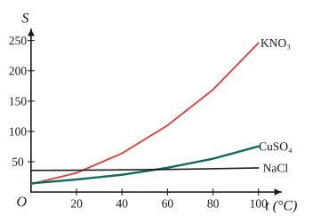

# Chủ đề 2. Dung dịch, độ tan và nồng độ

> **Level Cơ bản** (mục I, các bài gắn nhãn *Cơ bản*) bám sát SGK KHTN 8. **Level Nâng cao** (mục II, các bài gắn nhãn *Nâng cao*) dành cho ôn thi học sinh giỏi và thi vào lớp 10 chuyên Hóa.
>
> **Về thể tích khí:** chương trình mới dùng điều kiện chuẩn (đkc: 25 °C, 1 bar), khi đó 1 mol khí chiếm **24,79 lít**. Nhiều đề thi cũ dùng điều kiện tiêu chuẩn (đktc: 0 °C, 1 atm) với **22,4 lít**. Luôn đọc kỹ đề bài cho điều kiện nào.

## I. Kiến thức cơ bản

### 1. Dung dịch, dung môi, chất tan
- **Dung dịch** là hỗn hợp **đồng nhất** của dung môi và chất tan. Ví dụ: nước muối gồm dung môi là nước, chất tan là muối ăn.
- **Dung môi** là chất có khả năng hòa tan chất khác (thường là nước); **chất tan** có thể là chất rắn, lỏng hoặc khí.
- **Dung dịch chưa bão hòa** còn hòa tan thêm được chất tan; **dung dịch bão hòa** không hòa tan thêm được chất tan ở nhiệt độ đó.
- **Làm chất rắn tan nhanh hơn:** khuấy (đưa dung môi mới tiếp xúc với chất rắn), đun nóng (các hạt chuyển động nhanh hơn), nghiền nhỏ (tăng diện tích tiếp xúc).

### 2. Độ tan
**Độ tan** $S$ của một chất trong nước là số gam chất đó hòa tan tối đa trong **100 g nước** để tạo thành dung dịch bão hòa ở một nhiệt độ xác định.
- Độ tan của **chất rắn** thường **tăng** khi nhiệt độ tăng (đường, muối ăn, $\ce{KNO3}$, ...).
- Độ tan của **chất khí** **giảm** khi nhiệt độ tăng và **tăng** khi áp suất tăng. Vì vậy nước ngọt có ga để ấm thì "xì ga" mạnh hơn, và cá dễ thiếu oxygen khi nước ao nóng lên.
- Theo độ tan ở 25 °C: chất **dễ tan** ($S > 10$ g), **ít tan** ($1 \le S \le 10$ g), **không tan** ($S < 1$ g); xem bảng tính tan cuối sách.

**Nồng độ phần trăm của dung dịch bão hòa** (suy ra từ định nghĩa): trong $100 + S$ gam dung dịch có $S$ gam chất tan, nên
$$C\%_{\text{bão hòa}} = \frac{S}{100 + S}\cdot100\%.$$

### 3. Nồng độ phần trăm
$$C\% = \frac{m_{ct}}{m_{dd}}\cdot100\%, \qquad m_{dd} = m_{ct} + m_{dm}.$$
- $C\%$ cho biết số gam chất tan có trong **100 g dung dịch**. Ví dụ dung dịch $\ce{NaCl}$ 10% chứa 10 g muối trong 100 g dung dịch (tức 10 g muối và 90 g nước).
- **Lỗi hay gặp:** chia cho khối lượng **nước** thay vì khối lượng **dung dịch**.
- Liên hệ khối lượng và thể tích dung dịch qua khối lượng riêng: $m_{dd} = D\cdot V_{dd}$ (với $D$ tính bằng g/mL thì $V$ tính bằng mL).

### 4. Nồng độ mol
$$C_M = \frac{n}{V}\ (\text{mol/L, ký hiệu M}),$$
trong đó $n$ là số mol chất tan, $V$ là thể tích **dung dịch** tính bằng **lít**. Ví dụ dung dịch $\ce{NaOH}$ 0,5 M chứa 0,5 mol $\ce{NaOH}$ trong 1 lít dung dịch.
- Nhắc lại: $n = \frac{m}{M}$; khí ở đkc $n = \frac{V}{24{,}79}$.
- Tính số mol chất tan có trong dung dịch: $n = C_M\cdot V$, rồi dùng để tính theo phương trình hóa học.

### 5. Liên hệ giữa $C\%$ và $C_M$
Xét 1 lít $= 1000$ mL dung dịch có khối lượng riêng $D$ (g/mL): khối lượng dung dịch là $1000D$ gam, khối lượng chất tan là $1000D\cdot\frac{C\%}{100} = 10D\cdot C\%$ (với $C\%$ là con số, ví dụ 98), nên
$$C_M = \frac{10\cdot D\cdot C\%}{M}.$$
*Không nên học thuộc máy móc:* khi quên, chỉ cần tự tính lại cho 1 lít dung dịch như trên.

### 6. Pha chế dung dịch
**Pha một dung dịch có nồng độ cho trước:**
1. Tính khối lượng (hoặc số mol) chất tan cần dùng.
2. Tính khối lượng nước (hoặc thể tích dung dịch) cần có.
3. Cân chất tan cho vào cốc, rồi thêm nước đến đủ khối lượng (với $C\%$) hoặc đến vạch thể tích (với $C_M$, dùng bình định mức), khuấy đều.

**Pha loãng:** thêm nước thì **lượng chất tan không đổi**:
$$m_1\cdot C\%_1 = m_2\cdot C\%_2, \qquad C_{M1}\cdot V_1 = C_{M2}\cdot V_2.$$

> **An toàn:** pha loãng axit sulfuric đặc phải **rót từ từ axit vào nước** (không làm ngược lại), vì quá trình tỏa rất nhiều nhiệt, nước rót vào axit có thể sôi bùng và bắn axit ra ngoài.

### 7. Trộn hai dung dịch cùng chất tan
Khối lượng chất tan và khối lượng dung dịch đều cộng lại:
$$C\% = \frac{m_1C\%_1 + m_2C\%_2}{m_1 + m_2}, \qquad C_M = \frac{C_{M1}V_1 + C_{M2}V_2}{V_1 + V_2}$$
(công thức thứ hai coi thể tích dung dịch sau khi trộn bằng tổng thể tích, giả thiết thường được cho trong đề).

---

## II. Kiến thức nâng cao

### 1. Quy tắc đường chéo
Trộn $m_1$ gam dung dịch nồng độ $C_1$ với $m_2$ gam dung dịch nồng độ $C_2$ ($C_1 < C < C_2$) được dung dịch nồng độ $C$. Bảo toàn chất tan: $m_1C_1 + m_2C_2 = (m_1 + m_2)C$, suy ra $m_1(C - C_1) = m_2(C_2 - C)$, tức là
$$\frac{m_1}{m_2} = \frac{C_2 - C}{C - C_1}.$$
Sơ đồ dễ nhớ (mỗi số ở cột phải là hiệu theo đường chéo):
$$\begin{array}{ccccc} m_1: & C_1 & & & C_2 - C \\ & & \searrow\ \ \nearrow & & \\ & & C & & \\ & & \nearrow\ \ \searrow & & \\ m_2: & C_2 & & & C - C_1 \end{array}$$
- Áp dụng tương tự cho $C_M$ và thể tích: $\frac{V_1}{V_2} = \frac{C_{M2} - C_M}{C_M - C_{M1}}$.
- **Nước** coi là dung dịch có nồng độ 0%; **chất tan nguyên chất** coi là dung dịch 100%.

### 2. Tinh thể hiđrat (muối ngậm nước)
- Ví dụ $\ce{CuSO4.5H2O}$ (tinh thể màu xanh), $\ce{Na2CO3.10H2O}$, $\ce{FeSO4.7H2O}$. Khi hòa tan vào nước, phần nước kết tinh trở thành dung môi.
- **Coi tinh thể như một "dung dịch rắn"** có nồng độ: $\ce{CuSO4.5H2O}$ có $M = 160 + 5\cdot18 = 250$, nên
$$C\%_{\ce{CuSO4}\text{ trong tinh thể}} = \frac{160}{250}\cdot100\% = 64\%.$$
  Nhờ vậy có thể dùng quy tắc đường chéo khi pha dung dịch từ tinh thể.

### 3. Kết tinh khi làm lạnh dung dịch bão hòa
Khi làm lạnh dung dịch bão hòa, độ tan giảm nên một phần chất tan tách ra (thường dưới dạng tinh thể hiđrat). Cách giải:
1. Tính khối lượng chất tan và nước trong dung dịch ban đầu (dùng $S$ ở nhiệt độ cao).
2. Gọi số mol tinh thể tách ra là $x$; phần chất tan và nước **còn lại** trong dung dịch đều giảm.
3. Dung dịch còn lại vẫn **bão hòa** ở nhiệt độ thấp: lập tỉ lệ $\frac{m_{ct}}{m_{\text{nước}}} = \frac{S_{\text{thấp}}}{100}$, giải ra $x$.

### 4. Chất tan phản ứng với nước
Một số chất khi cho vào nước tạo ra **chất tan mới**:
$$\ce{2Na + 2H2O -> 2NaOH + H2 ^}, \quad \ce{Na2O + H2O -> 2NaOH}, \quad \ce{SO3 + H2O -> H2SO4}, \quad \ce{P2O5 + 3H2O -> 2H3PO4}.$$
- Chất tan trong dung dịch là **sản phẩm** ($\ce{NaOH}$, $\ce{H2SO4}$, ...), không phải chất ban đầu.
- **Khối lượng dung dịch sau phản ứng** (bảo toàn khối lượng):
$$m_{dd\text{ sau}} = \text{tổng khối lượng các chất cho vào} - m_{\text{khí bay ra}} - m_{\text{kết tủa}}.$$

### 5. Nồng độ các chất sau phản ứng trong dung dịch
1. Tính số mol các chất ban đầu, viết phương trình hóa học, xác định **chất hết, chất dư**.
2. Dung dịch sau phản ứng gồm **sản phẩm tan** và **chất phản ứng còn dư** (nếu tan).
3. Tính $C_M$ với thể tích dung dịch sau phản ứng (thường bằng tổng thể tích), hoặc $C\%$ với khối lượng dung dịch sau phản ứng tính theo mục 4.

### 6. Các định luật bảo toàn hay dùng
- **Bảo toàn khối lượng chất tan** khi pha loãng, cô cạn, trộn dung dịch.
- **Bảo toàn khối lượng** cho cả hệ phản ứng.
- **Bảo toàn nguyên tố:** số mol mỗi nguyên tố trước và sau phản ứng như nhau. Ví dụ toàn bộ S trong $\ce{SO3}$ và $\ce{H2SO4}$ ban đầu đều nằm trong $\ce{H2SO4}$ sau cùng.

---

## III. Bài tập

*Nguyên tử khối: H = 1, C = 12, O = 16, Na = 23, S = 32, Cl = 35,5, Fe = 56, Cu = 64, Ba = 137.*

**Bài 1 (Cơ bản).** Hòa tan 20 g $\ce{NaCl}$ vào 180 g nước. Tính nồng độ phần trăm của dung dịch thu được.

**Bài 2 (Cơ bản).** Tính nồng độ mol của dung dịch chứa 8 g $\ce{NaOH}$ trong 400 mL dung dịch.

**Bài 3 (Cơ bản).** Cần bao nhiêu gam $\ce{CuSO4}$ và bao nhiêu gam nước để pha chế 150 g dung dịch $\ce{CuSO4}$ 8%? Nêu cách pha chế.

**Bài 4 (Cơ bản).** Ở 25 °C, độ tan của $\ce{NaCl}$ là 36 g. Tính nồng độ phần trăm của dung dịch $\ce{NaCl}$ bão hòa ở nhiệt độ đó.

**Bài 5 (Cơ bản).** Thêm nước vào 50 mL dung dịch $\ce{HCl}$ 2 M để được 250 mL dung dịch. Tính nồng độ mol của dung dịch mới.

**Bài 6 (Cơ bản).** Dung dịch $\ce{H2SO4}$ 98% có khối lượng riêng 1,84 g/mL. Tính nồng độ mol của dung dịch này.

**Bài 7 (Cơ bản).** Cho 5,6 g sắt vào 200 mL dung dịch $\ce{HCl}$ 1,5 M.
a) Tính thể tích khí $\ce{H2}$ thu được ở đkc.
b) Tính nồng độ mol các chất trong dung dịch sau phản ứng (coi thể tích dung dịch không đổi).

**Bài 8 (Cơ bản).** Trộn 200 g dung dịch $\ce{NaCl}$ 10% với 300 g dung dịch $\ce{NaCl}$ 20%. Tính nồng độ phần trăm của dung dịch thu được.

**Bài 9 (Nâng cao, đường chéo).** Cần trộn dung dịch $\ce{NaOH}$ 10% và dung dịch $\ce{NaOH}$ 40% theo tỉ lệ khối lượng nào để được dung dịch $\ce{NaOH}$ 20%? Tính khối lượng mỗi dung dịch cần lấy để pha 300 g dung dịch 20%.

**Bài 10 (Nâng cao, tinh thể hiđrat).** Hòa tan 25 g tinh thể $\ce{CuSO4.5H2O}$ vào 175 g nước. Tính nồng độ phần trăm của dung dịch $\ce{CuSO4}$ thu được.

**Bài 11 (Nâng cao, tinh thể hiđrat).** Cần lấy bao nhiêu gam tinh thể $\ce{CuSO4.5H2O}$ và bao nhiêu gam dung dịch $\ce{CuSO4}$ 4% để pha chế 500 g dung dịch $\ce{CuSO4}$ 16%?

**Bài 12 (Nâng cao, kết tinh).** Độ tan của $\ce{CuSO4}$ ở 85 °C và 12 °C lần lượt là 87,7 g và 35,5 g. Làm lạnh 1877 g dung dịch $\ce{CuSO4}$ bão hòa từ 85 °C xuống 12 °C. Tính khối lượng tinh thể $\ce{CuSO4.5H2O}$ tách ra.

**Bài 13 (Nâng cao, chất phản ứng với nước).** Cho 4,6 g natri vào 95,6 g nước. Tính nồng độ phần trăm của dung dịch thu được.

**Bài 14 (Nâng cao, chất phản ứng với nước).** Cần hòa tan bao nhiêu gam $\ce{SO3}$ vào 100 g dung dịch $\ce{H2SO4}$ 9,8% để được dung dịch $\ce{H2SO4}$ 24,5%?

**Bài 15 (Nâng cao, đường chéo theo nồng độ mol).** Cần trộn dung dịch $\ce{HCl}$ 0,2 M và dung dịch $\ce{HCl}$ 0,5 M theo tỉ lệ thể tích nào để được dung dịch $\ce{HCl}$ 0,3 M? Muốn có 600 mL dung dịch 0,3 M thì lấy mỗi dung dịch bao nhiêu mL? (Coi thể tích dung dịch sau khi trộn bằng tổng thể tích.)

**Bài 16 (Nâng cao, nồng độ sau phản ứng).** Cho 200 g dung dịch $\ce{BaCl2}$ 10,4% vào 100 g dung dịch $\ce{H2SO4}$ 14,7%. Tính khối lượng kết tủa và nồng độ phần trăm các chất trong dung dịch sau phản ứng.

---

## IV. Lời giải chi tiết

### Bài 1
$m_{dd} = 20 + 180 = 200$ g, nên $C\% = \frac{20}{200}\cdot100\% = 10\%$.

> Không chia cho 180 g (khối lượng nước).

### Bài 2
$n_{\ce{NaOH}} = \frac{8}{40} = 0{,}2$ mol; $V = 0{,}4$ L. Vậy $C_M = \frac{0{,}2}{0{,}4} = 0{,}5$ M.

### Bài 3
- $m_{\ce{CuSO4}} = 150\cdot8\% = 12$ g; $m_{\text{nước}} = 150 - 12 = 138$ g.
- **Cách pha:** cân 12 g $\ce{CuSO4}$ khan cho vào cốc, đong 138 mL nước (vì $D_{\text{nước}} = 1$ g/mL) đổ vào cốc, khuấy đến khi tan hết.

### Bài 4
$C\% = \frac{36}{100 + 36}\cdot100\% \approx 26{,}47\%$.

### Bài 5
Số mol $\ce{HCl}$ không đổi: $n = 2\cdot0{,}05 = 0{,}1$ mol. Nồng độ mới: $C_M = \frac{0{,}1}{0{,}25} = 0{,}4$ M.
(Hoặc: $C_{M2} = \frac{C_{M1}V_1}{V_2} = \frac{2\cdot50}{250} = 0{,}4$ M.)

### Bài 6
Xét 1 lít dung dịch: $m_{dd} = 1000\cdot1{,}84 = 1840$ g; $m_{\ce{H2SO4}} = 1840\cdot98\% = 1803{,}2$ g; $n = \frac{1803{,}2}{98} = 18{,}4$ mol. Vậy $C_M = 18{,}4$ M.
(Hoặc dùng công thức $C_M = \frac{10\cdot1{,}84\cdot98}{98} = 18{,}4$ M.)

### Bài 7
$n_{\ce{Fe}} = \frac{5{,}6}{56} = 0{,}1$ mol; $n_{\ce{HCl}} = 1{,}5\cdot0{,}2 = 0{,}3$ mol.
$$\ce{Fe + 2HCl -> FeCl2 + H2 ^}$$
Tỉ lệ: 0,1 mol Fe cần 0,2 mol HCl $< 0{,}3$ mol, nên **Fe hết, HCl dư** 0,1 mol.

**a)** $n_{\ce{H2}} = n_{\ce{Fe}} = 0{,}1$ mol, $V_{\ce{H2}} = 0{,}1\cdot24{,}79 = 2{,}479$ L.

**b)** Dung dịch sau phản ứng gồm $\ce{FeCl2}$ 0,1 mol và $\ce{HCl}$ dư 0,1 mol, trong 0,2 L:
$C_{M\,\ce{FeCl2}} = 0{,}5$ M; $\ C_{M\,\ce{HCl}} = 0{,}5$ M.

> Đừng quên chất **còn dư** cũng nằm trong dung dịch sau phản ứng.

### Bài 8
$m_{ct} = 200\cdot10\% + 300\cdot20\% = 20 + 60 = 80$ g; $m_{dd} = 500$ g. Vậy $C\% = \frac{80}{500}\cdot100\% = 16\%$.

### Bài 9
Theo quy tắc đường chéo: $\frac{m_{10\%}}{m_{40\%}} = \frac{40 - 20}{20 - 10} = \frac{20}{10} = 2$.
Trộn theo tỉ lệ khối lượng **2 : 1**. Với 300 g: lấy **200 g** dung dịch 10% và **100 g** dung dịch 40%.
Kiểm tra: $\frac{200\cdot0{,}1 + 100\cdot0{,}4}{300} = \frac{60}{300} = 20\%$.

### Bài 10
$n_{\ce{CuSO4.5H2O}} = \frac{25}{250} = 0{,}1$ mol, nên $m_{\ce{CuSO4}} = 0{,}1\cdot160 = 16$ g. Khối lượng dung dịch: $25 + 175 = 200$ g.
$$C\% = \frac{16}{200}\cdot100\% = 8\%.$$

> Chất tan là $\ce{CuSO4}$ (16 g), **không phải** 25 g tinh thể.

### Bài 11
Coi tinh thể là "dung dịch" $\ce{CuSO4}$ 64%. Theo quy tắc đường chéo:
$$\frac{m_{\text{tinh thể}}}{m_{dd\,4\%}} = \frac{16 - 4}{64 - 16} = \frac{12}{48} = \frac14.$$
Tổng khối lượng 500 g, nên $m_{\text{tinh thể}} = 100$ g và $m_{dd\,4\%} = 400$ g.
Kiểm tra: $m_{\ce{CuSO4}} = 100\cdot0{,}64 + 400\cdot0{,}04 = 64 + 16 = 80$ g; $\frac{80}{500} = 16\%$.

### Bài 12
**Ở 85 °C:** cứ $100 + 87{,}7 = 187{,}7$ g dung dịch bão hòa có 87,7 g $\ce{CuSO4}$. Vậy 1877 g dung dịch có **877 g** $\ce{CuSO4}$ và **1000 g** nước.

**Khi làm lạnh:** gọi $x$ là số mol $\ce{CuSO4.5H2O}$ tách ra. Phần còn lại trong dung dịch:
- $\ce{CuSO4}$: $877 - 160x$ (g);
- nước: $1000 - 90x$ (g).

Dung dịch còn lại bão hòa ở 12 °C:
$$\frac{877 - 160x}{1000 - 90x} = \frac{35{,}5}{100} \iff 87\,700 - 16\,000x = 35\,500 - 3195x \iff 12\,805x = 52\,200.$$
$x \approx 4{,}077$ mol, nên khối lượng tinh thể tách ra $\approx 4{,}077\cdot250 \approx 1019$ g.

> Tinh thể lấy đi cả nước kết tinh ($5\ce{H2O}$), nên phải trừ cả hai phần. Nếu quên trừ nước, đáp số sẽ sai.

### Bài 13
$n_{\ce{Na}} = \frac{4{,}6}{23} = 0{,}2$ mol.
$$\ce{2Na + 2H2O -> 2NaOH + H2 ^}$$
$n_{\ce{NaOH}} = 0{,}2$ mol (8 g); $n_{\ce{H2}} = 0{,}1$ mol (0,2 g).
$m_{dd} = 4{,}6 + 95{,}6 - 0{,}2 = 100$ g (trừ khí $\ce{H2}$ bay ra). Vậy $C\%_{\ce{NaOH}} = \frac{8}{100}\cdot100\% = 8\%$.

### Bài 14
Gọi $a$ là số mol $\ce{SO3}$: $\ce{SO3 + H2O -> H2SO4}$ tạo thêm $a$ mol $\ce{H2SO4}$.
- $m_{\ce{H2SO4}} = 100\cdot9{,}8\% + 98a = 9{,}8 + 98a$;
- $m_{dd} = 100 + 80a$ (không có khí hay kết tủa).

$$\frac{9{,}8 + 98a}{100 + 80a} = 0{,}245 \iff 9{,}8 + 98a = 24{,}5 + 19{,}6a \iff 78{,}4a = 14{,}7 \iff a = 0{,}1875.$$
Khối lượng $\ce{SO3}$ cần dùng: $0{,}1875\cdot80 = 15$ g.

> Cách khác (đường chéo): $\ce{SO3}$ hòa vào nước tương đương "dung dịch" $\ce{H2SO4}$ có $C\% = \frac{98}{80}\cdot100\% = 122{,}5\%$. Khi đó $\frac{m_{\ce{SO3}}}{100} = \frac{24{,}5 - 9{,}8}{122{,}5 - 24{,}5} = \frac{14{,}7}{98}$, ra $m_{\ce{SO3}} = 15$ g.

### Bài 15
$\frac{V_{0,2\text{M}}}{V_{0,5\text{M}}} = \frac{0{,}5 - 0{,}3}{0{,}3 - 0{,}2} = 2$. Trộn theo tỉ lệ thể tích **2 : 1**: lấy **400 mL** dung dịch 0,2 M và **200 mL** dung dịch 0,5 M.
Kiểm tra: $n = 0{,}4\cdot0{,}2 + 0{,}2\cdot0{,}5 = 0{,}18$ mol; $\frac{0{,}18}{0{,}6} = 0{,}3$ M.

### Bài 16
$n_{\ce{BaCl2}} = \frac{200\cdot10{,}4\%}{208} = 0{,}1$ mol; $\ n_{\ce{H2SO4}} = \frac{100\cdot14{,}7\%}{98} = 0{,}15$ mol.
$$\ce{BaCl2 + H2SO4 -> BaSO4 v + 2HCl}$$
$\ce{BaCl2}$ hết, $\ce{H2SO4}$ dư $0{,}05$ mol.
- Kết tủa $\ce{BaSO4}$: $0{,}1\cdot233 = 23{,}3$ g.
- $m_{dd\text{ sau}} = 200 + 100 - 23{,}3 = 276{,}7$ g.
- $\ce{HCl}$: $0{,}2$ mol $= 7{,}3$ g, $C\% = \frac{7{,}3}{276{,}7}\cdot100\% \approx 2{,}64\%$.
- $\ce{H2SO4}$ dư: $0{,}05$ mol $= 4{,}9$ g, $C\% = \frac{4{,}9}{276{,}7}\cdot100\% \approx 1{,}77\%$.
