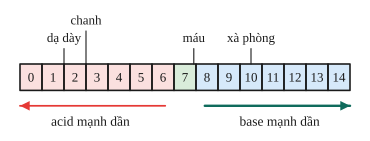
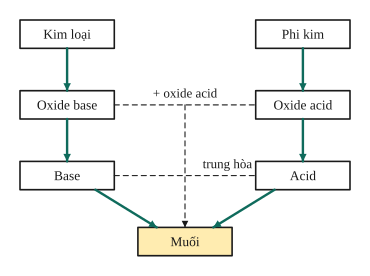
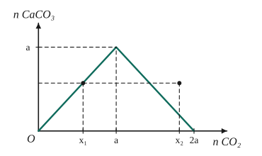

# Chủ đề 3. Oxide, acid, base, muối

> **Level Cơ bản** (mục I, các bài gắn nhãn *Cơ bản*) bám sát SGK KHTN 8. **Level Nâng cao** (mục II, các bài gắn nhãn *Nâng cao*) dành cho ôn thi học sinh giỏi và thi vào lớp 10 chuyên Hóa.
>
> Thể tích mol khí ở đkc: 24,79 L/mol. Nguyên tử khối: H = 1, C = 12, O = 16, Na = 23, Mg = 24, S = 32, Cl = 35,5, Ca = 40, Cu = 64, Ba = 137.

## I. Kiến thức cơ bản

### 1. Oxide
- **Oxide** là hợp chất của oxygen với một nguyên tố khác.
- **Oxide base** (thường là oxide kim loại: CaO, CuO, $\ce{Na2O}$): tác dụng với acid tạo muối và nước; một số (của Na, K, Ca, Ba) tác dụng với nước tạo base:
$$\ce{CuO + 2HCl -> CuCl2 + H2O}, \qquad \ce{CaO + H2O -> Ca(OH)2}.$$
- **Oxide acid** (thường là oxide phi kim: $\ce{CO2}$, $\ce{SO2}$, $\ce{SO3}$, $\ce{P2O5}$): tác dụng với base tạo muối và nước; nhiều oxide acid tác dụng với nước tạo acid:
$$\ce{CO2 + Ca(OH)2 -> CaCO3 v + H2O}, \qquad \ce{SO3 + H2O -> H2SO4}.$$
- **Oxide lưỡng tính** ($\ce{Al2O3}$, ZnO) tác dụng với cả acid và base; **oxide trung tính** (CO, NO) không tác dụng với acid, base, nước.

### 2. Acid
- **Acid** là hợp chất trong phân tử có nguyên tử H liên kết với gốc acid; khi tan trong nước tạo ion $\ce{H+}$. Ví dụ HCl, $\ce{H2SO4}$, $\ce{HNO3}$, $\ce{H3PO4}$.
- **Tính chất hóa học chung:**
  1. Làm quỳ tím hóa **đỏ**.
  2. Tác dụng với kim loại (đứng trước H trong dãy hoạt động) tạo muối và khí $\ce{H2}$: $\ce{Fe + H2SO4 -> FeSO4 + H2 ^}$.
  3. Tác dụng với base tạo muối và nước (**phản ứng trung hòa**): $\ce{NaOH + HCl -> NaCl + H2O}$.
  4. Tác dụng với oxide base tạo muối và nước.
  5. Tác dụng với muối tạo muối mới và acid mới: $\ce{BaCl2 + H2SO4 -> BaSO4 v + 2HCl}$.

### 3. Base
- **Base** là hợp chất gồm nguyên tử kim loại liên kết với nhóm $\ce{OH}$. Base tan được trong nước gọi là **kiềm** (NaOH, KOH, $\ce{Ca(OH)2}$, $\ce{Ba(OH)2}$); khi tan tạo ion $\ce{OH-}$.
- **Tính chất hóa học:**
  1. Dung dịch kiềm làm quỳ tím hóa **xanh**, phenolphthalein không màu hóa **hồng**.
  2. Tác dụng với acid tạo muối và nước.
  3. Dung dịch kiềm tác dụng với oxide acid và với dung dịch muối: $\ce{CuSO4 + 2NaOH -> Cu(OH)2 v + Na2SO4}$.
  4. Base không tan bị nhiệt phân: $\ce{Cu(OH)2 ->[t^\circ] CuO + H2O}$.

### 4. Thang pH
- **pH** cho biết độ acid hay base của dung dịch: pH < 7 là môi trường acid, pH = 7 trung tính (nước cất), pH > 7 là môi trường base. pH càng nhỏ thì tính acid càng mạnh.
- Ví dụ: dịch vị dạ dày pH ≈ 1,5–2; nước chanh ≈ 2,5; máu ≈ 7,4; nước xà phòng ≈ 10.

### 5. Muối
- **Muối** là hợp chất gồm kim loại (hoặc nhóm $\ce{NH4}$) liên kết với gốc acid: NaCl, $\ce{CaCO3}$, $\ce{CuSO4}$, $\ce{NaHCO3}$ (muối acid, còn H trong gốc).
- **Tên gọi:** tên kim loại (kèm hóa trị nếu có nhiều hóa trị) + tên gốc acid: chloride (Cl), sulfate ($\ce{SO4}$), nitrate ($\ce{NO3}$), carbonate ($\ce{CO3}$), phosphate ($\ce{PO4}$). Ví dụ $\ce{FeCl3}$: iron(III) chloride.
- **Tính chất hóa học:**
  1. Tác dụng với kim loại: kim loại mạnh hơn đẩy kim loại yếu hơn ra khỏi dung dịch muối: $\ce{Fe + CuSO4 -> FeSO4 + Cu}$.
  2. Tác dụng với acid, với base (dung dịch), với muối khác.
  3. Một số muối bị nhiệt phân: $\ce{CaCO3 ->[t^\circ] CaO + CO2}$.
- **Điều kiện phản ứng trao đổi** trong dung dịch (giữa acid, base, muối): sản phẩm phải có **chất kết tủa, chất khí hoặc nước**. Cần tra **bảng tính tan** để biết chất nào kết tủa.

### 6. Quan hệ giữa các loại hợp chất vô cơ

### 7. Phân bón hóa học
Cung cấp nguyên tố dinh dưỡng cho cây: **đạm** (N: urea $\ce{(NH2)2CO}$, $\ce{NH4NO3}$), **lân** (P: superphosphate), **kali** (K: KCl, $\ce{K2SO4}$), phân hỗn hợp NPK. Dùng quá liều gây ô nhiễm đất và nước.

---

## II. Kiến thức nâng cao

### 1. Oxide acid tác dụng với dung dịch kiềm
Với $\ce{CO2}$ (hoặc $\ce{SO2}$) và NaOH, xét tỉ lệ $T = \frac{n_{\ce{NaOH}}}{n_{\ce{CO2}}}$:
- $T \ge 2$: chỉ tạo muối trung hòa $\ce{Na2CO3}$ ($\ce{CO2 + 2NaOH -> Na2CO3 + H2O}$).
- $T \le 1$: chỉ tạo muối acid $\ce{NaHCO3}$ ($\ce{CO2 + NaOH -> NaHCO3}$).
- $1 < T < 2$: tạo cả hai muối; lập hệ theo bảo toàn C và Na.

Với $\ce{Ca(OH)2}$ (hoặc $\ce{Ba(OH)2}$): $\ce{CO2}$ ít thì tạo kết tủa $\ce{CaCO3}$; $\ce{CO2}$ dư thì kết tủa tan dần: $\ce{CaCO3 + CO2 + H2O -> Ca(HCO3)2}$. Đồ thị lượng kết tủa theo lượng $\ce{CO2}$ có dạng **tam giác cân**, nên một lượng kết tủa (chưa cực đại) ứng với **hai** giá trị của $\ce{CO2}$.

### 2. Nhận biết chất
Chọn thuốc thử cho hiện tượng **khác nhau rõ rệt** (đổi màu, kết tủa, khí). Một số thuốc thử hay dùng:
- Quỳ tím: acid (đỏ), kiềm (xanh), muối trung hòa của acid mạnh và base mạnh (không đổi).
- $\ce{BaCl2}$ hoặc $\ce{Ba(OH)2}$: nhận biết gốc sulfate (kết tủa trắng $\ce{BaSO4}$).
- $\ce{AgNO3}$: nhận biết gốc chloride (kết tủa trắng AgCl).
- Acid (HCl): nhận biết gốc carbonate (sủi bọt khí $\ce{CO2}$).

Khi **chỉ được dùng một thuốc thử** (hoặc không dùng thuốc thử), nhận biết được chất nào trước thì dùng chính chất đó làm thuốc thử cho các chất còn lại.

### 3. Tách và tinh chế chất
Chuyển chất cần tách thành dạng dễ tách (kết tủa, khí, chất tan), tách ra (lọc, cô cạn, chưng cất), rồi chuyển về chất ban đầu. Thuốc thử dư phải được loại bỏ ở bước sau.

### 4. Chuỗi phản ứng và điều chế
Dựa vào sơ đồ quan hệ giữa các loại hợp chất. Mỗi mũi tên là một phản ứng; cần ghi rõ điều kiện (nhiệt độ, xúc tác).

### 5. Xác định kim loại trong hợp chất
Lập biểu thức khối lượng mol theo dữ kiện, rồi biện luận theo hóa trị (I, II, III) để tìm nguyên tố phù hợp.

---

## III. Bài tập

**Bài 1 (Cơ bản).** Phân loại và gọi tên các chất: CaO, $\ce{SO2}$, $\ce{H2SO4}$, NaOH, $\ce{Fe(OH)3}$, $\ce{NaHCO3}$, $\ce{CuSO4}$.

**Bài 2 (Cơ bản).** Viết phương trình hóa học thực hiện dãy chuyển hóa:
$$\ce{Ca -> CaO -> Ca(OH)2 -> CaCO3 -> CaCl2}.$$

**Bài 3 (Cơ bản).** Cần bao nhiêu mL dung dịch $\ce{H2SO4}$ 0,5 M để trung hòa vừa đủ 200 mL dung dịch NaOH 1 M?

**Bài 4 (Cơ bản).** Chỉ dùng quỳ tím, hãy nhận biết ba dung dịch không màu: HCl, NaOH, NaCl.

**Bài 5 (Cơ bản).** Cho 8 g CuO tác dụng với 200 g dung dịch $\ce{H2SO4}$ 9,8%. Tính nồng độ phần trăm các chất trong dung dịch sau phản ứng.

**Bài 6 (Cơ bản).** Những cặp chất nào sau đây phản ứng được với nhau trong dung dịch? Viết phương trình hóa học.
a) NaCl và $\ce{AgNO3}$; b) $\ce{KNO3}$ và NaCl; c) $\ce{Na2CO3}$ và HCl; d) $\ce{BaCl2}$ và $\ce{Na2SO4}$; e) $\ce{CuSO4}$ và NaOH.

**Bài 7 (Nâng cao, CO₂ + NaOH).** Sục 0,15 mol $\ce{CO2}$ vào dung dịch chứa 0,2 mol NaOH. Tính số mol mỗi muối tạo thành.

**Bài 8 (Nâng cao, CO₂ và nước vôi trong).** Sục $V$ lít $\ce{CO2}$ (đkc) vào dung dịch chứa 0,1 mol $\ce{Ca(OH)2}$, thu được 6 g kết tủa. Tính $V$.

**Bài 9 (Nâng cao, nhận biết).** Chỉ dùng quỳ tím, hãy nhận biết bốn dung dịch: $\ce{Na2SO4}$, $\ce{BaCl2}$, $\ce{H2SO4}$, NaOH.

**Bài 10 (Nâng cao, tinh chế).** Muối ăn có lẫn tạp chất $\ce{Na2SO4}$ và $\ce{Na2CO3}$. Trình bày cách thu được NaCl tinh khiết. Viết các phương trình hóa học.

**Bài 11 (Nâng cao, hỗn hợp muối).** Cho 9,5 g hỗn hợp $\ce{Na2CO3}$ và $\ce{NaHCO3}$ tác dụng với dung dịch HCl dư, thu được 2,479 L khí $\ce{CO2}$ (đkc). Tính khối lượng mỗi muối.

**Bài 12 (Nâng cao, xác định kim loại).** Hòa tan hoàn toàn 4 g oxide của một kim loại hóa trị II cần vừa đủ 100 mL dung dịch HCl 2 M. Xác định công thức oxide.

---

## IV. Lời giải chi tiết

### Bài 1
- Oxide base: CaO (calcium oxide). Oxide acid: $\ce{SO2}$ (sulfur dioxide).
- Acid: $\ce{H2SO4}$ (sulfuric acid).
- Base: NaOH (sodium hydroxide, kiềm), $\ce{Fe(OH)3}$ (iron(III) hydroxide, không tan).
- Muối: $\ce{NaHCO3}$ (sodium hydrogencarbonate, muối acid), $\ce{CuSO4}$ (copper(II) sulfate).

### Bài 2
$\ce{2Ca + O2 -> 2CaO}$; $\ \ce{CaO + H2O -> Ca(OH)2}$; $\ \ce{Ca(OH)2 + CO2 -> CaCO3 v + H2O}$; $\ \ce{CaCO3 + 2HCl -> CaCl2 + CO2 ^ + H2O}$.

### Bài 3
$n_{\ce{NaOH}} = 0{,}2$ mol. $\ce{2NaOH + H2SO4 -> Na2SO4 + 2H2O}$, nên $n_{\ce{H2SO4}} = 0{,}1$ mol, $V = \frac{0{,}1}{0{,}5} = 0{,}2$ L $= 200$ mL.

### Bài 4
Nhúng quỳ tím vào từng mẫu: hóa đỏ là HCl; hóa xanh là NaOH; không đổi màu là NaCl.

### Bài 5
$n_{\ce{CuO}} = 0{,}1$ mol; $n_{\ce{H2SO4}} = \frac{200\cdot9{,}8\%}{98} = 0{,}2$ mol. $\ce{CuO + H2SO4 -> CuSO4 + H2O}$: CuO hết, $\ce{H2SO4}$ dư 0,1 mol.
- $m_{dd} = 8 + 200 = 208$ g (không có khí, kết tủa).
- $\ce{CuSO4}$: $16$ g, $C\% = \frac{16}{208} \approx 7{,}69\%$.
- $\ce{H2SO4}$ dư: $9{,}8$ g, $C\% \approx 4{,}71\%$.

### Bài 6
- a) Có: $\ce{NaCl + AgNO3 -> AgCl v + NaNO3}$.
- b) Không: sản phẩm ($\ce{KCl}$, $\ce{NaNO3}$) đều tan, không có khí hay nước.
- c) Có: $\ce{Na2CO3 + 2HCl -> 2NaCl + CO2 ^ + H2O}$.
- d) Có: $\ce{BaCl2 + Na2SO4 -> BaSO4 v + 2NaCl}$.
- e) Có: $\ce{CuSO4 + 2NaOH -> Cu(OH)2 v + Na2SO4}$.

### Bài 7
$T = \frac{0{,}2}{0{,}15} \approx 1{,}33$: tạo hai muối. Gọi $x$ mol $\ce{Na2CO3}$, $y$ mol $\ce{NaHCO3}$:
bảo toàn C: $x + y = 0{,}15$; bảo toàn Na: $2x + y = 0{,}2$. Giải ra $x = 0{,}05$, $y = 0{,}1$.

### Bài 8
$n_{\ce{CaCO3}} = 0{,}06 < 0{,}1$ (chưa cực đại), nên có hai trường hợp:
- **$\ce{CO2}$ thiếu**, chỉ tạo kết tủa: $n_{\ce{CO2}} = 0{,}06$ mol, $V \approx 1{,}49$ L.
- **$\ce{CO2}$ dư một phần**, kết tủa tan bớt: lượng $\ce{CO2}$ tạo kết tủa cực đại 0,1 mol, rồi hòa tan $0{,}1 - 0{,}06 = 0{,}04$ mol kết tủa cần thêm 0,04 mol $\ce{CO2}$. Tổng $n_{\ce{CO2}} = 0{,}14$ mol, $V \approx 3{,}47$ L.

### Bài 9
Dùng quỳ tím: $\ce{H2SO4}$ làm quỳ đỏ, NaOH làm quỳ xanh; $\ce{Na2SO4}$ và $\ce{BaCl2}$ không đổi màu.
Lấy $\ce{H2SO4}$ vừa nhận được nhỏ vào hai mẫu còn lại: mẫu có kết tủa trắng là $\ce{BaCl2}$ ($\ce{BaCl2 + H2SO4 -> BaSO4 v + 2HCl}$), còn lại là $\ce{Na2SO4}$.

### Bài 10
1. Hòa tan vào nước, thêm dung dịch $\ce{BaCl2}$ dư để kết tủa gốc sulfate và carbonate, lọc bỏ kết tủa:
$\ce{Na2SO4 + BaCl2 -> BaSO4 v + 2NaCl}$; $\ \ce{Na2CO3 + BaCl2 -> BaCO3 v + 2NaCl}$.
2. Thêm $\ce{Na2CO3}$ dư để loại $\ce{BaCl2}$ còn dư, lọc bỏ kết tủa: $\ce{BaCl2 + Na2CO3 -> BaCO3 v + 2NaCl}$.
3. Thêm HCl dư để loại $\ce{Na2CO3}$ dư: $\ce{Na2CO3 + 2HCl -> 2NaCl + CO2 ^ + H2O}$.
4. Cô cạn dung dịch (HCl dư bay hơi), thu được NaCl tinh khiết.

### Bài 11
$n_{\ce{CO2}} = 0{,}1$ mol. Gọi $a$, $b$ là số mol $\ce{Na2CO3}$, $\ce{NaHCO3}$. Mỗi muối đều cho 1 mol $\ce{CO2}$ trên 1 mol muối:
$a + b = 0{,}1$ và $106a + 84b = 9{,}5$. Giải ra $a = b = 0{,}05$.
$m_{\ce{Na2CO3}} = 5{,}3$ g; $m_{\ce{NaHCO3}} = 4{,}2$ g.

### Bài 12
Gọi oxide là MO: $\ce{MO + 2HCl -> MCl2 + H2O}$. $n_{\ce{HCl}} = 0{,}2$ mol, nên $n_{\ce{MO}} = 0{,}1$ mol, $M_{\ce{MO}} = 40$, suy ra $M = 24$: Mg. Oxide là **MgO**.
