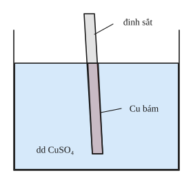
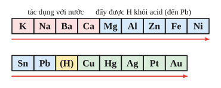

# Chủ đề 4. Kim loại và dãy hoạt động hóa học

> **Level Cơ bản** (mục I, các bài gắn nhãn *Cơ bản*) bám sát SGK KHTN 9. **Level Nâng cao** (mục II, các bài gắn nhãn *Nâng cao*) dành cho ôn thi học sinh giỏi và thi vào lớp 10 chuyên Hóa.
>
> Thể tích mol khí ở đkc: 24,79 L/mol. Nguyên tử khối: H = 1, O = 16, Na = 23, Mg = 24, Al = 27, S = 32, Cl = 35,5, Fe = 56, Cu = 64, Zn = 65, Ag = 108.

## I. Kiến thức cơ bản

### 1. Tính chất vật lí của kim loại
- Có **ánh kim**, **dẫn điện**, **dẫn nhiệt** tốt (bạc, đồng, nhôm dẫn điện tốt nhất), có **tính dẻo** (dát mỏng, kéo sợi được).
- Khối lượng riêng, nhiệt độ nóng chảy khác nhau nhiều: thủy ngân lỏng ở nhiệt độ thường; tungsten (W) nóng chảy ở 3410 °C nên dùng làm dây tóc bóng đèn.
- **Vì sao kim loại dẫn điện tốt?** Trong kim loại có nhiều electron tự do chuyển động được giữa các ion dương.

### 2. Tính chất hóa học chung
1. **Tác dụng với phi kim:** với oxygen tạo oxide ($\ce{3Fe + 2O2 ->[t^\circ] Fe3O4}$), với chlorine tạo muối chloride ($\ce{2Fe + 3Cl2 ->[t^\circ] 2FeCl3}$), với sulfur tạo muối sulfide.
2. **Tác dụng với dung dịch acid** (HCl, $\ce{H2SO4}$ loãng): kim loại đứng trước H trong dãy hoạt động giải phóng khí $\ce{H2}$:
$$\ce{Zn + 2HCl -> ZnCl2 + H2 ^}.$$
3. **Tác dụng với dung dịch muối:** kim loại mạnh hơn (trừ Na, K, Ca, Ba) đẩy kim loại yếu hơn ra khỏi dung dịch muối:
$$\ce{Fe + CuSO4 -> FeSO4 + Cu}.$$
   Hiện tượng: đinh sắt có lớp đồng màu đỏ bám vào, màu xanh của dung dịch nhạt dần.
4. Một số kim loại mạnh (Na, K, Ca, Ba) **tác dụng với nước** ở nhiệt độ thường: $\ce{2Na + 2H2O -> 2NaOH + H2 ^}$.

### 3. Dãy hoạt động hóa học của kim loại
$$\text{K, Na, Ba, Ca, Mg, Al, Zn, Fe, Ni, Sn, Pb, (H), Cu, Hg, Ag, Pt, Au}$$
**Ý nghĩa:**
- Mức độ hoạt động giảm dần từ trái sang phải.
- Kim loại **đứng trước Mg** (K, Na, Ba, Ca) phản ứng mạnh với nước ở nhiệt độ thường.
- Kim loại **đứng trước H** phản ứng với HCl, $\ce{H2SO4}$ loãng giải phóng $\ce{H2}$.
- Kim loại **đứng trước** (từ Mg trở đi) đẩy kim loại **đứng sau** ra khỏi dung dịch muối.

### 4. Nhôm và sắt
- **Nhôm** (Al, hóa trị III): nhẹ, dẫn điện tốt, bền trong không khí nhờ lớp oxide $\ce{Al2O3}$ mỏng bảo vệ. Tác dụng với acid, với muối, và **tác dụng với dung dịch kiềm** (tính chất riêng):
$$\ce{2Al + 2NaOH + 2H2O -> 2NaAlO2 + 3H2 ^}.$$
- **Sắt** (Fe, hóa trị II và III): tác dụng với HCl, $\ce{H2SO4}$ loãng tạo muối iron(II); với $\ce{Cl2}$ tạo muối iron(III). Sắt bị thụ động hóa (không phản ứng) trong $\ce{H2SO4}$ đặc nguội và $\ce{HNO3}$ đặc nguội.
- **Gang và thép:** hợp kim của sắt với carbon (gang 2–5% C, cứng giòn; thép dưới 2% C, dẻo, bền). Luyện gang trong lò cao bằng cách dùng CO khử oxide sắt: $\ce{Fe2O3 + 3CO ->[t^\circ] 2Fe + 3CO2}$.

### 5. Sự ăn mòn kim loại và cách bảo vệ
- **Ăn mòn kim loại** là sự phá hủy kim loại do tác dụng hóa học của môi trường (không khí ẩm, nước, acid). Sắt gỉ tạo lớp gỉ xốp, không bảo vệ được lớp bên trong.
- **Các yếu tố thúc đẩy:** độ ẩm, nhiệt độ cao, môi trường acid hoặc muối (gần biển).
- **Cách bảo vệ:** sơn, mạ (kẽm, thiếc, crom), bôi dầu mỡ; dùng hợp kim không gỉ (thép inox); gắn kim loại hoạt động hơn (kẽm) vào vỏ tàu biển.

---

## II. Kiến thức nâng cao

### 1. Kim loại tác dụng với dung dịch muối: tăng giảm khối lượng
Thanh kim loại A nhúng vào dung dịch muối của kim loại B (A mạnh hơn B): A tan ra, B bám vào. Khối lượng thanh thay đổi:
$$\Delta m = m_{B\text{ bám}} - m_{A\text{ tan}}.$$
Ví dụ $\ce{Fe + CuSO4 -> FeSO4 + Cu}$: cứ 1 mol Fe tan (56 g) thì 1 mol Cu bám (64 g), thanh tăng 8 g. Từ $\Delta m$ suy ra số mol phản ứng.

### 2. Kim loại kiềm, kiềm thổ cho vào dung dịch muối
Na, K, Ca, Ba **tác dụng với nước trước**, tạo kiềm và $\ce{H2}$; sau đó kiềm mới tác dụng với muối (nếu tạo kết tủa). Ví dụ Na vào dung dịch $\ce{CuSO4}$ thu được khí và kết tủa xanh $\ce{Cu(OH)2}$, **không** thu được Cu.

### 3. Thứ tự phản ứng
- Một kim loại cho vào dung dịch chứa nhiều muối: kim loại phản ứng với muối của kim loại **yếu nhất trước** (ion có tính oxi hóa mạnh nhất trước). Ví dụ Fe vào dung dịch chứa $\ce{AgNO3}$ và $\ce{Cu(NO3)2}$: Fe phản ứng với $\ce{AgNO3}$ trước, hết $\ce{Ag+}$ mới đến $\ce{Cu^2+}$.
- Hỗn hợp kim loại cho vào một dung dịch muối: kim loại **mạnh nhất phản ứng trước**.

### 4. Tính chất lưỡng tính của hợp chất nhôm
$\ce{Al2O3}$ và $\ce{Al(OH)3}$ tác dụng được với cả acid và dung dịch kiềm:
$$\ce{Al(OH)3 + NaOH -> NaAlO2 + 2H2O}, \qquad \ce{Al(OH)3 + 3HCl -> AlCl3 + 3H2O}.$$
Vì vậy nhỏ từ từ NaOH vào dung dịch $\ce{AlCl3}$: kết tủa keo trắng xuất hiện, tăng dần rồi tan khi NaOH dư.

### 5. Xác định kim loại
Lập biểu thức $M = k\cdot n$ ($n$ là hóa trị) từ dữ kiện, thử $n = 1, 2, 3$ để tìm kim loại phù hợp.

### 6. Hỗn hợp có Al tác dụng với kiềm và acid
Al tác dụng với cả kiềm và acid, còn Fe (hoặc Mg, Zn) chỉ tác dụng với acid. Hai thí nghiệm cho hai phương trình để tìm số mol mỗi kim loại.

---

## III. Bài tập

**Bài 1 (Cơ bản).** Viết phương trình hóa học (nếu có) khi cho: a) Fe vào dung dịch $\ce{CuSO4}$; b) Cu vào dung dịch $\ce{AgNO3}$; c) Zn vào dung dịch HCl; d) Cu vào dung dịch HCl.

**Bài 2 (Cơ bản).** Cho 5,4 g Al tác dụng hết với dung dịch HCl. Tính thể tích khí $\ce{H2}$ thu được (đkc) và khối lượng muối tạo thành.

**Bài 3 (Cơ bản).** Có ba lọ đựng ba kim loại dạng bột: Al, Fe, Cu. Trình bày cách nhận biết mỗi kim loại.

**Bài 4 (Cơ bản).** Có các kim loại X, Y, Z thỏa mãn: X tác dụng với HCl giải phóng $\ce{H2}$; Y không tác dụng với HCl nhưng đẩy được Z ra khỏi dung dịch muối của Z; Z không tác dụng với HCl. Sắp xếp X, Y, Z theo thứ tự hoạt động hóa học giảm dần.

**Bài 5 (Cơ bản).** Cho 10 g hỗn hợp Zn và Cu tác dụng với dung dịch HCl dư, thu được 2,479 L khí (đkc). Tính phần trăm khối lượng mỗi kim loại.

**Bài 6 (Cơ bản).** a) Vì sao tôn (sắt tráng kẽm) và sắt tây (sắt tráng thiếc) bền trong không khí? b) Nêu ba biện pháp chống ăn mòn kim loại trong đời sống.

**Bài 7 (Nâng cao, tăng giảm khối lượng).** Nhúng một thanh sắt nặng 50 g vào dung dịch $\ce{CuSO4}$. Sau một thời gian lấy thanh sắt ra, rửa nhẹ, làm khô, cân được 51 g. Tính khối lượng Cu bám vào thanh sắt và khối lượng sắt đã tan.

**Bài 8 (Nâng cao, Na vào dung dịch muối).** Cho 4,6 g Na vào 200 g dung dịch $\ce{CuSO4}$ 8%. Tính khối lượng kết tủa và nồng độ phần trăm của chất tan trong dung dịch thu được.

**Bài 9 (Nâng cao, xác định kim loại).** Cho 7,2 g một kim loại M (hóa trị II) tác dụng hết với dung dịch HCl, thu được 7,437 L khí $\ce{H2}$ (đkc). Xác định M.

**Bài 10 (Nâng cao, thứ tự phản ứng).** Cho 0,15 mol Fe vào dung dịch chứa 0,1 mol $\ce{AgNO3}$ và 0,1 mol $\ce{Cu(NO3)2}$. Sau khi phản ứng xảy ra hoàn toàn, tính khối lượng chất rắn thu được và cho biết dung dịch sau phản ứng chứa những chất nào.

**Bài 11 (Nâng cao, nhôm và kiềm).** a) Viết phương trình hóa học khi cho Al, $\ce{Al2O3}$ lần lượt vào dung dịch NaOH dư. b) Nhỏ từ từ đến dư dung dịch NaOH vào dung dịch $\ce{AlCl3}$; nêu hiện tượng và viết phương trình.

**Bài 12 (Nâng cao, hỗn hợp Al – Fe).** Chia $m$ gam hỗn hợp Al và Fe thành hai phần bằng nhau. Phần 1 tác dụng với dung dịch NaOH dư thu được 0,15 mol $\ce{H2}$. Phần 2 tác dụng với dung dịch HCl dư thu được 0,25 mol $\ce{H2}$. Tính $m$.

---

## IV. Lời giải chi tiết

### Bài 1
- a) $\ce{Fe + CuSO4 -> FeSO4 + Cu}$.
- b) $\ce{Cu + 2AgNO3 -> Cu(NO3)2 + 2Ag}$.
- c) $\ce{Zn + 2HCl -> ZnCl2 + H2 ^}$.
- d) Không phản ứng (Cu đứng sau H).

### Bài 2
$n_{\ce{Al}} = 0{,}2$ mol. $\ce{2Al + 6HCl -> 2AlCl3 + 3H2 ^}$.
$n_{\ce{H2}} = 0{,}3$ mol, $V = 0{,}3\cdot24{,}79 \approx 7{,}44$ L. $\ n_{\ce{AlCl3}} = 0{,}2$ mol, $m = 0{,}2\cdot133{,}5 = 26{,}7$ g.

### Bài 3
- Cho dung dịch NaOH vào ba mẫu: mẫu tan, có khí thoát ra là **Al**.
- Cho dung dịch HCl vào hai mẫu còn lại: mẫu tan, có khí là **Fe**; mẫu không tan là **Cu**.

$\ce{2Al + 2NaOH + 2H2O -> 2NaAlO2 + 3H2 ^}$; $\ \ce{Fe + 2HCl -> FeCl2 + H2 ^}$.

### Bài 4
X đứng trước H; Y, Z đứng sau H; Y đẩy được Z nên Y đứng trước Z. Thứ tự: **X > Y > Z**.

### Bài 5
Chỉ Zn phản ứng: $\ce{Zn + 2HCl -> ZnCl2 + H2 ^}$. $n_{\ce{Zn}} = n_{\ce{H2}} = 0{,}1$ mol, $m_{\ce{Zn}} = 6{,}5$ g (65%), $m_{\ce{Cu}} = 3{,}5$ g (35%).

### Bài 6
**a)** Lớp kẽm, thiếc phủ ngoài ngăn sắt tiếp xúc với không khí ẩm. Kẽm còn hoạt động mạnh hơn sắt, nếu lớp mạ bị trầy thì kẽm bị ăn mòn trước, bảo vệ sắt.
**b)** Sơn phủ bề mặt; bôi dầu mỡ cho dụng cụ; để đồ vật nơi khô ráo; dùng hợp kim không gỉ.

### Bài 7
$\ce{Fe + CuSO4 -> FeSO4 + Cu}$: mỗi mol phản ứng làm thanh tăng $64 - 56 = 8$ g. Thanh tăng $51 - 50 = 1$ g, nên số mol phản ứng là $\frac18 = 0{,}125$ mol.
$m_{\ce{Cu}\text{ bám}} = 0{,}125\cdot64 = 8$ g; $m_{\ce{Fe}\text{ tan}} = 0{,}125\cdot56 = 7$ g.

### Bài 8
$n_{\ce{Na}} = 0{,}2$ mol; $n_{\ce{CuSO4}} = \frac{200\cdot8\%}{160} = 0{,}1$ mol.
$$\ce{2Na + 2H2O -> 2NaOH + H2 ^}, \qquad \ce{2NaOH + CuSO4 -> Cu(OH)2 v + Na2SO4}.$$
$n_{\ce{NaOH}} = 0{,}2$ mol, $n_{\ce{H2}} = 0{,}1$ mol; phản ứng thứ hai vừa đủ: $\ce{Cu(OH)2}$ 0,1 mol (9,8 g), $\ce{Na2SO4}$ 0,1 mol (14,2 g).
$m_{dd} = 4{,}6 + 200 - 0{,}2 - 9{,}8 = 194{,}6$ g, nên $C\%_{\ce{Na2SO4}} = \frac{14{,}2}{194{,}6} \approx 7{,}30\%$.

### Bài 9
$n_{\ce{H2}} = \frac{7{,}437}{24{,}79} = 0{,}3$ mol. $\ce{M + 2HCl -> MCl2 + H2}$, nên $n_M = 0{,}3$, $M = \frac{7{,}2}{0{,}3} = 24$: **Mg**.

### Bài 10
Fe phản ứng với $\ce{AgNO3}$ trước:
$\ce{Fe + 2AgNO3 -> Fe(NO3)2 + 2Ag}$: dùng 0,05 mol Fe, tạo 0,1 mol Ag. Còn 0,1 mol Fe.
Sau đó $\ce{Fe + Cu(NO3)2 -> Fe(NO3)2 + Cu}$: 0,1 mol Fe vừa đủ với 0,1 mol $\ce{Cu(NO3)2}$, tạo 0,1 mol Cu.
Chất rắn: $0{,}1\cdot108 + 0{,}1\cdot64 = 17{,}2$ g (Ag và Cu). Dung dịch chỉ chứa $\ce{Fe(NO3)2}$ 0,15 mol.

### Bài 11
**a)** $\ce{2Al + 2NaOH + 2H2O -> 2NaAlO2 + 3H2 ^}$; $\ \ce{Al2O3 + 2NaOH -> 2NaAlO2 + H2O}$.
(Theo cách viết mới, sản phẩm có thể ghi là $\ce{Na[Al(OH)4]}$.)

**b)** Ban đầu xuất hiện **kết tủa keo trắng**, tăng dần: $\ce{AlCl3 + 3NaOH -> Al(OH)3 v + 3NaCl}$. Khi NaOH dư, kết tủa **tan dần** đến hết: $\ce{Al(OH)3 + NaOH -> NaAlO2 + 2H2O}$.

### Bài 12
Gọi $a$, $b$ là số mol Al, Fe trong **mỗi phần**.
- Phần 1 (NaOH, chỉ Al phản ứng): $1{,}5a = 0{,}15$, nên $a = 0{,}1$.
- Phần 2 (HCl, cả hai phản ứng): $1{,}5a + b = 0{,}25$, nên $b = 0{,}1$.

Mỗi phần nặng $2{,}7 + 5{,}6 = 8{,}3$ g, nên $m = 16{,}6$ g.
