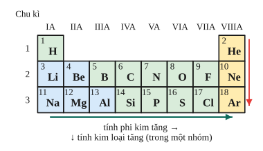

# Chủ đề 5. Phi kim và bảng tuần hoàn các nguyên tố hóa học

> **Level Cơ bản** (mục I, các bài gắn nhãn *Cơ bản*) bám sát SGK KHTN 7 – 9. **Level Nâng cao** (mục II, các bài gắn nhãn *Nâng cao*) dành cho ôn thi học sinh giỏi và thi vào lớp 10 chuyên Hóa.
>
> Thể tích mol khí ở đkc: 24,79 L/mol. Nguyên tử khối: H = 1, C = 12, O = 16, Na = 23, Mg = 24, S = 32, Cl = 35,5, Ca = 40, Mn = 55, Fe = 56, Cu = 64.

## I. Kiến thức cơ bản

### 1. Bảng tuần hoàn các nguyên tố hóa học
- Các nguyên tố được sắp xếp theo chiều **tăng dần điện tích hạt nhân** $Z$.
- **Ô nguyên tố:** cho biết số hiệu nguyên tử (= số proton = số electron), kí hiệu, tên, khối lượng nguyên tử.
- **Chu kì** (hàng ngang): các nguyên tố có **cùng số lớp electron**; số thứ tự chu kì = số lớp electron.
- **Nhóm** (cột dọc): các nguyên tố có tính chất tương tự nhau; với nhóm A, số thứ tự nhóm = **số electron lớp ngoài cùng**.
- **Vì sao tính chất tuần hoàn?** Tính chất hóa học phụ thuộc chủ yếu vào số electron lớp ngoài cùng, mà số này lặp lại theo chu kì.

### 2. Quy luật biến đổi trong bảng tuần hoàn
- **Trong một chu kì** (trái sang phải): tính kim loại giảm, tính phi kim tăng. Mỗi chu kì (trừ chu kì 1) bắt đầu bằng một kim loại kiềm mạnh và kết thúc bằng khí hiếm.
- **Trong một nhóm A** (trên xuống dưới): tính kim loại tăng, tính phi kim giảm (vì số lớp electron tăng, electron ngoài cùng ở xa hạt nhân hơn).
- Biết vị trí thì suy ra được cấu tạo nguyên tử và tính chất, và ngược lại.

### 3. Tính chất chung của phi kim
- Tính chất vật lí: tồn tại ở cả ba trạng thái (khí: $\ce{O2}$, $\ce{Cl2}$; lỏng: $\ce{Br2}$; rắn: C, S, P), thường dẫn điện, dẫn nhiệt kém.
- Tính chất hóa học:
  1. Tác dụng với kim loại tạo muối hoặc oxide: $\ce{2Na + Cl2 -> 2NaCl}$.
  2. Tác dụng với hydrogen tạo hợp chất khí: $\ce{H2 + Cl2 ->[as] 2HCl}$.
  3. Tác dụng với oxygen tạo oxide acid: $\ce{S + O2 ->[t^\circ] SO2}$.
- **Mức độ hoạt động:** fluorine, oxygen, chlorine là các phi kim mạnh; sulfur, phosphorus, carbon, silicon hoạt động yếu hơn.

### 4. Chlorine
- Khí màu vàng lục, mùi hắc, **rất độc**, nặng hơn không khí.
- Tác dụng với kim loại (Fe cháy trong $\ce{Cl2}$ tạo $\ce{FeCl3}$), với hydrogen, với nước (tạo nước chlorine có tính tẩy màu), với dung dịch NaOH (tạo nước Javel):
$$\ce{Cl2 + H2O <=> HCl + HClO}, \qquad \ce{Cl2 + 2NaOH -> NaCl + NaClO + H2O}.$$
- **Điều chế trong phòng thí nghiệm:** $\ce{MnO2 + 4HCl_{(đặc)} ->[t^\circ] MnCl2 + Cl2 ^ + 2H2O}$. Trong công nghiệp: điện phân dung dịch NaCl có màng ngăn.
- Ứng dụng: khử trùng nước sinh hoạt, sản xuất nước Javel, chất tẩy trắng, nhựa PVC.

### 5. Carbon và các oxide của carbon
- Carbon có các dạng thù hình: kim cương (rất cứng), than chì (mềm, dẫn điện), carbon vô định hình (than gỗ, có tính hấp phụ).
- Carbon có **tính khử**: $\ce{C + 2CuO ->[t^\circ] 2Cu + CO2}$.
- **Carbon monoxide (CO):** khí rất độc (kết hợp với hemoglobin trong máu), là chất khử mạnh ở nhiệt độ cao: $\ce{Fe2O3 + 3CO ->[t^\circ] 2Fe + 3CO2}$.
- **Carbon dioxide ($\ce{CO2}$):** oxide acid, làm đục nước vôi trong; không duy trì sự cháy, dùng chữa cháy; gây hiệu ứng nhà kính.

### 6. Muối carbonate và silicon
- Muối carbonate tác dụng với acid giải phóng $\ce{CO2}$; muối carbonate không tan và muối hydrogencarbonate bị nhiệt phân:
$$\ce{CaCO3 ->[t^\circ] CaO + CO2}, \qquad \ce{2NaHCO3 ->[t^\circ] Na2CO3 + CO2 + H2O}.$$
- Silicon và hợp chất là nguyên liệu của công nghiệp silicate: sản xuất đồ gốm, xi măng, thủy tinh.

---

## II. Kiến thức nâng cao

### 1. Xác định vị trí nguyên tố
Từ số hiệu $Z$, viết sự phân bố electron theo lớp: số lớp là số thứ tự chu kì, số electron lớp ngoài cùng là số thứ tự nhóm A. Ví dụ $Z = 17$: 2, 8, 7, nên Cl ở **chu kì 3, nhóm VIIA**.
- Hai nguyên tố **cùng nhóm A ở hai chu kì liên tiếp** (thuộc chu kì 2, 3 hoặc 3, 4 với nhóm IA, IIA) có $Z$ hơn kém nhau 8.
- Hai nguyên tố **kế tiếp nhau trong một chu kì** có $Z$ hơn kém nhau 1.

### 2. Hóa trị cao nhất với oxygen và hóa trị với hydrogen
Với phi kim nhóm A thứ $x$: hóa trị cao nhất với oxygen là $x$, hóa trị trong hợp chất khí với hydrogen là $8 - x$. Ví dụ S (nhóm VIA): oxide cao nhất $\ce{SO3}$, hợp chất với hydrogen $\ce{H2S}$.

### 3. Khử oxide kim loại bằng CO, H₂, C
$\ce{M_xO_y + yCO -> xM + yCO2}$: mỗi phân tử CO lấy đi một nguyên tử O, nên
$$n_{\ce{CO}} = n_{\ce{CO2}} = n_{\text{O trong oxide bị khử}}, \qquad m_{\text{kim loại}} = m_{\text{oxide}} - m_{\text{O}}.$$
CO, $\ce{H2}$ chỉ khử được oxide của kim loại **đứng sau Al** trong dãy hoạt động.

### 4. Chlorine tác dụng với kiềm
Ở nhiệt độ thường: $\ce{Cl2 + 2NaOH -> NaCl + NaClO + H2O}$. Khi đun nóng: $\ce{3Cl2 + 6KOH ->[t^\circ] 5KCl + KClO3 + 3H2O}$. Xác định chất dư để tìm thành phần dung dịch sau phản ứng.

### 5. Nhận biết các khí
- $\ce{CO2}$: làm đục nước vôi trong.
- $\ce{Cl2}$: màu vàng lục, làm mất màu quỳ tím ẩm (sau khi làm đỏ).
- $\ce{O2}$: làm tàn đóm đỏ bùng cháy.
- CO: khử CuO (đen) thành Cu (đỏ) khi đun nóng, khí sinh ra làm đục nước vôi trong.
- $\ce{H2}$: cháy với ngọn lửa xanh nhạt, tạo nước.

---

## III. Bài tập

**Bài 1 (Cơ bản).** Viết phương trình hóa học khi cho chlorine tác dụng với: a) sắt (đun nóng); b) nước; c) dung dịch NaOH ở nhiệt độ thường.

**Bài 2 (Cơ bản).** Viết phương trình hóa học: a) carbon khử copper(II) oxide; b) CO khử iron(III) oxide; c) $\ce{CO2}$ tác dụng với nước vôi trong.

**Bài 3 (Cơ bản).** Nguyên tố X có số hiệu nguyên tử 11, nguyên tố Y có số hiệu nguyên tử 17. Cho biết vị trí (chu kì, nhóm) của X, Y trong bảng tuần hoàn; chúng là kim loại hay phi kim? Viết công thức hợp chất tạo bởi X và Y.

**Bài 4 (Cơ bản).** Nhiệt phân hoàn toàn 16,8 g $\ce{NaHCO3}$. Tính khối lượng chất rắn còn lại và thể tích khí $\ce{CO2}$ (đkc).

**Bài 5 (Cơ bản).** Sắp xếp các nguyên tố sau theo chiều tính phi kim tăng dần, giải thích: a) P, S, Cl (cùng chu kì 3); b) I, Br, Cl, F (cùng nhóm VIIA).

**Bài 6 (Cơ bản).** Cho 8,7 g $\ce{MnO2}$ tác dụng với dung dịch HCl đặc, dư, đun nóng. Tính thể tích khí chlorine thu được (đkc).

**Bài 7 (Nâng cao, khử oxide).** Dẫn khí CO dư qua ống sứ đựng 16 g $\ce{Fe2O3}$ nung nóng đến phản ứng hoàn toàn. Dẫn toàn bộ khí sinh ra vào nước vôi trong dư. Tính khối lượng sắt thu được và khối lượng kết tủa.

**Bài 8 (Nâng cao, hỗn hợp oxide).** Khử hoàn toàn 24 g hỗn hợp CuO và $\ce{Fe2O3}$ bằng CO dư, thu được 17,6 g hỗn hợp kim loại. Tính khối lượng mỗi oxide trong hỗn hợp ban đầu.

**Bài 9 (Nâng cao, vị trí và công thức).** Nguyên tố R thuộc nhóm VIA. Trong oxide cao nhất của R, oxygen chiếm 60% về khối lượng. Xác định R và viết công thức hợp chất khí của R với hydrogen.

**Bài 10 (Nâng cao, Cl₂ + NaOH).** Dẫn 2,479 L khí $\ce{Cl2}$ (đkc) vào 300 mL dung dịch NaOH 1 M ở nhiệt độ thường. Tính nồng độ mol các chất trong dung dịch sau phản ứng (coi thể tích dung dịch không đổi).

**Bài 11 (Nâng cao, nhận biết khí).** Có bốn bình khí riêng biệt: $\ce{CO2}$, CO, $\ce{Cl2}$, $\ce{O2}$. Trình bày cách nhận biết mỗi khí.

**Bài 12 (Nâng cao, hai nguyên tố cùng nhóm).** Hai nguyên tố A, B thuộc cùng một nhóm A, ở hai chu kì liên tiếp, có tổng số proton là 32. Xác định A, B.

---

## IV. Lời giải chi tiết

### Bài 1
a) $\ce{2Fe + 3Cl2 ->[t^\circ] 2FeCl3}$. b) $\ce{Cl2 + H2O <=> HCl + HClO}$. c) $\ce{Cl2 + 2NaOH -> NaCl + NaClO + H2O}$.

### Bài 2
a) $\ce{C + 2CuO ->[t^\circ] 2Cu + CO2}$. b) $\ce{Fe2O3 + 3CO ->[t^\circ] 2Fe + 3CO2}$. c) $\ce{CO2 + Ca(OH)2 -> CaCO3 v + H2O}$.

### Bài 3
- X ($Z = 11$): 2, 8, 1, nên ở chu kì 3, nhóm IA: kim loại (sodium, Na).
- Y ($Z = 17$): 2, 8, 7, nên ở chu kì 3, nhóm VIIA: phi kim (chlorine, Cl).
- Hợp chất: NaCl.

### Bài 4
$n_{\ce{NaHCO3}} = \frac{16{,}8}{84} = 0{,}2$ mol. $\ce{2NaHCO3 ->[t^\circ] Na2CO3 + CO2 + H2O}$.
Chất rắn $\ce{Na2CO3}$ 0,1 mol, $m = 10{,}6$ g; $\ce{CO2}$ 0,1 mol, $V \approx 2{,}48$ L.

### Bài 5
a) P < S < Cl: trong một chu kì, từ trái sang phải tính phi kim tăng.
b) I < Br < Cl < F: trong một nhóm, từ dưới lên trên tính phi kim tăng (số lớp electron giảm).

### Bài 6
$n_{\ce{MnO2}} = \frac{8{,}7}{87} = 0{,}1$ mol; theo phương trình $n_{\ce{Cl2}} = 0{,}1$ mol, $V \approx 2{,}48$ L.

### Bài 7
$n_{\ce{Fe2O3}} = 0{,}1$ mol. $\ce{Fe2O3 + 3CO -> 2Fe + 3CO2}$: Fe 0,2 mol (11,2 g), $\ce{CO2}$ 0,3 mol.
$\ce{CO2 + Ca(OH)2 -> CaCO3 v + H2O}$: $\ce{CaCO3}$ 0,3 mol, $m = 30$ g.

### Bài 8
Khối lượng oxygen bị lấy đi: $24 - 17{,}6 = 6{,}4$ g, tức là 0,4 mol O. Gọi $a$, $b$ là số mol CuO, $\ce{Fe2O3}$:
$80a + 160b = 24$ và $a + 3b = 0{,}4$ (số mol O). Giải ra $a = 0{,}1$, $b = 0{,}1$.
$m_{\ce{CuO}} = 8$ g; $m_{\ce{Fe2O3}} = 16$ g.

### Bài 9
Nhóm VIA nên oxide cao nhất là $\ce{RO3}$: $\frac{48}{R + 48} = 0{,}6 \iff R = 32$: **sulfur (S)**. Hợp chất khí với hydrogen: $\ce{H2S}$.

### Bài 10
$n_{\ce{Cl2}} = 0{,}1$ mol; $n_{\ce{NaOH}} = 0{,}3$ mol. $\ce{Cl2 + 2NaOH -> NaCl + NaClO + H2O}$: $\ce{Cl2}$ hết, NaOH dư $0{,}1$ mol.
Dung dịch: NaCl 0,1 mol, NaClO 0,1 mol, NaOH 0,1 mol trong 0,3 L, mỗi chất có $C_M = \frac13 \approx 0{,}33$ M.

### Bài 11
- Quan sát màu: bình có màu vàng lục là $\ce{Cl2}$.
- Dẫn ba khí còn lại qua nước vôi trong: khí làm đục là $\ce{CO2}$.
- Đưa tàn đóm đỏ vào hai bình còn lại: tàn đóm bùng cháy là $\ce{O2}$; còn lại là CO (kiểm tra thêm: dẫn qua CuO nung nóng thấy chất rắn đen chuyển đỏ).

### Bài 12
Cùng nhóm, hai chu kì liên tiếp (với các chu kì nhỏ): $Z_B - Z_A = 8$. Kết hợp $Z_A + Z_B = 32$: $Z_A = 12$ (Mg), $Z_B = 20$ (Ca), cùng nhóm IIA. (Thử thêm trường hợp hiệu bằng 18 cho $Z_A = 7$, $Z_B = 25$: không cùng nhóm A, loại.)
