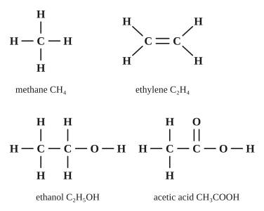

# Chủ đề 6. Hóa học hữu cơ: hydrocarbon, alcohol, acid hữu cơ, chất béo, carbohydrate, polymer

> **Level Cơ bản** (mục I, các bài gắn nhãn *Cơ bản*) bám sát SGK KHTN 9. **Level Nâng cao** (mục II, các bài gắn nhãn *Nâng cao*) dành cho ôn thi học sinh giỏi và thi vào lớp 10 chuyên Hóa.
>
> Thể tích mol khí ở đkc: 24,79 L/mol. Nguyên tử khối: H = 1, C = 12, O = 16, Na = 23, Ca = 40, Br = 80.

## I. Kiến thức cơ bản

### 1. Hợp chất hữu cơ và công thức cấu tạo
- **Hợp chất hữu cơ** là hợp chất của carbon (trừ CO, $\ce{CO2}$, muối carbonate, ...). Thường kém bền với nhiệt, dễ cháy, phản ứng chậm.
- Trong hợp chất hữu cơ, **C luôn có hóa trị IV**, H hóa trị I, O hóa trị II. Các nguyên tử C liên kết được với nhau tạo thành **mạch carbon** (thẳng, nhánh, vòng).
- **Công thức cấu tạo** cho biết thứ tự liên kết giữa các nguyên tử. Cùng một công thức phân tử có thể có nhiều chất (đồng phân), ví dụ $\ce{C2H6O}$: ethanol $\ce{CH3-CH2-OH}$ và dimethyl ether $\ce{CH3-O-CH3}$.

### 2. Hydrocarbon: alkane và alkene
- **Alkane** (chỉ có liên kết đơn), tiêu biểu là **methane** $\ce{CH4}$ (thành phần chính của khí thiên nhiên, khí biogas):
  - phản ứng cháy: $\ce{CH4 + 2O2 ->[t^\circ] CO2 + 2H2O}$ (tỏa nhiều nhiệt);
  - phản ứng thế với chlorine khi có ánh sáng: $\ce{CH4 + Cl2 ->[as] CH3Cl + HCl}$.
- **Alkene** (có một liên kết đôi C=C), tiêu biểu là **ethylene** $\ce{C2H4}$:
  - phản ứng cộng: làm **mất màu dung dịch bromine** (dùng để nhận biết): $\ce{CH2=CH2 + Br2 -> CH2Br-CH2Br}$;
  - phản ứng trùng hợp tạo polyethylene (PE): $n\ce{CH2=CH2} \to (\ce{-CH2-CH2-})_n$;
  - là hormone kích thích quả mau chín.
- **Nhiên liệu:** dầu mỏ (chưng cất phân đoạn cho xăng, dầu hỏa, diesel), khí thiên nhiên, than. Đốt nhiên liệu cần đủ oxygen để tránh tạo khí CO độc.

### 3. Ethanol (alcohol ethylic)
- Công thức $\ce{C2H5OH}$ ($\ce{CH3-CH2-OH}$); chất lỏng, tan vô hạn trong nước. **Nhóm $\ce{-OH}$** quyết định tính chất đặc trưng.
- **Độ rượu** là số mL ethanol nguyên chất có trong 100 mL hỗn hợp rượu với nước: rượu 40° có 40 mL ethanol trong 100 mL.
- Tính chất: cháy với ngọn lửa xanh ($\ce{C2H5OH + 3O2 ->[t^\circ] 2CO2 + 3H2O}$); tác dụng với Na giải phóng $\ce{H2}$: $\ce{2C2H5OH + 2Na -> 2C2H5ONa + H2 ^}$.
- Điều chế: lên men tinh bột, đường; hoặc cộng nước vào ethylene.

### 4. Acetic acid
- Công thức $\ce{CH3COOH}$; giấm ăn là dung dịch acetic acid 2–5%. **Nhóm $\ce{-COOH}$** gây tính acid.
- Có tính chất của acid (yếu): làm quỳ tím hóa đỏ, tác dụng với kim loại trước H, base, oxide base, muối carbonate:
$$\ce{2CH3COOH + Na2CO3 -> 2CH3COONa + CO2 ^ + H2O}.$$
- **Phản ứng ester hóa** (thuận nghịch, xúc tác $\ce{H2SO4}$ đặc, đun nóng):
$$\ce{CH3COOH + C2H5OH <=>[H2SO4, t^\circ] CH3COOC2H5 + H2O}.$$
  Sản phẩm ethyl acetate có mùi thơm.

### 5. Chất béo
- Chất béo là **ester của glycerol với các acid béo**, ví dụ tristearin $\ce{(C17H35COO)3C3H5}$. Không tan trong nước, nhẹ hơn nước.
- **Phản ứng thủy phân trong môi trường kiềm (xà phòng hóa)** tạo glycerol và muối của acid béo (thành phần chính của xà phòng):
$$\ce{(RCOO)3C3H5 + 3NaOH -> C3H5(OH)3 + 3RCOONa}.$$

### 6. Carbohydrate
- **Glucose** $\ce{C6H12O6}$: có trong quả chín; tham gia **phản ứng tráng bạc** (nhận biết); lên men tạo ethanol: $\ce{C6H12O6 ->[men] 2C2H5OH + 2CO2}$.
- **Saccharose** $\ce{C12H22O11}$ (đường mía): thủy phân (xúc tác acid) tạo glucose và fructose.
- **Tinh bột và cellulose** $\ce{(C6H10O5)_n}$: thủy phân hoàn toàn tạo glucose; tinh bột tạo màu **xanh tím với iodine**. Cây xanh tạo tinh bột nhờ quang hợp.

### 7. Protein và polymer
- **Protein** là chất có phân tử khối rất lớn, cấu tạo từ các amino acid. Bị **đông tụ** khi đun nóng (luộc trứng), bị thủy phân tạo amino acid; cháy có mùi khét.
- **Polymer** là chất có phân tử khối rất lớn do nhiều mắt xích liên kết với nhau: PE, PVC (nhựa), cao su, tơ nylon, tinh bột, protein. Hệ số trùng hợp $n = \frac{M_{\text{polymer}}}{M_{\text{mắt xích}}}$.
- Rác thải nhựa khó phân hủy; cần giảm dùng, tái chế, phân loại rác.

---

## II. Kiến thức nâng cao

### 1. Lập công thức phân tử từ phản ứng cháy
Đốt hợp chất hữu cơ X (C, H, có thể có O) thu được $\ce{CO2}$ và $\ce{H2O}$:
$$n_C = n_{\ce{CO2}}, \qquad n_H = 2n_{\ce{H2O}}, \qquad m_O = m_X - m_C - m_H.$$
Tỉ lệ $n_C : n_H : n_O$ cho công thức đơn giản nhất; kết hợp khối lượng mol (từ tỉ khối) để có công thức phân tử.
- Nhận xét nhanh: alkane cháy cho $n_{\ce{H2O}} > n_{\ce{CO2}}$; alkene cho $n_{\ce{H2O}} = n_{\ce{CO2}}$.

### 2. Viết đồng phân cấu tạo
Viết mạch carbon dài nhất rồi rút ngắn dần (thêm nhánh); với hợp chất có O, thay đổi vị trí và kiểu nhóm chức. Ví dụ $\ce{C4H10}$ có 2 đồng phân: butane (mạch thẳng) và isobutane (mạch nhánh).

### 3. Hỗn hợp hydrocarbon với dung dịch bromine
Alkane không phản ứng, alkene phản ứng: **khối lượng bình bromine tăng bằng khối lượng alkene bị hấp thụ**; số mol $\ce{Br2}$ phản ứng bằng số mol alkene (một liên kết đôi).

### 4. Hiệu suất lên men và ester hóa
- Lên men: $n_{\ce{C2H5OH}} = 2n_{\text{glucose}}\cdot H$; tinh bột $\to$ glucose $\to$ ethanol thì nhân các hiệu suất.
- Ester hóa thuận nghịch: hiệu suất tính theo chất **thiếu** (theo tỉ lệ 1 : 1).

### 5. Bài toán độ rượu
$V_{\text{ethanol}} = V_{\text{rượu}}\cdot\frac{\text{độ}}{100}$; $m = D\cdot V$ với $D_{\text{ethanol}} = 0{,}8$ g/mL. Pha loãng rượu: thể tích ethanol không đổi.

### 6. Chuỗi phản ứng hữu cơ
Ghi nhớ mối liên hệ: tinh bột → glucose → ethanol → acetic acid → ethyl acetate; ethylene ↔ ethanol; ethylene → PE.

---

## III. Bài tập

**Bài 1 (Cơ bản).** Viết công thức cấu tạo các đồng phân có công thức phân tử $\ce{C2H6O}$ và $\ce{C4H10}$.

**Bài 2 (Cơ bản).** Viết phương trình hóa học: a) methane tác dụng với chlorine (ánh sáng); b) ethylene tác dụng với dung dịch bromine; c) trùng hợp ethylene; d) đốt cháy ethanol.

**Bài 3 (Cơ bản).** Đốt cháy hoàn toàn 2,479 L khí methane (đkc). Tính thể tích oxygen cần dùng (đkc) và khối lượng nước tạo thành.

**Bài 4 (Cơ bản).** Trong 500 mL rượu 40° có bao nhiêu mL và bao nhiêu gam ethanol? (Khối lượng riêng của ethanol là 0,8 g/mL.)

**Bài 5 (Cơ bản).** Cho 12 g acetic acid tác dụng hết với dung dịch $\ce{Na2CO3}$. Tính thể tích khí $\ce{CO2}$ thu được (đkc).

**Bài 6 (Cơ bản).** Nhận biết ba dung dịch không màu: ethanol, acetic acid, glucose.

**Bài 7 (Nâng cao, lập công thức).** Đốt cháy hoàn toàn 4,6 g hợp chất hữu cơ X thu được 8,8 g $\ce{CO2}$ và 5,4 g $\ce{H2O}$. Tỉ khối hơi của X so với hydrogen là 23. Xác định công thức phân tử và viết các công thức cấu tạo có thể có của X.

**Bài 8 (Nâng cao, hỗn hợp với bromine).** Dẫn 3,7185 L hỗn hợp khí methane và ethylene (đkc) qua bình đựng dung dịch bromine dư, thấy khối lượng bình tăng 2,8 g. Tính phần trăm thể tích mỗi khí.

**Bài 9 (Nâng cao, lên men).** Lên men 360 g glucose với hiệu suất 80%. Tính khối lượng ethanol thu được. Dẫn toàn bộ khí $\ce{CO2}$ sinh ra vào nước vôi trong dư thì thu được bao nhiêu gam kết tủa?

**Bài 10 (Nâng cao, ester hóa).** Đun nóng 12 g acetic acid với 13,8 g ethanol (xúc tác $\ce{H2SO4}$ đặc). Hiệu suất phản ứng ester hóa là 60%. Tính khối lượng ethyl acetate thu được.

**Bài 11 (Nâng cao, xà phòng hóa).** Xà phòng hóa hoàn toàn 89 kg tristearin $\ce{(C17H35COO)3C3H5}$ bằng dung dịch NaOH. Tính khối lượng xà phòng (natri stearate $\ce{C17H35COONa}$) và glycerol thu được.

**Bài 12 (Nâng cao, polymer).** Một loại nhựa PVC (mắt xích $\ce{-CH2-CHCl-}$) có phân tử khối trung bình 62 500. Tính hệ số trùng hợp trung bình.

---

## IV. Lời giải chi tiết

### Bài 1
- $\ce{C2H6O}$: $\ce{CH3-CH2-OH}$ (ethanol) và $\ce{CH3-O-CH3}$ (dimethyl ether).
- $\ce{C4H10}$: $\ce{CH3-CH2-CH2-CH3}$ (butane) và $\ce{CH3-CH(CH3)-CH3}$ (isobutane).

### Bài 2
a) $\ce{CH4 + Cl2 ->[as] CH3Cl + HCl}$.
b) $\ce{CH2=CH2 + Br2 -> CH2Br-CH2Br}$.
c) $n\ce{CH2=CH2} \xrightarrow{t^\circ, p, xt} (\ce{-CH2-CH2-})_n$.
d) $\ce{C2H5OH + 3O2 ->[t^\circ] 2CO2 + 3H2O}$.

### Bài 3
$n_{\ce{CH4}} = 0{,}1$ mol. $\ce{CH4 + 2O2 -> CO2 + 2H2O}$: $n_{\ce{O2}} = 0{,}2$ mol, $V \approx 4{,}96$ L; $n_{\ce{H2O}} = 0{,}2$ mol, $m = 3{,}6$ g.

### Bài 4
$V_{\text{ethanol}} = 500\cdot\frac{40}{100} = 200$ mL; $m = 0{,}8\cdot200 = 160$ g.

### Bài 5
$n_{\ce{CH3COOH}} = 0{,}2$ mol. $\ce{2CH3COOH + Na2CO3 -> 2CH3COONa + CO2 + H2O}$: $n_{\ce{CO2}} = 0{,}1$ mol, $V \approx 2{,}48$ L.

### Bài 6
- Quỳ tím: hóa đỏ là **acetic acid**.
- Hai mẫu còn lại thực hiện phản ứng tráng bạc (dung dịch $\ce{AgNO3}$ trong $\ce{NH3}$, đun nhẹ): mẫu tạo lớp bạc sáng là **glucose**; còn lại là ethanol.

### Bài 7
- $n_C = n_{\ce{CO2}} = 0{,}2$ mol (2,4 g); $n_H = 2\cdot\frac{5{,}4}{18} = 0{,}6$ mol (0,6 g).
- $m_O = 4{,}6 - 2{,}4 - 0{,}6 = 1{,}6$ g, $n_O = 0{,}1$ mol.
- $C : H : O = 0{,}2 : 0{,}6 : 0{,}1 = 2 : 6 : 1$; công thức đơn giản nhất $\ce{C2H6O}$ ($M = 46$). $M_X = 23\cdot2 = 46$, nên công thức phân tử là **$\ce{C2H6O}$**.
- Công thức cấu tạo: $\ce{CH3-CH2-OH}$ hoặc $\ce{CH3-O-CH3}$.

### Bài 8
$n_{\text{hh}} = \frac{3{,}7185}{24{,}79} = 0{,}15$ mol. Khối lượng bình tăng là khối lượng ethylene: $n_{\ce{C2H4}} = \frac{2{,}8}{28} = 0{,}1$ mol; $n_{\ce{CH4}} = 0{,}05$ mol.
%V: ethylene $\approx 66{,}7\%$, methane $\approx 33{,}3\%$.

### Bài 9
$n_{\text{glucose}} = 2$ mol. $\ce{C6H12O6 ->[men] 2C2H5OH + 2CO2}$.
Với $H = 80\%$: $n_{\ce{C2H5OH}} = n_{\ce{CO2}} = 2\cdot2\cdot0{,}8 = 3{,}2$ mol.
$m_{\ce{C2H5OH}} = 3{,}2\cdot46 = 147{,}2$ g; kết tủa $\ce{CaCO3}$ 3,2 mol $= 320$ g.

### Bài 10
$n_{\text{acid}} = 0{,}2$ mol; $n_{\text{ethanol}} = 0{,}3$ mol. Tỉ lệ 1 : 1 nên acid là chất thiếu, tính theo acid.
$n_{\text{ester}} = 0{,}2\cdot60\% = 0{,}12$ mol; $m = 0{,}12\cdot88 = 10{,}56$ g.

### Bài 11
$M_{\text{tristearin}} = 890$, nên 89 kg ứng với 0,1 kmol.
$\ce{(C17H35COO)3C3H5 + 3NaOH -> C3H5(OH)3 + 3C17H35COONa}$.
Xà phòng: $0{,}3$ kmol $\cdot306 = 91{,}8$ kg; glycerol: $0{,}1$ kmol $\cdot92 = 9{,}2$ kg.

### Bài 12
Mắt xích $\ce{C2H3Cl}$ có $M = 62{,}5$. Hệ số trùng hợp $n = \frac{62\,500}{62{,}5} = 1000$.
