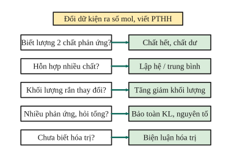

# Chủ đề 7. Phương pháp giải toán hóa học

> **Level Cơ bản** (mục I, các bài gắn nhãn *Cơ bản*) là các bước giải bài toán tính theo phương trình hóa học. **Level Nâng cao** (mục II, các bài gắn nhãn *Nâng cao*) là các phương pháp giải nhanh dùng trong đề thi học sinh giỏi và thi chuyên Hóa.
>
> Thể tích mol khí ở đkc: 24,79 L/mol. Nguyên tử khối: H = 1, C = 12, O = 16, Na = 23, Mg = 24, Al = 27, S = 32, Cl = 35,5, K = 39, Ca = 40, Fe = 56, Cu = 64, Zn = 65.

## I. Kiến thức cơ bản

### 1. Các bước giải một bài toán hóa học
1. **Tóm tắt** đề, đổi các dữ kiện ra **số mol**.
2. **Viết và cân bằng** các phương trình hóa học.
3. Xác định **chất hết, chất dư** (nếu biết lượng của hai chất phản ứng).
4. Đặt số mol theo phương trình, tính số mol chất cần tìm.
5. Đổi ra đại lượng đề hỏi (khối lượng, thể tích, nồng độ, phần trăm) và **kiểm tra lại**.

### 2. Bài toán lượng dư
Với phản ứng $a\text{A} + b\text{B} \to \dots$, so sánh $\frac{n_A}{a}$ và $\frac{n_B}{b}$: tỉ số nào nhỏ hơn thì chất đó **hết**; tính toán theo chất hết.

### 3. Bài toán hiệu suất
- Tính theo sản phẩm: $H = \frac{m_{\text{thực tế}}}{m_{\text{lí thuyết}}}\cdot100\%$.
- Tính theo chất phản ứng: lượng cần dùng thực tế $=$ lượng lí thuyết $: H$.

### 4. Bài toán hỗn hợp
Gọi số mol mỗi chất là ẩn ($x$, $y$, ...); mỗi dữ kiện độc lập cho một phương trình (tổng khối lượng, số mol khí, số mol acid phản ứng, ...); số phương trình bằng số ẩn thì giải được.

---

## II. Kiến thức nâng cao

### 1. Bảo toàn khối lượng
Tổng khối lượng các chất tham gia bằng tổng khối lượng các sản phẩm. Hay dùng:
- Kim loại tác dụng với HCl: $m_{\text{muối}} = m_{\text{kim loại}} + m_{\ce{Cl}} = m_{\text{KL}} + 35{,}5\cdot n_{\ce{HCl}}$, với $n_{\ce{HCl}} = 2n_{\ce{H2}}$.
- Kim loại tác dụng với $\ce{H2SO4}$ loãng: $m_{\text{muối}} = m_{\text{KL}} + 96\cdot n_{\ce{H2}}$.

### 2. Bảo toàn nguyên tố
Số mol mỗi nguyên tố không đổi qua các phản ứng. Ví dụ khử oxide bằng CO: $n_{\ce{CO2}} = n_{\text{O bị lấy}}$; đốt hợp chất hữu cơ: $n_C = n_{\ce{CO2}}$, $n_H = 2n_{\ce{H2O}}$.

### 3. Tăng giảm khối lượng
Khi 1 mol chất A chuyển thành chất B, khối lượng thay đổi một lượng xác định $\Delta M$. Biết độ thay đổi khối lượng thực tế $\Delta m$ thì $n = \frac{\Delta m}{\Delta M}$. Ví dụ:
- Muối carbonate chuyển thành muối chloride: $\ce{CO3}$ (60) được thay bằng $\ce{2Cl}$ (71), mỗi mol $\ce{CO2}$ thoát ra thì khối lượng muối **tăng 11 g**.
- Thanh kim loại trong dung dịch muối: xem Chủ đề 4.

### 4. Phương pháp trung bình
Hỗn hợp nhiều chất cùng loại có thể thay bằng một chất "trung bình" với $\bar M = \frac{m_{\text{hh}}}{n_{\text{hh}}}$. Luôn có $M_{\min} < \bar M < M_{\max}$. Dùng để xác định hai kim loại (hai chất) **kế tiếp nhau** trong một nhóm hoặc dãy đồng đẳng.

### 5. Biện luận
Khi số ẩn nhiều hơn số phương trình, lập biểu thức liên hệ (ví dụ $M = k\cdot n$ với hóa trị $n$) rồi xét các giá trị nguyên có thể ($n = 1, 2, 3$) để chọn nghiệm hợp lí.

### 6. Bảo toàn điện tích
Trong dung dịch, tổng điện tích dương bằng tổng điện tích âm:
$$\sum(\text{số mol cation}\times\text{điện tích}) = \sum(\text{số mol anion}\times|\text{điện tích}|).$$
Khối lượng muối trong dung dịch bằng tổng khối lượng các ion.

### 7. Phương pháp giới hạn (khoảng)
Khi không biết chính xác thành phần hỗn hợp, giả sử hỗn hợp **chỉ gồm một chất** (lần lượt từng chất) để tìm giá trị lớn nhất và nhỏ nhất. Đáp số thực nằm giữa hai giá trị đó. Dùng để chứng minh "hỗn hợp tan hết" hoặc "acid còn dư".

---

## III. Bài tập

**Bài 1 (Cơ bản, lượng dư).** Cho 6,5 g Zn vào dung dịch chứa 0,15 mol HCl. Chất nào dư? Tính thể tích khí $\ce{H2}$ thu được (đkc).

**Bài 2 (Cơ bản, hiệu suất).** Nhiệt phân 20 g $\ce{CaCO3}$ thu được 8,96 g CaO. Tính hiệu suất phản ứng.

**Bài 3 (Cơ bản, hỗn hợp).** Cho 10 g hỗn hợp Mg và MgO tác dụng với dung dịch HCl dư, thu được 2,479 L khí (đkc). Tính khối lượng mỗi chất trong hỗn hợp.

**Bài 4 (Cơ bản, tính theo phương trình).** Cho 10 g hỗn hợp các kim loại Mg, Zn, Fe tác dụng hết với dung dịch HCl, thu được 4,958 L khí $\ce{H2}$ (đkc). Tính khối lượng muối chloride tạo thành.

**Bài 5 (Nâng cao, tăng giảm khối lượng).** Hòa tan hoàn toàn 10 g hỗn hợp hai muối carbonate của kim loại hóa trị I và II bằng dung dịch HCl dư, thu được 2,479 L khí $\ce{CO2}$ (đkc). Tính khối lượng muối chloride thu được khi cô cạn dung dịch.

**Bài 6 (Nâng cao, trung bình).** Hòa tan 3,1 g hỗn hợp hai kim loại kiềm thuộc hai chu kì liên tiếp vào nước, thu được 1,2395 L khí $\ce{H2}$ (đkc). Xác định hai kim loại và khối lượng mỗi kim loại.

**Bài 7 (Nâng cao, biện luận).** Hòa tan hoàn toàn 5,4 g một kim loại M chưa rõ hóa trị bằng dung dịch HCl dư, thu được 7,437 L khí $\ce{H2}$ (đkc). Xác định M.

**Bài 8 (Nâng cao, bảo toàn nguyên tố).** Khử hoàn toàn $m$ gam hỗn hợp X gồm Fe và các oxide sắt bằng khí CO dư ở nhiệt độ cao, thu được 8,4 g Fe. Dẫn toàn bộ khí sinh ra vào nước vôi trong dư, thu được 15 g kết tủa. Tính $m$.

**Bài 9 (Nâng cao, bảo toàn điện tích).** Một dung dịch chứa 0,1 mol $\ce{Na+}$, 0,2 mol $\ce{Mg^2+}$, $x$ mol $\ce{Cl-}$ và 0,15 mol $\ce{SO4^2-}$. Tính $x$ và tổng khối lượng muối có trong dung dịch.

**Bài 10 (Nâng cao, giới hạn).** Cho 8 g hỗn hợp Mg và Fe vào dung dịch chứa 0,25 mol HCl. Chứng minh rằng hỗn hợp kim loại không tan hết.

**Bài 11 (Nâng cao, tăng giảm khối lượng).** Nhúng thanh kẽm nặng 20 g vào dung dịch chứa 0,1 mol $\ce{CuSO4}$ đến khi phản ứng hoàn toàn. Tính khối lượng thanh kim loại sau phản ứng (giả sử toàn bộ Cu bám vào thanh).

**Bài 12 (Nâng cao, giới hạn).** Hòa tan hoàn toàn 8,4 g hỗn hợp $\ce{MgCO3}$ và $\ce{CaCO3}$ (tỉ lệ chưa biết) bằng dung dịch HCl dư. Thể tích khí $\ce{CO2}$ thu được (đkc) nằm trong khoảng nào?

---

## IV. Lời giải chi tiết

### Bài 1
$n_{\ce{Zn}} = 0{,}1$ mol. $\ce{Zn + 2HCl -> ZnCl2 + H2}$. So sánh $\frac{0{,}1}{1} > \frac{0{,}15}{2}$: HCl hết, Zn dư $0{,}1 - 0{,}075 = 0{,}025$ mol.
$n_{\ce{H2}} = 0{,}075$ mol, $V \approx 1{,}86$ L.

### Bài 2
Lí thuyết: $n_{\ce{CaO}} = n_{\ce{CaCO3}} = 0{,}2$ mol, $m = 11{,}2$ g. $H = \frac{8{,}96}{11{,}2} = 80\%$.

### Bài 3
Chỉ Mg tạo khí: $n_{\ce{Mg}} = n_{\ce{H2}} = 0{,}1$ mol, $m_{\ce{Mg}} = 2{,}4$ g; $m_{\ce{MgO}} = 7{,}6$ g.

### Bài 4
$n_{\ce{H2}} = 0{,}2$ mol, nên $n_{\ce{HCl}} = 0{,}4$ mol (mọi kim loại đều theo tỉ lệ $\ce{2HCl -> H2}$).
Bảo toàn khối lượng: $m_{\text{muối}} = m_{\text{KL}} + m_{\ce{Cl}} = 10 + 0{,}4\cdot35{,}5 = 24{,}2$ g.

### Bài 5
$n_{\ce{CO2}} = 0{,}1$ mol. Mỗi mol $\ce{CO2}$ thoát ra, gốc $\ce{CO3}$ (60 g) được thay bằng hai gốc Cl (71 g): khối lượng muối tăng 11 g.
$m_{\text{muối chloride}} = 10 + 0{,}1\cdot11 = 11{,}1$ g.

### Bài 6
Gọi kim loại trung bình là $\bar M$: $\ce{2\bar{M} + 2H2O -> 2\bar{M}OH + H2}$. $n_{\ce{H2}} = 0{,}05$ mol, nên $n_{\text{KL}} = 0{,}1$ mol, $\bar M = 31$.
Hai kim loại kiềm kế tiếp có $M_1 < 31 < M_2$: **Na (23) và K (39)**.
Gọi $a$, $b$ là số mol Na, K: $a + b = 0{,}1$, $23a + 39b = 3{,}1$, giải ra $a = b = 0{,}05$. $m_{\ce{Na}} = 1{,}15$ g, $m_{\ce{K}} = 1{,}95$ g.

### Bài 7
$n_{\ce{H2}} = 0{,}3$ mol. Với hóa trị $n$: $\ce{2M + 2nHCl -> 2MCl_n + nH2}$, nên $n_M = \frac{0{,}6}{n}$ và $M = \frac{5{,}4n}{0{,}6} = 9n$.
$n = 1$: $M = 9$ (loại); $n = 2$: $M = 18$ (loại); $n = 3$: $M = 27$, là **Al**.

### Bài 8
Bảo toàn C: $n_{\ce{CO2}} = n_{\ce{CaCO3}} = 0{,}15$ mol $= n_{\text{O bị lấy đi}}$. Toàn bộ O trong X bị lấy đi, nên $m_O = 0{,}15\cdot16 = 2{,}4$ g.
$m = m_{\ce{Fe}} + m_O = 8{,}4 + 2{,}4 = 10{,}8$ g.

### Bài 9
Bảo toàn điện tích: $0{,}1\cdot1 + 0{,}2\cdot2 = x\cdot1 + 0{,}15\cdot2$, nên $x = 0{,}2$.
$m_{\text{muối}} = 0{,}1\cdot23 + 0{,}2\cdot24 + 0{,}2\cdot35{,}5 + 0{,}15\cdot96 = 2{,}3 + 4{,}8 + 7{,}1 + 14{,}4 = 28{,}6$ g.

### Bài 10
Cả Mg và Fe đều hóa trị II, phản ứng theo tỉ lệ 1 kim loại : 2 HCl. Số mol hỗn hợp nhỏ nhất khi hỗn hợp toàn là Fe: $n_{\min} = \frac{8}{56} \approx 0{,}143$ mol. Muốn tan hết cần ít nhất $2\cdot0{,}143 = 0{,}286$ mol HCl $> 0{,}25$ mol. Vậy dù thành phần thế nào, hỗn hợp **không tan hết**.

### Bài 11
$\ce{Zn + CuSO4 -> ZnSO4 + Cu}$: 0,1 mol Zn (6,5 g) tan, 0,1 mol Cu (6,4 g) bám vào. Khối lượng thanh: $20 - 6{,}5 + 6{,}4 = 19{,}9$ g (giảm 0,1 g).

### Bài 12
Mỗi muối cho 1 mol $\ce{CO2}$ trên 1 mol muối.
- Nếu toàn bộ là $\ce{MgCO3}$ (M = 84): $n = 0{,}1$ mol, $V \approx 2{,}479$ L (lớn nhất).
- Nếu toàn bộ là $\ce{CaCO3}$ (M = 100): $n = 0{,}084$ mol, $V \approx 2{,}082$ L (nhỏ nhất).

Hỗn hợp gồm cả hai muối nên $2{,}082 < V < 2{,}479$ (L).
