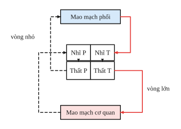
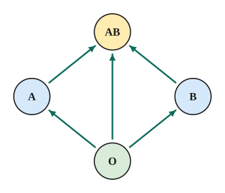
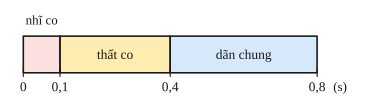

# Chủ đề 1. Cơ thể người: tiêu hóa, tuần hoàn, hô hấp, bài tiết, thần kinh, nội tiết

> **Level Cơ bản** (mục I, các bài gắn nhãn *Cơ bản*) bám sát SGK KHTN 8. **Level Nâng cao** (mục II, các bài gắn nhãn *Nâng cao*) dành cho ôn thi học sinh giỏi và thi vào lớp 10 chuyên Sinh.

## I. Kiến thức cơ bản

### 1. Tổ chức cơ thể người
Tế bào → mô → cơ quan → hệ cơ quan → cơ thể. Các hệ cơ quan chính: vận động, tiêu hóa, tuần hoàn, hô hấp, bài tiết, thần kinh và giác quan, nội tiết, sinh sản. Các hệ **phối hợp** với nhau dưới sự điều khiển của hệ thần kinh và hệ nội tiết.

### 2. Hệ vận động
- Gồm **bộ xương** (nâng đỡ, bảo vệ, là chỗ bám của cơ) và **hệ cơ** (co, dãn giúp cơ thể vận động).
- Xương dài có cấu trúc ống, mô xương xốp ở hai đầu giúp xương nhẹ mà vững chắc. Xương to ra nhờ màng xương, dài ra nhờ sụn tăng trưởng.
- Bảo vệ: ăn uống đủ calcium và vitamin D, tập thể dục, ngồi học đúng tư thế (tránh cong vẹo cột sống).

### 3. Hệ tiêu hóa
- Ống tiêu hóa: miệng → hầu → thực quản → dạ dày → ruột non → ruột già → hậu môn; tuyến tiêu hóa: tuyến nước bọt, tuyến vị, gan, tụy, tuyến ruột.
- **Biến đổi lí học** (nghiền, nhào trộn) và **biến đổi hóa học** nhờ enzyme:
  - Tinh bột → maltose (amylase nước bọt, ở miệng) → glucose (ở ruột non).
  - Protein → chuỗi ngắn (pepsin, ở dạ dày) → amino acid (ở ruột non).
  - Lipid được mật nhũ tương hóa rồi lipase phân giải thành glycerol và acid béo (ở ruột non).
- **Ruột non** là nơi tiêu hóa và **hấp thụ** chủ yếu, nhờ có nếp gấp, lông ruột, lông cực nhỏ làm diện tích bề mặt rất lớn (khoảng hàng trăm m²).

### 4. Hệ tuần hoàn
- **Máu** gồm huyết tương (vận chuyển chất) và các tế bào máu: hồng cầu (chứa hemoglobin vận chuyển $\ce{O2}$, $\ce{CO2}$), bạch cầu (bảo vệ cơ thể), tiểu cầu (đông máu).
- **Tim** có 4 ngăn: tâm nhĩ phải, tâm thất phải, tâm nhĩ trái, tâm thất trái; van tim giúp máu chảy **một chiều** (nhĩ → thất → động mạch).
- **Hai vòng tuần hoàn:**
  - Vòng tuần hoàn **nhỏ** (phổi): tâm thất phải → động mạch phổi → phổi (nhận $\ce{O2}$, thải $\ce{CO2}$) → tĩnh mạch phổi → tâm nhĩ trái.
  - Vòng tuần hoàn **lớn**: tâm thất trái → động mạch chủ → các cơ quan (trao đổi chất) → tĩnh mạch chủ → tâm nhĩ phải.
- **Vì sao thành tâm thất trái dày nhất?** Tâm thất trái phải bơm máu đi khắp cơ thể (quãng đường dài, sức cản lớn), cần lực co mạnh nhất.

### 5. Miễn dịch và nhóm máu
- **Miễn dịch:** khả năng cơ thể không mắc một bệnh nào đó. Bạch cầu thực bào vi khuẩn, tế bào lympho B tạo kháng thể, lympho T phá hủy tế bào nhiễm. **Vaccine** giúp cơ thể tạo miễn dịch chủ động.
- **Hệ nhóm máu ABO:** hồng cầu có thể mang kháng nguyên A, B; huyết tương có thể có kháng thể α (chống A), β (chống B).

| Nhóm máu | Kháng nguyên trên hồng cầu | Kháng thể trong huyết tương |
|---|---|---|
| O | không có | α và β |
| A | A | β |
| B | B | α |
| AB | A và B | không có |

- **Nguyên tắc truyền máu:** hồng cầu của người cho **không bị ngưng kết** bởi huyết tương của người nhận. Nhóm O truyền được cho mọi nhóm (với lượng nhỏ); nhóm AB nhận được của mọi nhóm.

### 6. Hệ hô hấp
- Đường dẫn khí (mũi, họng, thanh quản, khí quản, phế quản) làm ấm, ẩm, lọc sạch không khí; **phổi** gồm hàng triệu phế nang là nơi trao đổi khí.
- **Trao đổi khí** ở phổi và ở tế bào đều theo cơ chế **khuếch tán** từ nơi có nồng độ cao đến nơi có nồng độ thấp: ở phổi $\ce{O2}$ từ phế nang vào máu, $\ce{CO2}$ từ máu ra phế nang; ở tế bào thì ngược lại.
- Bảo vệ: không hút thuốc lá, đeo khẩu trang nơi khói bụi, trồng nhiều cây xanh.

### 7. Hệ bài tiết
- Thải chất thải và chất độc ra khỏi cơ thể qua phổi ($\ce{CO2}$), da (mồ hôi), **thận** (nước tiểu).
- Mỗi thận có khoảng một triệu **đơn vị chức năng (nephron)**. Nước tiểu được tạo thành qua: **lọc máu** ở cầu thận tạo nước tiểu đầu; **hấp thụ lại** các chất cần thiết; **bài tiết tiếp** các chất thải; tạo nước tiểu chính thức.

### 8. Hệ thần kinh, giác quan và nội tiết
- Hệ thần kinh gồm **bộ phận trung ương** (não, tủy sống) và **bộ phận ngoại biên** (dây thần kinh, hạch). Đơn vị cấu tạo là **neuron**.
- **Phản xạ** là phản ứng của cơ thể trả lời kích thích, thông qua **cung phản xạ**: cơ quan thụ cảm → neuron hướng tâm → trung ương thần kinh → neuron li tâm → cơ quan phản ứng. **Phản xạ không điều kiện** bẩm sinh, bền vững (rụt tay khi chạm vật nóng); **phản xạ có điều kiện** hình thành trong đời sống, cần củng cố (dừng xe khi đèn đỏ).
- **Mắt** (màng lưới chứa tế bào que, tế bào nón) và **tai** (ốc tai chứa cơ quan thụ cảm âm thanh) là hai cơ quan cảm giác quan trọng.
- **Tuyến nội tiết** tiết hormone thẳng vào máu: tuyến yên ("chỉ huy" các tuyến khác), tuyến giáp (thyroxine, cần iodine), tuyến tụy (insulin, glucagon), tuyến trên thận, tuyến sinh dục. Hormone có tác dụng đặc hiệu, lượng nhỏ nhưng hoạt tính cao.

### 9. Dinh dưỡng và năng lượng
- Năng lượng do thức ăn cung cấp: 1 g carbohydrate (glucid) $\approx$ 4,3 kcal; 1 g lipid $\approx$ 9,3 kcal; 1 g protein $\approx$ 4,1 kcal.
- Khẩu phần ăn cần đủ năng lượng, cân đối các nhóm chất, đủ vitamin, muối khoáng và nước, phù hợp lứa tuổi, giới tính, mức độ lao động.

---

## II. Kiến thức nâng cao

### 1. Chu kì hoạt động của tim
Một chu kì tim kéo dài khoảng **0,8 s** (nhịp 75 lần/phút): pha nhĩ co 0,1 s, pha thất co 0,3 s, pha dãn chung 0,4 s.
- Tâm nhĩ làm việc 0,1 s, nghỉ 0,7 s; tâm thất làm việc 0,3 s, nghỉ 0,5 s. Nhờ thời gian nghỉ dài, tim hoạt động suốt đời không mệt mỏi.
- **Lưu lượng tim** (lượng máu tâm thất bơm mỗi phút) $=$ thể tích tâm thu $\times$ nhịp tim.

### 2. Thông khí phổi
- **Khí lưu thông** (mỗi lần thở thường) khoảng 500 mL, trong đó khoảng 150 mL nằm ở **khoảng chết** (đường dẫn khí, không trao đổi).
- **Lượng khí hữu ích** mỗi phút $=$ (khí lưu thông $-$ khoảng chết) $\times$ nhịp thở. Vì vậy **thở sâu và chậm** hiệu quả hơn thở nông và nhanh.

### 3. Xác định nhóm máu bằng phản ứng ngưng kết
Trộn hồng cầu của một người với huyết thanh chứa α (hoặc β): ngưng kết với α chứng tỏ hồng cầu có kháng nguyên A; ngưng kết với β chứng tỏ có kháng nguyên B. Kết hợp hai phản ứng suy ra nhóm máu.

### 4. Điều hòa đường huyết
- Đường huyết tăng (sau bữa ăn): tế bào beta của tụy tiết **insulin**, chuyển glucose thành glycogen dự trữ ở gan và cơ, làm đường huyết giảm.
- Đường huyết giảm (khi đói): tế bào alpha tiết **glucagon**, chuyển glycogen thành glucose, làm đường huyết tăng.
- Rối loạn: bệnh tiểu đường (thiếu insulin hoặc tế bào kém đáp ứng với insulin).

### 5. Tính khẩu phần
Năng lượng $E = 4{,}3\,m_G + 9{,}3\,m_L + 4{,}1\,m_P$ (kcal). Biết nhu cầu năng lượng và tỉ lệ các chất, lập phương trình để tìm khối lượng mỗi chất.

---

## III. Bài tập

**Bài 1 (Cơ bản).** Vì sao thành tâm thất trái dày hơn thành tâm thất phải, và thành tâm thất dày hơn thành tâm nhĩ?

**Bài 2 (Cơ bản).** a) Người có nhóm máu O nhận được máu của những nhóm nào? b) Người có nhóm máu AB có thể truyền máu cho những nhóm nào? Giải thích.

**Bài 3 (Cơ bản).** Nêu sự biến đổi hóa học của tinh bột, protein, lipid trong ống tiêu hóa (enzyme, nơi xảy ra, sản phẩm cuối cùng).

**Bài 4 (Cơ bản).** Trình bày sự trao đổi khí ở phổi và ở tế bào. Cơ chế của quá trình đó là gì?

**Bài 5 (Cơ bản).** Một khẩu phần ăn trong ngày có 400 g carbohydrate, 70 g lipid và 80 g protein. Tính năng lượng khẩu phần cung cấp.

**Bài 6 (Cơ bản).** Phân biệt phản xạ không điều kiện và phản xạ có điều kiện. Cho mỗi loại hai ví dụ.

**Bài 7 (Nâng cao, chu kì tim).** Một người có nhịp tim 75 lần/phút. a) Tính thời gian một chu kì tim. b) Biết pha thất co kéo dài 0,3 s; tính tổng thời gian tâm thất được nghỉ trong một ngày.

**Bài 8 (Nâng cao, lưu lượng tim).** Mỗi lần co, tâm thất trái tống đi 70 mL máu; nhịp tim 75 lần/phút. Tính lượng máu tâm thất trái bơm đi trong một phút và trong một ngày. Cơ thể có khoảng 5 lít máu; trung bình mỗi phút máu đi qua tim bao nhiêu vòng?

**Bài 9 (Nâng cao, thông khí phổi).** Người A thở 18 lần/phút, mỗi lần hít vào 420 mL; người B thở 12 lần/phút, mỗi lần hít vào 600 mL. Khoảng chết là 150 mL. Tính lượng khí hữu ích vào đến phế nang mỗi phút của mỗi người. Rút ra nhận xét.

**Bài 10 (Nâng cao, nhóm máu).** Có bốn người I, II, III, IV thuộc bốn nhóm máu khác nhau. Lấy hồng cầu của từng người trộn với huyết thanh chống A (chứa α) và huyết thanh chống B (chứa β), kết quả ("+" là có ngưng kết):

| | Huyết thanh chống A | Huyết thanh chống B |
|---|---|---|
| I | + | − |
| II | − | − |
| III | + | + |
| IV | − | + |

Xác định nhóm máu của mỗi người. Người nào có thể cho máu người II?

**Bài 11 (Nâng cao, đường huyết).** Giải thích vai trò của insulin và glucagon trong điều hòa đường huyết. Vì sao người bị tiểu đường có glucose trong nước tiểu?

**Bài 12 (Nâng cao, khẩu phần).** Một học sinh cần 2200 kcal mỗi ngày. Khẩu phần có tỉ lệ khối lượng carbohydrate : lipid : protein là 4 : 1 : 1. Tính khối lượng mỗi chất trong khẩu phần.

---

## IV. Lời giải chi tiết

### Bài 1
- Tâm thất trái bơm máu vào vòng tuần hoàn **lớn** (đi khắp cơ thể, đường dài, sức cản lớn); tâm thất phải chỉ bơm máu lên phổi (đường ngắn). Vì vậy tâm thất trái cần co mạnh nhất, thành dày nhất.
- Tâm nhĩ chỉ đẩy máu xuống tâm thất ngay bên dưới, còn tâm thất đẩy máu vào động mạch đi xa, nên thành tâm thất dày hơn.

### Bài 2
**a)** Huyết tương nhóm O có cả α và β, ngưng kết hồng cầu A, B, AB. Nhóm O chỉ nhận được máu nhóm **O**.
**b)** Hồng cầu nhóm AB có cả A và B, bị ngưng kết bởi huyết tương các nhóm O, A, B. Nhóm AB chỉ truyền được cho nhóm **AB**.

### Bài 3
- **Tinh bột:** amylase nước bọt (miệng) phân giải một phần thành maltose; ở ruột non, amylase tụy và enzyme ruột phân giải thành **glucose**.
- **Protein:** pepsin (dạ dày) cắt thành chuỗi ngắn; ở ruột non, trypsin và enzyme ruột phân giải thành **amino acid**.
- **Lipid:** ở ruột non, muối mật nhũ tương hóa, lipase phân giải thành **glycerol và acid béo**.

### Bài 4
- **Ở phổi:** nồng độ $\ce{O2}$ trong phế nang cao hơn trong máu nên $\ce{O2}$ khuếch tán từ phế nang vào máu; nồng độ $\ce{CO2}$ trong máu cao hơn nên $\ce{CO2}$ khuếch tán từ máu ra phế nang.
- **Ở tế bào:** máu giàu $\ce{O2}$ nên $\ce{O2}$ khuếch tán vào tế bào; tế bào giàu $\ce{CO2}$ nên $\ce{CO2}$ khuếch tán vào máu.
- Cơ chế: **khuếch tán** theo chênh lệch nồng độ.

### Bài 5
$E = 400\cdot4{,}3 + 70\cdot9{,}3 + 80\cdot4{,}1 = 1720 + 651 + 328 = 2699$ kcal.

### Bài 6
| | Không điều kiện | Có điều kiện |
|---|---|---|
| Nguồn gốc | Bẩm sinh, di truyền | Hình thành trong đời sống |
| Tính bền vững | Bền vững | Dễ mất nếu không củng cố |
| Tính chất | Có tính chủng loại | Có tính cá thể |
| Trung ương | Chủ yếu tủy sống, trụ não | Có sự tham gia của vỏ não |

Ví dụ không điều kiện: rụt tay khi chạm vật nóng, tiết nước bọt khi thức ăn chạm lưỡi. Có điều kiện: dừng xe khi thấy đèn đỏ, tiết nước bọt khi nghe tên món ăn quen.

### Bài 7
**a)** $\frac{60}{75} = 0{,}8$ s.
**b)** Mỗi chu kì tâm thất nghỉ $0{,}8 - 0{,}3 = 0{,}5$ s, tức $\frac58$ thời gian. Trong 24 giờ: $24\cdot\frac58 = 15$ giờ.

### Bài 8
Mỗi phút: $70\cdot75 = 5250$ mL $= 5{,}25$ L. Mỗi ngày: $5{,}25\cdot1440 = 7560$ L.
Số vòng mỗi phút: $\frac{5{,}25}{5} = 1{,}05$, tức là trung bình hơn một vòng mỗi phút.

### Bài 9
- A: $(420 - 150)\cdot18 = 4860$ mL/phút.
- B: $(600 - 150)\cdot12 = 5400$ mL/phút.

Tuy thở ít lần hơn, B có lượng khí hữu ích nhiều hơn: **thở sâu, chậm** hiệu quả hơn thở nông, nhanh (giảm tỉ lệ khí nằm ở khoảng chết).

### Bài 10
Ngưng kết với α nghĩa là hồng cầu có A; ngưng kết với β nghĩa là có B.
- I: có A, không B, nhóm **A**. II: không có, nhóm **O**. III: có cả hai, nhóm **AB**. IV: chỉ có B, nhóm **B**.

Người II nhóm O chỉ nhận được máu nhóm O: không ai trong ba người còn lại cho được người II.

### Bài 11
- Đường huyết tăng: insulin chuyển glucose thành glycogen dự trữ, tăng hấp thụ glucose vào tế bào, đường huyết giảm về bình thường. Đường huyết giảm: glucagon chuyển glycogen thành glucose.
- Người tiểu đường thiếu insulin (hoặc tế bào kém đáp ứng), glucose không vào được tế bào, đường huyết quá cao; ống thận không hấp thụ lại hết glucose ở nước tiểu đầu, nên glucose có trong nước tiểu.

### Bài 12
Gọi khối lượng lipid là $x$ (g), thì carbohydrate $4x$, protein $x$:
$$4{,}3\cdot4x + 9{,}3x + 4{,}1x = 2200 \iff 30{,}6x = 2200 \iff x \approx 71{,}9.$$
Carbohydrate $\approx 287{,}6$ g; lipid $\approx 71{,}9$ g; protein $\approx 71{,}9$ g.
