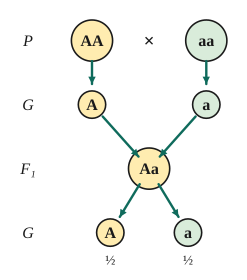
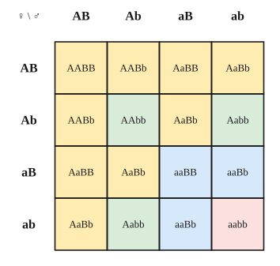

# Chủ đề 2. Di truyền học Mendel

> **Level Cơ bản** (mục I, các bài gắn nhãn *Cơ bản*) bám sát SGK KHTN 9. **Level Nâng cao** (mục II, các bài gắn nhãn *Nâng cao*) dành cho ôn thi học sinh giỏi và thi vào lớp 10 chuyên Sinh.
>
> Trong cả chủ đề, nếu không nói gì thêm thì mỗi gen quy định một tính trạng, trội hoàn toàn, các cặp gen phân li độc lập và không có đột biến.

## I. Kiến thức cơ bản

### 1. Các khái niệm và ký hiệu
- **Tính trạng:** đặc điểm về hình thái, cấu tạo, sinh lí của cơ thể (màu hạt, chiều cao thân, nhóm máu, ...). **Cặp tính trạng tương phản:** hai trạng thái biểu hiện trái ngược của cùng một tính trạng (hạt vàng – hạt xanh).
- **Gen** (Mendel gọi là *nhân tố di truyền*) quy định tính trạng. Các dạng khác nhau của một gen gọi là **allele**: allele trội viết hoa ($A$), allele lặn viết thường ($a$).
- **Kiểu gen:** tổ hợp các allele của cơ thể ($AA$, $Aa$, $aa$). **Kiểu hình:** tổ hợp các tính trạng biểu hiện ra ngoài.
- **Đồng hợp** ($AA$, $aa$): hai allele giống nhau; **dị hợp** ($Aa$): hai allele khác nhau. **Thuần chủng:** đồng hợp về các gen đang xét, tự thụ phấn cho đời con giống hệt bố mẹ.
- **Trội hoàn toàn:** $Aa$ có kiểu hình giống $AA$ (allele lặn bị "che lấp").
- **Ký hiệu:** $P$ (bố mẹ), $G$ (giao tử), $F_1, F_2$ (thế hệ con), $\times$ (phép lai), ♀ (cái), ♂ (đực).

### 2. Phương pháp của Mendel
- **Đối tượng:** đậu Hà Lan, vì tự thụ phấn nghiêm ngặt (dễ tạo dòng thuần), có nhiều cặp tính trạng tương phản dễ quan sát, vòng đời ngắn, nhiều hạt.
- **Phương pháp phân tích các thế hệ lai:** lai các cặp bố mẹ thuần chủng khác nhau về một hoặc vài cặp tính trạng, theo dõi riêng từng cặp tính trạng qua nhiều thế hệ, **dùng thống kê** để phân tích số liệu.

### 3. Lai một cặp tính trạng và quy luật phân li
**Thí nghiệm:** $P$: hạt vàng thuần chủng $\times$ hạt xanh thuần chủng $\to$ $F_1$: 100% hạt vàng. $F_1$ tự thụ phấn $\to$ $F_2$: khoảng **3 vàng : 1 xanh**.

**Giải thích của Mendel:**
- Mỗi tính trạng do một cặp nhân tố di truyền quy định; trong tế bào chúng tồn tại thành từng cặp.
- Khi giảm phân tạo giao tử, **mỗi allele của cặp phân li về một giao tử** (giao tử "thuần khiết"): $Aa$ tạo hai loại giao tử $A$ và $a$ với tỉ lệ bằng nhau.
- Khi thụ tinh, các giao tử kết hợp **ngẫu nhiên**.

**Sơ đồ lai:**
$$P_{tc}:\ AA\ (\text{vàng}) \times aa\ (\text{xanh}) \quad\to\quad G_P:\ A,\ a \quad\to\quad F_1:\ Aa\ (100\%\text{ vàng}).$$
$F_1 \times F_1$: $Aa \times Aa$, mỗi bên cho giao tử $\frac12A : \frac12a$. Kẻ **khung Punnett**:

| ♀ \ ♂ | $A$ | $a$ |
|---|---|---|
| $A$ | $AA$ | $Aa$ |
| $a$ | $Aa$ | $aa$ |

$F_2$: kiểu gen $1AA : 2Aa : 1aa$; kiểu hình **3 vàng : 1 xanh**.

**Quy luật phân li:** trong quá trình phát sinh giao tử, mỗi nhân tố di truyền trong cặp phân li về một giao tử và giữ nguyên bản chất như ở cơ thể thuần chủng của P.

### 4. Phép lai phân tích
Cơ thể mang tính trạng trội ($AA$ hay $Aa$?) được lai với cơ thể mang tính trạng **lặn** ($aa$, chỉ cho một loại giao tử $a$), nên kiểu hình đời con phản ánh trực tiếp các loại giao tử của cơ thể cần kiểm tra:
- đời con **đồng tính** trội $\Rightarrow$ cơ thể cần kiểm tra là $AA$;
- đời con **1 trội : 1 lặn** $\Rightarrow$ cơ thể cần kiểm tra là $Aa$.

Ứng dụng: kiểm tra độ thuần chủng của giống trước khi đưa vào sản xuất.

### 5. Trội không hoàn toàn
Kiểu hình của $Aa$ là **trung gian** giữa $AA$ và $aa$. Ví dụ hoa phấn: $AA$ đỏ, $Aa$ hồng, $aa$ trắng. Khi đó $F_2$ có tỉ lệ kiểu hình **1 đỏ : 2 hồng : 1 trắng**, trùng với tỉ lệ kiểu gen.

### 6. Lai hai cặp tính trạng và quy luật phân li độc lập
**Thí nghiệm:** $P$: vàng, trơn thuần chủng $\times$ xanh, nhăn thuần chủng $\to$ $F_1$: 100% vàng, trơn. $F_1$ tự thụ phấn $\to$ $F_2$: **9 vàng, trơn : 3 vàng, nhăn : 3 xanh, trơn : 1 xanh, nhăn**.

**Vì sao là 9 : 3 : 3 : 1?** Xét riêng từng cặp tính trạng ở $F_2$: màu hạt 3 vàng : 1 xanh; hình dạng 3 trơn : 1 nhăn. Tỉ lệ chung bằng **tích** hai tỉ lệ riêng:
$$(3\text{ vàng} : 1\text{ xanh})(3\text{ trơn} : 1\text{ nhăn}) = 9 : 3 : 3 : 1.$$
Điều này chỉ đúng khi hai cặp tính trạng di truyền **độc lập** với nhau.

**Giải thích:** quy ước $A$ vàng, $a$ xanh, $B$ trơn, $b$ nhăn. $F_1$: $AaBb$. Khi giảm phân, hai cặp allele phân li độc lập, nên $F_1$ tạo **4 loại giao tử** $AB, Ab, aB, ab$ với tỉ lệ bằng nhau. Thụ tinh ngẫu nhiên tạo $4\times4 = 16$ tổ hợp.

**Quy luật phân li độc lập:** các cặp nhân tố di truyền (cặp gen) phân li độc lập trong quá trình phát sinh giao tử. Điều kiện: các cặp gen nằm trên **các cặp nhiễm sắc thể khác nhau**.

**Ý nghĩa:** giải thích sự xuất hiện **biến dị tổ hợp** (những kiểu hình mới không có ở bố mẹ, như vàng nhăn, xanh trơn). Đây là nguồn nguyên liệu cho chọn giống và tiến hóa, và là lí do các con của cùng bố mẹ có nhiều điểm khác nhau.

---

## II. Kiến thức nâng cao

### 1. Công thức tổng quát cho $n$ cặp gen dị hợp
Cơ thể dị hợp $n$ cặp gen phân li độc lập, tự thụ phấn (hoặc lai với cơ thể giống hệt):

| Đại lượng | Một cặp | $n$ cặp |
|---|---|---|
| Số loại giao tử | 2 | $2^n$ |
| Số tổ hợp giao tử | 4 | $4^n$ |
| Số loại kiểu gen | 3 | $3^n$ |
| Số loại kiểu hình (trội hoàn toàn) | 2 | $2^n$ |
| Tỉ lệ kiểu hình | $3 : 1$ | $(3 : 1)^n$ |
| Tỉ lệ kiểu gen | $1 : 2 : 1$ | $(1 : 2 : 1)^n$ |

**Vì sao nhân?** Các cặp gen phân li độc lập, nên mỗi cặp là một "lựa chọn" riêng; theo quy tắc nhân (xem Toán chủ đề 10), số khả năng của cả $n$ cặp bằng tích số khả năng của từng cặp.

### 2. Giao tử của một kiểu gen cụ thể
- Kiểu gen có $k$ cặp dị hợp cho $2^k$ loại giao tử với tỉ lệ bằng nhau (cặp đồng hợp chỉ cho một loại allele). Ví dụ $AaBBDd$ có 2 cặp dị hợp, cho 4 loại giao tử: $ABD, ABd, aBD, aBd$.
- **Tỉ lệ một loại giao tử** bằng tích tỉ lệ của từng allele: ở $AaBBDd$, giao tử $aBd$ chiếm $\frac12\cdot1\cdot\frac12 = \frac14$.

### 3. Phương pháp tách riêng từng cặp gen
Với phép lai nhiều cặp gen phân li độc lập, **xét riêng từng cặp** rồi **nhân** các kết quả:
- $Aa \times Aa$: $\frac34$ trội ($A\!-$), $\frac14$ lặn; kiểu gen $\frac14AA, \frac12Aa, \frac14aa$.
- $Aa \times aa$: $\frac12$ trội, $\frac12$ lặn.
- $AA \times$ bất kỳ: 100% trội.

*Ví dụ:* $AaBbDd \times AaBbdd$, tỉ lệ kiểu hình $A\!-\,bb\,D\!-$ là $\frac34\cdot\frac14\cdot\frac12 = \frac{3}{32}$.

### 4. Bài toán ngược: từ tỉ lệ đời con suy ra kiểu gen bố mẹ
1. Xét **riêng từng cặp tính trạng** ở đời con để suy ra kiểu gen từng cặp của P.
2. Tổng số phần của tỉ lệ = số tổ hợp = (số loại giao tử bên bố) $\times$ (số loại giao tử bên mẹ).
3. Kiểm tra xem tỉ lệ chung có bằng tích các tỉ lệ riêng không (để biết có phân li độc lập không).

**Bảng nhận dạng nhanh:**

| Tỉ lệ đời con | Phép lai P |
|---|---|
| $3 : 1$ | $Aa \times Aa$ |
| $1 : 1$ | $Aa \times aa$ |
| $1 : 2 : 1$ | $Aa \times Aa$ (trội không hoàn toàn) |
| $9 : 3 : 3 : 1$ | $AaBb \times AaBb$ |
| $3 : 3 : 1 : 1$ | $AaBb \times Aabb$ (hoặc $AaBb \times aaBb$) |
| $1 : 1 : 1 : 1$ | $AaBb \times aabb$ hoặc $Aabb \times aaBb$ |

### 5. Xác suất trong di truyền
- **Quy tắc nhân:** hai sự kiện độc lập cùng xảy ra thì xác suất bằng tích. **Quy tắc cộng:** hai sự kiện không thể cùng xảy ra thì xác suất "sự kiện này hoặc sự kiện kia" bằng tổng.
- Xác suất sinh con trai (hoặc gái) mỗi lần là $\frac12$, độc lập với tính trạng đang xét.
- **Trong $n$ lần sinh, đúng $k$ lần có tính trạng xác suất $p$:**
$$C_n^k\, p^k(1 - p)^{n-k}.$$
  *Vì sao?* Có $C_n^k$ cách chọn $k$ lần (trong $n$ lần) có tính trạng; mỗi cách có xác suất $p^k(1 - p)^{n-k}$.
- **"Ít nhất một"** nên tính qua phần bù: $1 - (1 - p)^n$.
- **Xác suất có điều kiện thường gặp:** trong các cây trội ở $F_2$ ($AA$ và $Aa$ theo tỉ lệ $1 : 2$), xác suất chọn được cây thuần chủng là $\frac13$.

### 6. Một số trường hợp làm thay đổi tỉ lệ Mendel
- **Gen gây chết:** nếu kiểu gen $AA$ chết ở giai đoạn phôi thì $Aa \times Aa$ cho đời con $2Aa : 1aa$, tức tỉ lệ kiểu hình **2 : 1**.
- **Trội không hoàn toàn** ở một cặp: tỉ lệ cặp đó là $1 : 2 : 1$ thay cho $3 : 1$, rồi nhân với các cặp khác như bình thường.
- **Liên kết gen hoàn toàn** (hai gen nằm trên cùng một nhiễm sắc thể): $F_1$ dị hợp hai cặp chỉ cho **2 loại giao tử**, nên tự thụ phấn cho 4 tổ hợp, tỉ lệ $3 : 1$ (nếu $F_1$ là $\frac{AB}{ab}$) hoặc $1 : 2 : 1$ (nếu là $\frac{Ab}{aB}$), thay cho $9 : 3 : 3 : 1$. Dấu hiệu nhận biết: **tổng số tổ hợp ít hơn** so với phân li độc lập.

---

## III. Bài tập

**Bài 1 (Cơ bản).** Ở đậu Hà Lan, hạt vàng ($A$) trội hoàn toàn so với hạt xanh ($a$). Cho cây hạt vàng thuần chủng lai với cây hạt xanh. Viết sơ đồ lai từ $P$ đến $F_2$ và cho biết tỉ lệ kiểu gen, kiểu hình ở $F_2$.

**Bài 2 (Cơ bản).** Ở một loài thực vật, hoa đỏ trội hoàn toàn so với hoa trắng. Cho một cây hoa đỏ lai với cây hoa trắng, đời con thu được 50% hoa đỏ và 50% hoa trắng. Xác định kiểu gen của cây hoa đỏ đem lai và viết sơ đồ lai.

**Bài 3 (Cơ bản).** Ở hoa phấn, kiểu gen $AA$ cho hoa đỏ, $Aa$ cho hoa hồng, $aa$ cho hoa trắng.
a) Cho cây hoa đỏ lai với cây hoa trắng được $F_1$, rồi cho $F_1$ tự thụ phấn. Xác định tỉ lệ kiểu hình ở $F_2$.
b) Cho cây hoa hồng lai với cây hoa đỏ. Xác định tỉ lệ kiểu hình ở đời con.

**Bài 4 (Cơ bản).** Ở cà chua, quả đỏ trội hoàn toàn so với quả vàng. Cho hai cây quả đỏ lai với nhau, đời con có cả cây quả đỏ và cây quả vàng. Xác định kiểu gen của hai cây đem lai và tỉ lệ kiểu hình ở đời con.

**Bài 5 (Cơ bản).** Ở đậu Hà Lan, $A$: hạt vàng, $a$: hạt xanh; $B$: hạt trơn, $b$: hạt nhăn; hai cặp gen phân li độc lập. Cho cây hạt vàng, trơn thuần chủng lai với cây hạt xanh, nhăn. Xác định kiểu gen, kiểu hình của $F_1$ và tỉ lệ kiểu hình ở $F_2$ khi cho $F_1$ tự thụ phấn.

**Bài 6 (Cơ bản).** Viết các loại giao tử của các kiểu gen sau: $AaBb$; $\ AABb$; $\ AaBbDd$.

**Bài 7 (Cơ bản).** Ở người, mắt nâu ($A$) trội hoàn toàn so với mắt xanh ($a$). Một cặp vợ chồng đều mắt nâu sinh được một đứa con mắt xanh.
a) Xác định kiểu gen của bố, mẹ và con.
b) Nếu họ sinh thêm con, xác suất sinh con mắt xanh là bao nhiêu?

**Bài 8 (Cơ bản).** Cho phép lai $AaBb \times aabb$ (hai cặp gen phân li độc lập). Xác định tỉ lệ kiểu gen và kiểu hình ở đời con. Phép lai này gọi là gì?

**Bài 9 (Nâng cao, công thức tổng quát).** Cho phép lai $P$: $AaBbDd \times AaBbDd$.
a) Mỗi bên $P$ cho bao nhiêu loại giao tử? $F_1$ có bao nhiêu loại kiểu gen, bao nhiêu loại kiểu hình?
b) Tính tỉ lệ kiểu hình $A\!-\,bb\,D\!-$ ở $F_1$.
c) Tính tỉ lệ kiểu gen $AaBbDd$ ở $F_1$.
d) Tính tỉ lệ cá thể mang đúng 2 tính trạng trội và 1 tính trạng lặn ở $F_1$.

**Bài 10 (Nâng cao, bài toán ngược).** Ở đậu, thân cao ($A$) trội so với thân thấp ($a$), hoa đỏ ($B$) trội so với hoa trắng ($b$). Cho cây thân cao, hoa đỏ lai với cây thân cao, hoa trắng, $F_1$ thu được tỉ lệ 3 cao, đỏ : 3 cao, trắng : 1 thấp, đỏ : 1 thấp, trắng. Xác định kiểu gen của $P$.

**Bài 11 (Nâng cao, gen gây chết).** Ở chuột, cho các con lông vàng giao phối với nhau, đời con luôn thu được tỉ lệ 2 lông vàng : 1 lông đen. Giải thích kết quả và viết sơ đồ lai. Nếu cho chuột lông vàng giao phối với chuột lông đen thì tỉ lệ đời con thế nào?

**Bài 12 (Nâng cao, xác suất).** Bệnh bạch tạng ở người do allele lặn $a$ quy định. Một cặp vợ chồng đều có kiểu gen $Aa$ dự định sinh 3 người con.
a) Tính xác suất trong 3 người con có đúng 1 người bị bệnh.
b) Tính xác suất có ít nhất 1 người con bị bệnh.
c) Tính xác suất người con đầu lòng là con trai và không bị bệnh.

**Bài 13 (Nâng cao, tách từng cặp).** Cho phép lai $AaBbDdEe \times AabbDdee$ (các cặp gen phân li độc lập, trội hoàn toàn).
a) Tính tỉ lệ đời con có kiểu hình trội về cả 4 tính trạng.
b) Tính tỉ lệ đời con có kiểu gen đồng hợp về tất cả các cặp gen.

**Bài 14 (Nâng cao, nhận biết liên kết gen).** Cho cây $F_1$ dị hợp hai cặp gen (thân cao, hoa đỏ) tự thụ phấn, $F_2$ thu được 75% thân cao, hoa đỏ : 25% thân thấp, hoa trắng. Hai cặp gen có phân li độc lập không? Giải thích và viết kiểu gen của $F_1$.

**Bài 15 (Nâng cao, trội không hoàn toàn kết hợp).** Ở một loài, $A$ quy định hoa đỏ trội không hoàn toàn so với $a$ quy định hoa trắng ($Aa$ cho hoa hồng); $B$ quy định thân cao trội hoàn toàn so với $b$ quy định thân thấp; hai cặp gen phân li độc lập. Cho $AaBb \times AaBb$. Xác định số loại kiểu hình và tỉ lệ kiểu hình ở đời con.

**Bài 16 (Nâng cao, xác suất có điều kiện).** Một cây tự thụ phấn, $F_1$ thu được 56,25% cây cao, đỏ : 18,75% cây cao, trắng : 18,75% cây thấp, đỏ : 6,25% cây thấp, trắng.
a) Xác định kiểu gen của cây đem tự thụ phấn.
b) Lấy ngẫu nhiên một cây cao, đỏ ở $F_1$. Tính xác suất cây đó thuần chủng.

---

## IV. Lời giải chi tiết

### Bài 1
$$P_{tc}:\ AA\ (\text{vàng}) \times aa\ (\text{xanh}); \qquad G_P:\ A;\ a; \qquad F_1:\ Aa\ (100\%\text{ vàng}).$$
$F_1 \times F_1$: $Aa \times Aa$; $\ G_{F_1}$: $\frac12A, \frac12a$ (mỗi bên).

| ♀ \ ♂ | $A$ | $a$ |
|---|---|---|
| $A$ | $AA$ | $Aa$ |
| $a$ | $Aa$ | $aa$ |

$F_2$: kiểu gen $1AA : 2Aa : 1aa$; kiểu hình 3 vàng : 1 xanh.

### Bài 2
Cây hoa trắng (lặn) có kiểu gen $aa$, chỉ cho giao tử $a$. Đời con có cây hoa trắng $aa$, nên cây hoa đỏ phải cho được giao tử $a$, tức là có kiểu gen $Aa$.
$$P:\ Aa\ (\text{đỏ}) \times aa\ (\text{trắng}); \quad G:\ \tfrac12A, \tfrac12a;\ a; \quad F_1:\ 1Aa : 1aa\ (1\text{ đỏ} : 1\text{ trắng}).$$
Đây chính là **phép lai phân tích**.

### Bài 3
**a)** $P$: $AA$ (đỏ) $\times$ $aa$ (trắng) $\to$ $F_1$: $Aa$ (100% hồng). $F_1 \times F_1$: $Aa \times Aa \to F_2$: $1AA : 2Aa : 1aa$, tức là **1 đỏ : 2 hồng : 1 trắng**.

**b)** $Aa$ (hồng) $\times$ $AA$ (đỏ): giao tử $\frac12A, \frac12a$ và $A$, đời con $1AA : 1Aa$, tức là **1 đỏ : 1 hồng**.

### Bài 4
Quy ước $A$: đỏ, $a$: vàng. Đời con có cây quả vàng ($aa$), nên mỗi cây $P$ đều cho giao tử $a$. Hai cây $P$ quả đỏ đều phải là $Aa$.
$P$: $Aa \times Aa$ $\to$ $1AA : 2Aa : 1aa$, kiểu hình **3 quả đỏ : 1 quả vàng**.

### Bài 5
$P_{tc}$: $AABB$ (vàng, trơn) $\times$ $aabb$ (xanh, nhăn) $\to$ $F_1$: $AaBb$, 100% vàng, trơn.
$F_1$ cho 4 loại giao tử $AB, Ab, aB, ab$, mỗi loại $\frac14$. Xét riêng từng cặp ở $F_2$: $(3\text{ vàng} : 1\text{ xanh})(3\text{ trơn} : 1\text{ nhăn})$, nên
$$F_2:\ 9\text{ vàng, trơn} : 3\text{ vàng, nhăn} : 3\text{ xanh, trơn} : 1\text{ xanh, nhăn}.$$

### Bài 6
- $AaBb$: $AB, Ab, aB, ab$ (4 loại).
- $AABb$: $AB, Ab$ (2 loại, vì cặp $AA$ chỉ cho $A$).
- $AaBbDd$: $2^3 = 8$ loại: $ABD, ABd, AbD, Abd, aBD, aBd, abD, abd$.

> Mẹo liệt kê không sót: viết dạng "cây": chọn $A$ hoặc $a$, rồi với mỗi lựa chọn chọn $B$ hoặc $b$, ...

### Bài 7
**a)** Con mắt xanh có kiểu gen $aa$, nhận một allele $a$ từ bố và một allele $a$ từ mẹ. Bố mẹ mắt nâu nên mỗi người có một allele $A$. Vậy bố $Aa$, mẹ $Aa$, con $aa$.

**b)** $Aa \times Aa$ cho $\frac14aa$. Mỗi lần sinh là độc lập, nên xác suất sinh con mắt xanh là $\frac14$, **không phụ thuộc** vào việc đứa trước mắt xanh.

### Bài 8
$AaBb$ cho 4 loại giao tử $\frac14AB, \frac14Ab, \frac14aB, \frac14ab$; $aabb$ chỉ cho $ab$. Đời con:
- kiểu gen $1AaBb : 1Aabb : 1aaBb : 1aabb$;
- kiểu hình $1 A\!-B\!- : 1 A\!-bb : 1 aaB\!- : 1 aabb$, tức **1 : 1 : 1 : 1**.

Đây là **phép lai phân tích** hai cặp tính trạng: tỉ lệ kiểu hình đời con phản ánh đúng tỉ lệ các loại giao tử của $AaBb$.

### Bài 9
**a)** Mỗi bên dị hợp 3 cặp: $2^3 = 8$ loại giao tử. $F_1$: $3^3 = 27$ loại kiểu gen; $2^3 = 8$ loại kiểu hình.

**b)** $A\!-\,bb\,D\!- = \frac34\cdot\frac14\cdot\frac34 = \frac{9}{64}$.

**c)** Mỗi cặp $Aa \times Aa$ cho $\frac12Aa$, nên $AaBbDd = \left(\frac12\right)^3 = \frac18$.

**d)** Chọn tính trạng lặn: 3 cách. Mỗi cách có xác suất $\frac34\cdot\frac34\cdot\frac14 = \frac{9}{64}$. Vậy tỉ lệ $= 3\cdot\frac{9}{64} = \frac{27}{64}$.

### Bài 10
Xét riêng từng cặp ở $F_1$:
- Chiều cao: cao : thấp $= (3 + 3) : (1 + 1) = 3 : 1$, nên $P$: $Aa \times Aa$.
- Màu hoa: đỏ : trắng $= (3 + 1) : (3 + 1) = 1 : 1$, nên $P$: $Bb \times bb$.

Tích $(3 : 1)(1 : 1) = 3 : 3 : 1 : 1$ đúng bằng tỉ lệ đề cho (hai cặp phân li độc lập). Cây cao, đỏ là $AaBb$; cây cao, trắng là $Aabb$.
**Kiểu gen $P$:** $AaBb \times Aabb$. (Tổng số tổ hợp $8 = 4\cdot2$, khớp với 4 loại giao tử của $AaBb$ và 2 loại của $Aabb$.)

### Bài 11
Vàng $\times$ vàng cho ra đen, nên vàng là trội ($A$), đen là lặn ($a$), và chuột vàng đem lai là $Aa$. Phép lai $Aa \times Aa$ đáng lẽ cho $1AA : 2Aa : 1aa$ (3 vàng : 1 đen). Thực tế chỉ có 2 vàng : 1 đen, và **không có chuột vàng thuần chủng**, chứng tỏ kiểu gen $AA$ bị chết ở giai đoạn phôi.
$$P:\ Aa \times Aa \to 1AA\ (\text{chết}) : 2Aa\ (\text{vàng}) : 1aa\ (\text{đen}).$$
Vàng $\times$ đen: $Aa \times aa \to 1Aa : 1aa$, tức **1 vàng : 1 đen**.

### Bài 12
Mỗi người con bị bệnh với xác suất $p = \frac14$, không bị bệnh với xác suất $\frac34$; các lần sinh độc lập.

**a)** Đúng 1 trong 3 người bị bệnh: $C_3^1\cdot\frac14\cdot\left(\frac34\right)^2 = 3\cdot\frac{9}{64} = \frac{27}{64}$.

**b)** Ít nhất 1 người bị bệnh $= 1 - P(\text{cả 3 đều không bệnh}) = 1 - \left(\frac34\right)^3 = 1 - \frac{27}{64} = \frac{37}{64}$.

**c)** Con trai ($\frac12$) và không bị bệnh ($\frac34$), hai sự kiện độc lập: $\frac12\cdot\frac34 = \frac38$.

### Bài 13
Tách riêng từng cặp:

| Cặp | Phép lai | Tỉ lệ trội | Tỉ lệ đồng hợp |
|---|---|---|---|
| A | $Aa \times Aa$ | $\frac34$ | $\frac12$ ($AA$ + $aa$) |
| B | $Bb \times bb$ | $\frac12$ | $\frac12$ ($bb$) |
| D | $Dd \times Dd$ | $\frac34$ | $\frac12$ |
| E | $Ee \times ee$ | $\frac12$ | $\frac12$ ($ee$) |

**a)** Trội cả 4 tính trạng: $\frac34\cdot\frac12\cdot\frac34\cdot\frac12 = \frac{9}{64}$.

**b)** Đồng hợp tất cả các cặp: $\left(\frac12\right)^4 = \frac1{16}$.

### Bài 14
Nếu hai cặp gen phân li độc lập thì $F_1$ dị hợp hai cặp tự thụ phấn phải cho $F_2$ có tỉ lệ $9 : 3 : 3 : 1$ (16 tổ hợp, 4 loại kiểu hình). Ở đây $F_2$ chỉ có 2 loại kiểu hình với tỉ lệ $3 : 1$ (4 tổ hợp), nên mỗi bên $F_1$ chỉ cho **2 loại giao tử**. Vậy hai cặp gen **không phân li độc lập**, mà nằm trên cùng một nhiễm sắc thể và **liên kết hoàn toàn**.
$F_2$ có thân thấp, hoa trắng ($\frac{ab}{ab}$) nên $F_1$ cho giao tử $ab$; $F_1$ cao, đỏ, nên allele $A$ và $B$ cùng nằm trên một nhiễm sắc thể: **$F_1$ có kiểu gen $\frac{AB}{ab}$**.
$$F_1 \times F_1:\ \frac{AB}{ab}\times\frac{AB}{ab} \to 1\frac{AB}{AB} : 2\frac{AB}{ab} : 1\frac{ab}{ab}\ (3\text{ cao, đỏ} : 1\text{ thấp, trắng}).$$

### Bài 15
- Cặp A (trội không hoàn toàn): $Aa \times Aa \to 1$ đỏ : 2 hồng : 1 trắng (3 kiểu hình).
- Cặp B (trội hoàn toàn): $Bb \times Bb \to 3$ cao : 1 thấp (2 kiểu hình).

Số loại kiểu hình: $3\cdot2 = 6$. Tỉ lệ: $(1 : 2 : 1)(3 : 1)$, tức là
**3 đỏ, cao : 1 đỏ, thấp : 6 hồng, cao : 2 hồng, thấp : 3 trắng, cao : 1 trắng, thấp**.

### Bài 16
**a)** Tỉ lệ $56{,}25 : 18{,}75 : 18{,}75 : 6{,}25 = 9 : 3 : 3 : 1$ (16 tổ hợp), nên cây đem tự thụ cho 4 loại giao tử, dị hợp hai cặp gen phân li độc lập: **$AaBb$** (với $A$: cao, $B$: đỏ).

**b)** Cây cao, đỏ ($A\!-B\!-$) chiếm $\frac{9}{16}$, trong đó cây thuần chủng $AABB$ chiếm $\frac14\cdot\frac14 = \frac1{16}$. Vậy xác suất cần tìm là
$$\frac{1/16}{9/16} = \frac19.$$

> Có thể lập luận từng cặp: trong các cây cao ($AA$ : $Aa$ = 1 : 2), xác suất thuần chủng là $\frac13$; tương tự với màu hoa. Hai cặp độc lập, nên $\frac13\cdot\frac13 = \frac19$.
