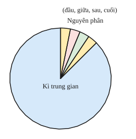
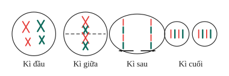
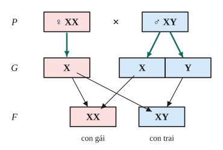

# Chủ đề 3. Nhiễm sắc thể, nguyên phân, giảm phân, di truyền liên kết

> **Level Cơ bản** (mục I, các bài gắn nhãn *Cơ bản*) bám sát SGK KHTN 9. **Level Nâng cao** (mục II, các bài gắn nhãn *Nâng cao*) dành cho ôn thi học sinh giỏi và thi vào lớp 10 chuyên Sinh.

## I. Kiến thức cơ bản

### 1. Nhiễm sắc thể
- **Nhiễm sắc thể (NST)** là cấu trúc mang gen nằm trong nhân tế bào, gồm DNA và protein. Ở kì giữa của phân bào, NST co ngắn cực đại, gồm **hai chromatid** (nhiễm sắc tử chị em) dính nhau ở **tâm động**.
- Trong tế bào sinh dưỡng, NST tồn tại thành từng **cặp tương đồng** (giống nhau về hình dạng, kích thước; một chiếc từ bố, một chiếc từ mẹ): **bộ NST lưỡng bội 2n**. Giao tử chỉ chứa một chiếc của mỗi cặp: **bộ đơn bội n**.
- Mỗi loài có bộ NST đặc trưng về số lượng, hình dạng, cấu trúc: người $2n = 46$, ruồi giấm $2n = 8$, lúa $2n = 24$, đậu Hà Lan $2n = 14$.
- **NST thường** giống nhau ở hai giới; **NST giới tính** khác nhau ở hai giới (người: nữ XX, nam XY).

### 2. Chu kì tế bào và nguyên phân
- **Chu kì tế bào** gồm **kì trung gian** (chiếm phần lớn thời gian; DNA và NST **nhân đôi**, mỗi NST thành NST kép gồm hai chromatid) và **nguyên phân**.
- **Nguyên phân** gồm 4 kì:
  - **Kì đầu:** NST kép bắt đầu đóng xoắn, thoi phân bào hình thành.
  - **Kì giữa:** NST kép đóng xoắn cực đại, xếp **thành một hàng** trên mặt phẳng xích đạo.
  - **Kì sau:** hai chromatid của mỗi NST kép **tách nhau** thành hai NST đơn, đi về hai cực.
  - **Kì cuối:** NST dãn xoắn, tế bào chất phân chia, tạo **hai tế bào con có bộ NST 2n giống hệt tế bào mẹ**.
- **Ý nghĩa:** giúp cơ thể lớn lên, thay thế tế bào già, tái sinh mô; là cơ chế sinh sản vô tính; **duy trì ổn định bộ NST** qua các thế hệ tế bào.

### 3. Giảm phân
- Xảy ra ở tế bào sinh dục chín, gồm **hai lần phân bào liên tiếp** nhưng **NST chỉ nhân đôi một lần** (ở kì trung gian trước giảm phân I).
- **Giảm phân I:** các NST kép trong cặp tương đồng tiếp hợp, xếp thành **hai hàng** ở mặt phẳng xích đạo (kì giữa I), rồi **mỗi NST kép trong cặp tương đồng đi về một cực** (kì sau I). Kết quả: hai tế bào con có bộ **n NST kép**.
- **Giảm phân II:** giống nguyên phân: các chromatid tách nhau. Kết quả: **4 tế bào con có bộ n NST đơn**.
- **Ý nghĩa:** tạo giao tử có bộ NST đơn bội; sự phân li độc lập của các cặp NST tạo ra nhiều loại giao tử khác nhau, nguồn gốc của biến dị tổ hợp.

### 4. Phát sinh giao tử và thụ tinh
- **Ở động vật đực:** mỗi tinh bào bậc I giảm phân tạo **4 tinh trùng**.
- **Ở động vật cái:** mỗi noãn bào bậc I giảm phân tạo **1 trứng** và 3 thể cực (tiêu biến).
- **Thụ tinh:** sự kết hợp ngẫu nhiên giữa một giao tử đực và một giao tử cái tạo **hợp tử 2n**.
- Nhờ **nguyên phân, giảm phân và thụ tinh**, bộ NST đặc trưng của loài được duy trì ổn định qua các thế hệ cơ thể.

### 5. Cơ chế xác định giới tính
Ở người: mẹ XX chỉ cho một loại trứng (X); bố XY cho hai loại tinh trùng (X và Y) với tỉ lệ bằng nhau. Trứng X kết hợp với tinh trùng X cho con gái XX, với tinh trùng Y cho con trai XY, nên **tỉ lệ nam : nữ xấp xỉ 1 : 1**. Giới tính của con do **tinh trùng của bố** quyết định.

### 6. Di truyền liên kết
- **Thí nghiệm của Morgan** trên ruồi giấm: $P$ thân xám, cánh dài × thân đen, cánh cụt (thuần chủng) → $F_1$ 100% xám, dài. Lai phân tích **ruồi đực** $F_1$ với ruồi cái đen, cụt → $F_a$: **1 xám, dài : 1 đen, cụt** (chỉ 2 tổ hợp thay vì 4).
- **Giải thích:** gen quy định màu thân và gen quy định độ dài cánh cùng nằm trên một NST, **di truyền cùng nhau** (liên kết hoàn toàn): $F_1$ $\frac{BV}{bv}$ chỉ cho hai loại giao tử BV và bv.
- **Ý nghĩa:** hạn chế biến dị tổ hợp, bảo đảm sự di truyền bền vững của từng nhóm tính trạng; trong chọn giống có thể chọn được nhóm tính trạng tốt đi kèm nhau.

---

## II. Kiến thức nâng cao

### 1. Số NST, chromatid, tâm động qua các kì
Với tế bào có bộ $2n$:

| Kì (nguyên phân) | Số NST | Trạng thái | Số chromatid | Số tâm động |
|---|---|---|---|---|
| Trung gian (sau nhân đôi), đầu, giữa | $2n$ | kép | $4n$ | $2n$ |
| Sau | $4n$ | đơn | 0 | $4n$ |
| Cuối (mỗi tế bào con) | $2n$ | đơn | 0 | $2n$ |

| Kì (giảm phân) | Số NST trong một tế bào |
|---|---|
| Đầu I, giữa I, sau I | $2n$ kép |
| Cuối I, đầu II, giữa II | $n$ kép |
| Sau II | $2n$ đơn |
| Cuối II (mỗi tế bào con) | $n$ đơn |

### 2. Công thức nguyên phân
Một tế bào nguyên phân liên tiếp $k$ lần:
- Số tế bào con: $2^k$.
- Số NST môi trường cung cấp: $2n(2^k - 1)$ (vì tổng NST trong các tế bào con là $2n\cdot2^k$, trừ đi $2n$ của tế bào mẹ ban đầu).
- Số NST mới hoàn toàn từ nguyên liệu môi trường: $2n(2^k - 2)$.
- $a$ tế bào cùng nguyên phân $k$ lần: nhân các kết quả trên với $a$.

### 3. Giảm phân, giao tử, hiệu suất thụ tinh
- $x$ tế bào sinh tinh tạo $4x$ tinh trùng; $x$ tế bào sinh trứng tạo $x$ trứng.
- Số NST môi trường cung cấp cho $x$ tế bào giảm phân: $2n\cdot x$.
- **Hiệu suất thụ tinh** $= \frac{\text{số giao tử được thụ tinh}}{\text{tổng số giao tử}}\cdot100\%$; số hợp tử $=$ số trứng được thụ tinh $=$ số tinh trùng được thụ tinh.

### 4. Số loại giao tử và số kiểu tổ hợp
Loài có bộ $2n$, các cặp NST đều khác nhau, không có trao đổi chéo: số loại giao tử tối đa $2^n$; số kiểu tổ hợp giao tử khi thụ tinh $2^n\cdot2^n = 4^n$.

---

## III. Bài tập

**Bài 1 (Cơ bản).** Ruồi giấm có $2n = 8$. Một tế bào đang nguyên phân. Xác định số NST và trạng thái NST (đơn hay kép), số chromatid trong tế bào ở kì giữa và kì sau.

**Bài 2 (Cơ bản).** Người có $2n = 46$. Mỗi tinh trùng, trứng, hợp tử của người có bao nhiêu NST? Vì sao bộ NST của người được duy trì ổn định qua các thế hệ?

**Bài 3 (Cơ bản).** Giải thích vì sao ở người tỉ lệ nam : nữ xấp xỉ 1 : 1. Quan niệm "người mẹ quyết định việc sinh con trai hay con gái" có đúng không?

**Bài 4 (Cơ bản).** So sánh nguyên phân và giảm phân (nơi xảy ra, số lần phân bào, kết quả, ý nghĩa).

**Bài 5 (Cơ bản).** Một tế bào nguyên phân liên tiếp 4 lần. Tính số tế bào con tạo thành.

**Bài 6 (Cơ bản).** Trình bày thí nghiệm của Morgan về di truyền liên kết. Vì sao Morgan dùng ruồi đực $F_1$ để lai phân tích cho kết quả 1 : 1?

**Bài 7 (Nâng cao, nguyên phân).** Có 5 tế bào của ruồi giấm ($2n = 8$) cùng nguyên phân liên tiếp 3 lần. Tính số tế bào con và số NST môi trường cung cấp.

**Bài 8 (Nâng cao, các kì giảm phân).** Một tế bào sinh tinh của ruồi giấm ($2n = 8$) giảm phân bình thường. Xác định số NST, trạng thái NST, số chromatid, số tâm động trong một tế bào ở các kì: kì giữa I, kì cuối I, kì sau II, kì cuối II.

**Bài 9 (Nâng cao, hiệu suất thụ tinh).** Có 16 tế bào sinh tinh giảm phân tạo tinh trùng; các tinh trùng tham gia thụ tinh tạo được 8 hợp tử. Tính hiệu suất thụ tinh của tinh trùng. Nếu hiệu suất thụ tinh của trứng là 50% thì cần bao nhiêu tế bào sinh trứng?

**Bài 10 (Nâng cao, nguyên phân rồi giảm phân).** Một tế bào sinh dục sơ khai của ruồi giấm đực ($2n = 8$) nguyên phân 5 lần, các tế bào con đều trở thành tinh bào bậc I và giảm phân tạo tinh trùng. Tính số tinh trùng tạo thành và tổng số NST môi trường cung cấp cho cả quá trình.

**Bài 11 (Nâng cao, tìm bộ NST).** Một tế bào nguyên phân liên tiếp 3 lần, tổng số NST trong các tế bào con là 64. Xác định bộ NST lưỡng bội của loài.

**Bài 12 (Nâng cao, số loại giao tử).** Một loài có $2n = 8$, các cặp NST tương đồng đều có cấu trúc khác nhau, giảm phân không có trao đổi chéo. Tính số loại giao tử tối đa và số kiểu tổ hợp giao tử có thể có khi thụ tinh.

---

## IV. Lời giải chi tiết

### Bài 1
- Kì giữa: 8 NST **kép**, 16 chromatid.
- Kì sau: 16 NST **đơn**, 0 chromatid.

### Bài 2
Tinh trùng, trứng: $n = 23$; hợp tử: $2n = 46$. Nhờ **giảm phân** (tạo giao tử n), **thụ tinh** (khôi phục 2n) và **nguyên phân** (duy trì 2n trong các tế bào của cơ thể), bộ NST của loài được duy trì ổn định qua các thế hệ.

### Bài 3
Mẹ XX chỉ cho trứng X; bố XY cho hai loại tinh trùng X, Y với tỉ lệ ngang nhau, khả năng thụ tinh như nhau. Vì vậy hợp tử XX (con gái) và XY (con trai) có tỉ lệ xấp xỉ 1 : 1.
Quan niệm đó **không đúng**: giới tính do loại tinh trùng (của bố) kết hợp với trứng quyết định.

### Bài 4
| | Nguyên phân | Giảm phân |
|---|---|---|
| Nơi xảy ra | Tế bào sinh dưỡng, tế bào sinh dục sơ khai | Tế bào sinh dục chín |
| Số lần phân bào | 1 | 2 (NST nhân đôi 1 lần) |
| Kết quả | 2 tế bào con 2n | 4 tế bào con n |
| Ý nghĩa | Sinh trưởng, duy trì bộ NST | Tạo giao tử, tạo biến dị tổ hợp |

Giống nhau: đều có nhân đôi NST, các kì tương tự (đầu, giữa, sau, cuối), có sự hình thành thoi phân bào.

### Bài 5
$2^4 = 16$ tế bào con.

### Bài 6
(Xem mục I.6.) Ở ruồi giấm, **ruồi đực không có trao đổi chéo**, nên ruồi đực $F_1$ $\frac{BV}{bv}$ chỉ cho hai loại giao tử BV, bv; ruồi cái đen, cụt $\frac{bv}{bv}$ chỉ cho bv. Kết quả $F_a$: $1\frac{BV}{bv} : 1\frac{bv}{bv}$, tức 1 xám, dài : 1 đen, cụt.

### Bài 7
- Số tế bào con: $5\cdot2^3 = 40$.
- NST môi trường cung cấp: $5\cdot8\cdot(2^3 - 1) = 280$.

### Bài 8
| Kì | NST | Trạng thái | Chromatid | Tâm động |
|---|---|---|---|---|
| Giữa I | 8 | kép | 16 | 8 |
| Cuối I (mỗi tế bào) | 4 | kép | 8 | 4 |
| Sau II | 8 | đơn | 0 | 8 |
| Cuối II (mỗi tế bào) | 4 | đơn | 0 | 4 |

### Bài 9
Số tinh trùng: $16\cdot4 = 64$; hiệu suất thụ tinh $= \frac{8}{64} = 12{,}5\%$.
Cần 8 trứng được thụ tinh, hiệu suất 50% nên cần 16 trứng, tức **16 tế bào sinh trứng** (mỗi tế bào cho 1 trứng).

### Bài 10
- Sau 5 lần nguyên phân: $2^5 = 32$ tinh bào bậc I, tạo $32\cdot4 = 128$ tinh trùng.
- NST cho nguyên phân: $8\cdot(2^5 - 1) = 248$; cho giảm phân: $32\cdot8 = 256$. Tổng: $504$ NST.

### Bài 11
Sau 3 lần nguyên phân có $2^3 = 8$ tế bào, nên $8\cdot2n = 64$, tức là $2n = 8$.

### Bài 12
$n = 4$: số loại giao tử tối đa $2^4 = 16$; số kiểu tổ hợp $16\cdot16 = 256$.
