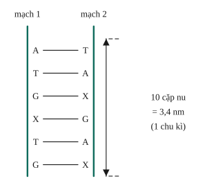
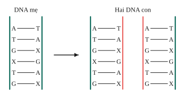
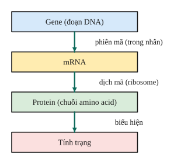

# Chủ đề 4. DNA, RNA, protein và mã di truyền

> **Level Cơ bản** (mục I, các bài gắn nhãn *Cơ bản*) bám sát SGK KHTN 9. **Level Nâng cao** (mục II, các bài gắn nhãn *Nâng cao*) dành cho ôn thi học sinh giỏi và thi vào lớp 10 chuyên Sinh.
>
> Kí hiệu: $N$ là tổng số nucleotide của gene (DNA); A, T, G, X (hoặc C) là các loại nucleotide; $L$ là chiều dài; 1 nm = 10 Å.

## I. Kiến thức cơ bản

### 1. Cấu trúc DNA
- DNA (deoxyribonucleic acid) là đại phân tử cấu tạo theo nguyên tắc **đa phân**, đơn phân là **nucleotide**, gồm 4 loại: A (adenine), T (thymine), G (guanine), X (cytosine).
- **Mô hình Watson – Crick (1953):** DNA là **chuỗi xoắn kép** gồm hai mạch song song, xoắn đều quanh một trục. Các nucleotide giữa hai mạch liên kết theo **nguyên tắc bổ sung**: **A với T** (2 liên kết hydrogen), **G với X** (3 liên kết hydrogen).
- Mỗi chu kì xoắn dài **3,4 nm** gồm **10 cặp nucleotide**; đường kính vòng xoắn 2 nm. Mỗi nucleotide dài 0,34 nm (3,4 Å).
- **Hệ quả của nguyên tắc bổ sung:** biết trình tự một mạch thì suy ra trình tự mạch kia; trong DNA, $A = T$, $G = X$, nên $A + G = T + X = \frac N2$.
- DNA có tính **đa dạng và đặc thù** nhờ số lượng, thành phần và trình tự sắp xếp các nucleotide.

### 2. Nhân đôi DNA
- Diễn ra ở kì trung gian, trong nhân tế bào. Hai mạch DNA tách nhau; mỗi mạch làm **khuôn** để tổng hợp mạch mới theo **nguyên tắc bổ sung** (A–T, G–X).
- Kết quả: từ 1 DNA mẹ tạo **2 DNA con giống hệt nhau và giống mẹ**. Mỗi DNA con gồm một mạch cũ và một mạch mới (**nguyên tắc bán bảo toàn**).
- Ý nghĩa: là cơ sở của sự nhân đôi NST, giúp thông tin di truyền được truyền đạt chính xác qua các thế hệ tế bào.

### 3. Gene
**Gene** là một đoạn DNA mang thông tin quy định cấu trúc của một sản phẩm (protein hoặc RNA). Mỗi DNA chứa rất nhiều gene.

### 4. RNA và phiên mã
- RNA là đại phân tử gồm **một mạch**, đơn phân là 4 loại nucleotide: A, **U** (uracil, thay cho T), G, X.
- Ba loại RNA: **mRNA** (truyền đạt thông tin từ gene tới nơi tổng hợp protein), **tRNA** (vận chuyển amino acid), **rRNA** (thành phần của ribosome).
- **Phiên mã** (tổng hợp RNA): diễn ra trong nhân, dựa trên **một mạch** của gene làm khuôn, theo nguyên tắc bổ sung: A của mạch khuôn với U, T với A, G với X, X với G. Trình tự mRNA giống mạch không làm khuôn (chỉ thay T bằng U).

### 5. Protein, mã di truyền và dịch mã
- **Protein** là đại phân tử có đơn phân là **amino acid** (khoảng 20 loại). Protein có nhiều chức năng: cấu trúc, enzyme, hormone, kháng thể, vận chuyển, ...
- **Mã di truyền** là **mã bộ ba**: cứ 3 nucleotide liên tiếp trên mRNA (một **codon**) mã hóa một amino acid. Có 64 bộ ba, trong đó có bộ ba **mở đầu** (AUG) và các bộ ba **kết thúc** (không mã hóa amino acid).
- **Dịch mã** diễn ra ở tế bào chất, tại ribosome: tRNA mang amino acid tới, bộ ba đối mã của tRNA khớp bổ sung với codon trên mRNA; ribosome dịch chuyển từng bộ ba, các amino acid nối với nhau thành chuỗi.
- **Mối quan hệ:** gene (DNA) → mRNA → protein → tính trạng. Trình tự nucleotide của gene quy định trình tự amino acid của protein, protein biểu hiện thành tính trạng.

---

## II. Kiến thức nâng cao

### 1. Công thức về cấu trúc gene
- Tổng số nucleotide: $N = 2A + 2G$; $\ \%A + \%G = 50\%$.
- Chiều dài: $L = \frac N2\cdot3{,}4$ Å.
- Số chu kì xoắn: $C = \frac{N}{20}$.
- Khối lượng: $M = 300\cdot N$ (đvC), coi mỗi nucleotide nặng 300 đvC.
- Số liên kết hydrogen: $H = 2A + 3G$.
- Số liên kết phosphodiester (liên kết cộng hóa trị giữa các nucleotide): $2\left(\frac N2 - 1\right) = N - 2$.

### 2. Quan hệ giữa hai mạch của gene
$A_1 = T_2$, $T_1 = A_2$, $G_1 = X_2$, $X_1 = G_2$. Suy ra $A = A_1 + A_2 = A_1 + T_1$, $G = G_1 + X_1$.

### 3. Nhân đôi $k$ lần
- Số DNA con: $2^k$.
- Số nucleotide môi trường cung cấp: $N(2^k - 1)$; mỗi loại: $A_{mt} = T_{mt} = A(2^k - 1)$, $G_{mt} = X_{mt} = G(2^k - 1)$.

### 4. Phiên mã và dịch mã
- mRNA tổng hợp từ mạch khuôn 1: $U_{m} = A_1$, $A_{m} = T_1$, $G_{m} = X_1$, $X_{m} = G_1$. Số nucleotide của mRNA: $\frac N2$.
- Số bộ ba của mRNA: $\frac{N}{6}$. Số amino acid trong **chuỗi polypeptide** được tổng hợp (bộ ba kết thúc không mã hóa): $\frac N6 - 1$; trong **protein hoàn chỉnh** (đã cắt bỏ amino acid mở đầu): $\frac N6 - 2$.
- Mỗi ribosome trượt qua mRNA một lần tổng hợp một chuỗi polypeptide.

---

## III. Bài tập

**Bài 1 (Cơ bản).** Một đoạn mạch 1 của gene có trình tự: –A–T–G–X–T–T–A–G–X–. Viết trình tự mạch 2 của đoạn gene đó và trình tự mRNA được phiên mã nếu mạch 2 làm khuôn.

**Bài 2 (Cơ bản).** Một gene có 3000 nucleotide. Tính chiều dài (Å) và số chu kì xoắn của gene.

**Bài 3 (Cơ bản).** Một gene có 600 nucleotide loại A và 900 nucleotide loại G. Tính tổng số nucleotide và số liên kết hydrogen của gene.

**Bài 4 (Cơ bản).** Trong một gene, nucleotide loại A chiếm 20%. Tính tỉ lệ phần trăm các loại nucleotide còn lại.

**Bài 5 (Cơ bản).** Trình bày nguyên tắc nhân đôi DNA. Vì sao hai DNA con giống hệt DNA mẹ?

**Bài 6 (Cơ bản).** Một phân tử mRNA có 1500 nucleotide. Tính số bộ ba, số amino acid trong chuỗi polypeptide được tổng hợp và trong protein hoàn chỉnh.

**Bài 7 (Nâng cao, cấu trúc gene).** Một gene dài 4080 Å, có A = 20% tổng số nucleotide. Tính số nucleotide mỗi loại và số liên kết hydrogen của gene.

**Bài 8 (Nâng cao, nhân đôi).** Gene ở Bài 7 nhân đôi liên tiếp 3 lần. Tính số nucleotide mỗi loại môi trường cung cấp.

**Bài 9 (Nâng cao, tìm số nucleotide).** Một gene có 3900 liên kết hydrogen và số nucleotide loại G bằng 1,5 lần số nucleotide loại A. Tính số nucleotide mỗi loại và chiều dài của gene.

**Bài 10 (Nâng cao, hai mạch và mRNA).** Mạch 1 của một gene có A₁ = 200, T₁ = 300, G₁ = 400, X₁ = 600. a) Tính số nucleotide mỗi loại của gene. b) Gene phiên mã lấy mạch 1 làm khuôn; tính số nucleotide mỗi loại của mRNA.

**Bài 11 (Nâng cao, dịch mã).** Một gene có 3000 nucleotide phiên mã 2 lần; mỗi mRNA có 5 ribosome trượt qua một lần. Tính số chuỗi polypeptide được tổng hợp và tổng số amino acid môi trường cung cấp.

**Bài 12 (Nâng cao, khối lượng và liên kết).** Một gene có 3000 nucleotide. Tính khối lượng của gene và số liên kết phosphodiester giữa các nucleotide trong gene.

---

## IV. Lời giải chi tiết

### Bài 1
Mạch 1: –A–T–G–X–T–T–A–G–X–
Mạch 2: –T–A–X–G–A–A–T–X–G–
mRNA (khuôn là mạch 2): –A–U–G–X–U–U–A–G–X– (giống mạch 1, thay T bằng U).

### Bài 2
$L = \frac{3000}{2}\cdot3{,}4 = 5100$ Å; $\ C = \frac{3000}{20} = 150$ chu kì.

### Bài 3
$N = 2\cdot600 + 2\cdot900 = 3000$; $\ H = 2\cdot600 + 3\cdot900 = 3900$.

### Bài 4
$\%T = \%A = 20\%$; $\%G = \%X = 50\% - 20\% = 30\%$.

### Bài 5
Hai mạch tách nhau, mỗi mạch làm khuôn tổng hợp mạch mới theo **nguyên tắc bổ sung**, và mỗi DNA con giữ lại một mạch của mẹ (**bán bảo toàn**). Vì các nucleotide được lắp đúng theo khuôn nên hai DNA con có trình tự giống hệt DNA mẹ.

### Bài 6
Số bộ ba: $\frac{1500}{3} = 500$. Chuỗi polypeptide: $500 - 1 = 499$ amino acid (bộ ba kết thúc không mã hóa). Protein hoàn chỉnh: $499 - 1 = 498$ amino acid (bỏ amino acid mở đầu).

### Bài 7
$N = \frac{2L}{3{,}4} = \frac{2\cdot4080}{3{,}4} = 2400$.
$A = T = 20\%\cdot2400 = 480$; $G = X = 30\%\cdot2400 = 720$.
$H = 2\cdot480 + 3\cdot720 = 3120$.

### Bài 8
$A_{mt} = T_{mt} = 480\cdot(2^3 - 1) = 3360$; $G_{mt} = X_{mt} = 720\cdot7 = 5040$. (Tổng $2400\cdot7 = 16\,800$.)

### Bài 9
$2A + 3G = 3900$ với $G = 1{,}5A$: $2A + 4{,}5A = 3900$, nên $A = T = 600$, $G = X = 900$.
$N = 3000$, $L = 1500\cdot3{,}4 = 5100$ Å.

### Bài 10
**a)** $A = T = A_1 + T_1 = 500$; $G = X = G_1 + X_1 = 1000$.
**b)** Khuôn là mạch 1: $U_m = A_1 = 200$, $A_m = T_1 = 300$, $X_m = G_1 = 400$, $G_m = X_1 = 600$.

### Bài 11
Số chuỗi polypeptide: $2\cdot5 = 10$. Mỗi mRNA có $\frac{3000}{2} = 1500$ nucleotide, 500 bộ ba, mỗi chuỗi có $499$ amino acid.
Tổng amino acid môi trường cung cấp: $10\cdot499 = 4990$.

### Bài 12
$M = 300\cdot3000 = 900\,000$ đvC. Số liên kết phosphodiester: $N - 2 = 2998$.
