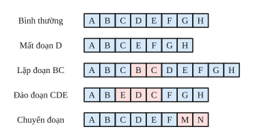
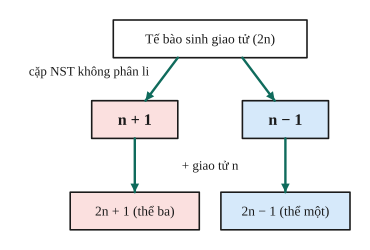
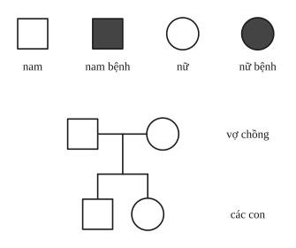
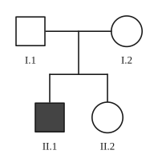
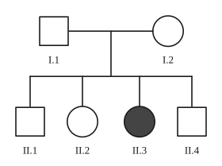

# Chủ đề 5. Đột biến và di truyền học người

> **Level Cơ bản** (mục I, các bài gắn nhãn *Cơ bản*) bám sát SGK KHTN 9. **Level Nâng cao** (mục II, các bài gắn nhãn *Nâng cao*) dành cho ôn thi học sinh giỏi và thi vào lớp 10 chuyên Sinh.

## I. Kiến thức cơ bản

### 1. Đột biến gene
- **Đột biến gene** là những biến đổi trong cấu trúc của gene, thường liên quan tới **một hoặc một số cặp nucleotide**. Các dạng: **mất**, **thêm**, **thay thế** một cặp nucleotide.
- **Nguyên nhân:** tác nhân vật lí (tia phóng xạ, tia UV), hóa học (hóa chất độc), sinh học (virus), hoặc rối loạn trong quá trình nhân đôi DNA.
- **Hậu quả:** làm biến đổi mRNA, có thể làm thay đổi protein và tính trạng. Đa số đột biến gene **có hại** (phá vỡ sự hài hòa đã qua chọn lọc lâu dài), một số trung tính, một số ít có lợi. Đột biến là nguồn nguyên liệu cho chọn giống và tiến hóa.

### 2. Đột biến cấu trúc NST
Biến đổi trong cấu trúc NST: **mất đoạn**, **lặp đoạn**, **đảo đoạn**, **chuyển đoạn**. Thường có hại (mất đoạn NST số 21 ở người gây ung thư máu), một số dạng có ý nghĩa trong chọn giống (lặp đoạn làm tăng hoạt tính enzyme amylase ở lúa mạch).

### 3. Đột biến số lượng NST
- **Thể dị bội (lệch bội):** một hoặc một số cặp NST bị thay đổi số lượng: **thể ba** ($2n + 1$), **thể một** ($2n - 1$). Nguyên nhân: một cặp NST **không phân li** trong giảm phân, tạo giao tử $n + 1$ và $n - 1$.
- **Thể đa bội:** bộ NST là bội số của $n$ lớn hơn $2n$ ($3n$, $4n$, ...). Do toàn bộ NST không phân li. Thể đa bội ở thực vật có tế bào to, cơ quan sinh dưỡng lớn, sinh trưởng mạnh, chống chịu tốt (dưa hấu tam bội không hạt, nho tứ bội).

### 4. Thường biến
- **Thường biến** là những biến đổi kiểu hình của cùng một kiểu gene do ảnh hưởng của môi trường, **không di truyền**, biến đổi đồng loạt theo một hướng (cây rau mác có lá hình bản dài khi ở dưới nước, hình mũi mác khi ở trên cạn).
- **Mức phản ứng** là giới hạn thường biến của một kiểu gene, **do kiểu gene quy định** nên di truyền được. Năng suất là kết quả tác động của giống (kiểu gene) và kĩ thuật sản xuất (môi trường).

| | Thường biến | Đột biến |
|---|---|---|
| Vật chất di truyền | Không biến đổi | Biến đổi |
| Di truyền | Không | Có |
| Hướng biến đổi | Đồng loạt, xác định | Riêng lẻ, không xác định |
| Ý nghĩa | Giúp sinh vật thích nghi | Nguyên liệu cho chọn giống, tiến hóa |

### 5. Phương pháp nghiên cứu di truyền người
- **Phả hệ:** theo dõi sự di truyền một tính trạng qua nhiều thế hệ của một dòng họ để xác định tính trạng trội hay lặn, do gene trên NST thường hay NST giới tính. Kí hiệu: ô vuông là nam, hình tròn là nữ, tô đen là người mang tính trạng (bệnh).
- **Trẻ đồng sinh:** đồng sinh cùng trứng có cùng kiểu gene (cùng giới); đồng sinh khác trứng có kiểu gene khác nhau. So sánh giúp phân biệt vai trò của kiểu gene và môi trường.

### 6. Bệnh và tật di truyền ở người
- **Bệnh Down:** có **3 NST số 21** (thể ba): bé, lùn, cổ rụt, má phệ, khe mắt xếch, si đần, không có con.
- **Bệnh Turner:** nữ chỉ có **một NST giới tính X** (XO): lùn, tuyến vú không phát triển, thường mất trí và không có con.
- **Bệnh Klinefelter:** nam có **XXY**.
- **Bệnh bạch tạng** (gene lặn trên NST thường), **bệnh máu khó đông, bệnh mù màu đỏ – lục** (gene lặn trên NST X, gặp ở nam nhiều hơn nữ).
- Phòng tránh: hạn chế tác nhân gây đột biến (chất phóng xạ, hóa chất, thuốc diệt cỏ), **tư vấn di truyền**, không kết hôn gần (trong vòng ba đời), không sinh con khi tuổi cao (nguy cơ con bị Down tăng).

---

## II. Kiến thức nâng cao

### 1. Đột biến gene làm thay đổi số liên kết hydrogen và chiều dài
| Dạng đột biến (một cặp) | Chiều dài | Liên kết hydrogen |
|---|---|---|
| Mất cặp A – T | giảm 3,4 Å | giảm 2 |
| Mất cặp G – X | giảm 3,4 Å | giảm 3 |
| Thêm cặp A – T / G – X | tăng 3,4 Å | tăng 2 / 3 |
| Thay A – T bằng G – X | không đổi | tăng 1 |
| Thay G – X bằng A – T | không đổi | giảm 1 |

### 2. Số lượng NST của các thể đột biến
Với loài $2n$: thể ba $2n + 1$, thể một $2n - 1$, thể bốn $2n + 2$, tam bội $3n$, tứ bội $4n$. Số loại thể ba (hoặc thể một) khác nhau tối đa bằng $n$ (mỗi cặp có thể bị đột biến).

### 3. Phân tích phả hệ
1. **Trội hay lặn?** Bố mẹ đều bình thường sinh con bệnh thì bệnh do **gene lặn**. Bố mẹ đều bệnh sinh con bình thường thì bệnh do gene trội.
2. **NST thường hay NST X?** Với bệnh lặn: nếu có **con gái bệnh mà bố bình thường** thì gene nằm trên **NST thường** (nếu trên X, con gái bệnh $X^aX^a$ phải nhận $X^a$ từ bố, bố sẽ bị bệnh). Bệnh lặn trên X có đặc điểm: nam mắc nhiều hơn nữ, bố bệnh truyền gene cho con gái, mẹ mang gene truyền cho con trai.
3. **Xác suất:** người bình thường có bố mẹ dị hợp (Aa × Aa) có kiểu gene $\frac13AA : \frac23Aa$.

### 4. Di truyền liên kết với giới tính
Gene trên NST X không có alen trên Y: nam $X^AY$ hoặc $X^aY$ (chỉ cần một allele lặn là biểu hiện bệnh); nữ cần hai allele lặn $X^aX^a$ mới bệnh. Viết sơ đồ lai kèm NST giới tính.

---

## III. Bài tập

**Bài 1 (Cơ bản).** Một gene bị đột biến làm số liên kết hydrogen tăng 1 nhưng chiều dài không đổi. Đây là dạng đột biến gene nào?

**Bài 2 (Cơ bản).** Cà chua có $2n = 24$. Tính số NST trong tế bào sinh dưỡng của thể ba, thể một, thể tam bội, thể tứ bội.

**Bài 3 (Cơ bản).** Bệnh Down là dạng đột biến nào? Nêu các đặc điểm nhận biết bệnh nhân Down.

**Bài 4 (Cơ bản).** Bệnh máu khó đông do gene lặn h trên NST X quy định. Mẹ bình thường mang gene bệnh ($X^HX^h$), bố bình thường. Tính xác suất họ sinh con trai bị bệnh, con gái bị bệnh.

**Bài 5 (Cơ bản).** Phân biệt thường biến và đột biến.

**Bài 6 (Cơ bản).** Quan sát sơ đồ phả hệ dưới đây về một bệnh ở người. Bệnh do gene trội hay gene lặn quy định? Giải thích.

**Bài 7 (Nâng cao, đột biến gene).** Một gene có 3000 nucleotide và 3900 liên kết hydrogen. Tính số liên kết hydrogen và chiều dài của gene sau đột biến nếu: a) thay một cặp A – T bằng một cặp G – X; b) mất một cặp G – X.

**Bài 8 (Nâng cao, cơ chế XXY).** Một người nam mắc hội chứng Klinefelter (XXY). Giải thích các cơ chế có thể dẫn đến hội chứng này (xét sự không phân li NST giới tính ở bố hoặc ở mẹ).

**Bài 9 (Nâng cao, phả hệ và xác suất).** Cho phả hệ dưới đây về bệnh P ở người (người II.3 là con gái bị bệnh của cặp vợ chồng I.1 và I.2 bình thường).
a) Bệnh do gene trội hay lặn, nằm trên NST thường hay NST X? Giải thích.
b) Người II.4 (bình thường) lấy một người vợ bình thường có kiểu gene dị hợp. Tính xác suất cặp vợ chồng này sinh đứa con đầu lòng bị bệnh.

**Bài 10 (Nâng cao, mù màu).** Bệnh mù màu đỏ – lục do gene lặn trên NST X. Một người đàn ông mù màu lấy vợ bình thường không mang gene bệnh, sinh được một con gái. Con gái này lớn lên lấy chồng bình thường. Tính xác suất cặp vợ chồng sau sinh con trai bị mù màu (trong số con trai) và xác suất sinh con bị mù màu (trong tổng số con).

**Bài 11 (Nâng cao, số thể đột biến).** Một loài có $2n = 24$. a) Có tối đa bao nhiêu loại thể ba khác nhau? b) Một tế bào thể tứ bội của loài này đang ở kì giữa nguyên phân có bao nhiêu NST, ở trạng thái nào?

**Bài 12 (Nâng cao, tam bội).** Vì sao thể tam bội (ví dụ dưa hấu 3n) thường không có hạt? Người ta tạo dưa hấu tam bội bằng cách nào?

---

## IV. Lời giải chi tiết

### Bài 1
Chiều dài không đổi nên số nucleotide không đổi: đột biến **thay thế**. Liên kết hydrogen tăng 1: **thay một cặp A – T bằng một cặp G – X**.

### Bài 2
$n = 12$: thể ba $25$; thể một $23$; tam bội $36$; tứ bội $48$.

### Bài 3
Đột biến **số lượng NST dạng thể ba** ở cặp NST số 21 (3 NST số 21). Đặc điểm: bé, lùn, cổ rụt, má phệ, miệng hơi há, lưỡi hơi thè, mắt hơi sâu và một mí, khoảng cách hai mắt xa, ngón tay ngắn, si đần bẩm sinh, không có con.

### Bài 4
$X^HX^h \times X^HY \to X^HX^H : X^HX^h : X^HY : X^hY$ (mỗi loại $\frac14$).
- Con trai bị bệnh ($X^hY$): $\frac14$ trong tổng số con, tức $\frac12$ trong số con trai.
- Con gái bị bệnh: $0$ (con gái luôn nhận $X^H$ từ bố).

### Bài 5
Xem bảng so sánh ở mục I.4.

### Bài 6
Trong phả hệ, bố mẹ đều bình thường nhưng sinh con bị bệnh, nên con nhận allele gây bệnh từ cả bố và mẹ mà bố mẹ không biểu hiện: bệnh do **gene lặn** quy định.

### Bài 7
Gene ban đầu: $N = 3000$, $L = 5100$ Å, $H = 3900$.
**a)** Thay A – T bằng G – X: $H = 3901$; $L = 5100$ Å (không đổi).
**b)** Mất một cặp G – X: $H = 3897$; $L = 5100 - 3{,}4 = 5096{,}6$ Å.

### Bài 8
Hợp tử XXY có thể tạo thành theo hai cách:
- **Do mẹ:** cặp XX không phân li trong giảm phân của mẹ, tạo trứng XX; trứng XX thụ tinh với tinh trùng Y.
- **Do bố:** cặp XY không phân li trong giảm phân I của bố, tạo tinh trùng XY; tinh trùng XY thụ tinh với trứng X.

### Bài 9
**a)** I.1 và I.2 bình thường sinh con gái II.3 bị bệnh, nên bệnh do **gene lặn** (a). Con gái bệnh ($aa$) mà bố I.1 bình thường: nếu gene nằm trên X thì con gái $X^aX^a$ phải nhận $X^a$ từ bố và bố sẽ bị bệnh, mâu thuẫn. Vậy gene nằm trên **NST thường**.

**b)** I.1, I.2 đều là $Aa$. II.4 bình thường nên có kiểu gene $\frac13AA$ hoặc $\frac23Aa$. Vợ là $Aa$.
Con bị bệnh chỉ khi II.4 là $Aa$ và con nhận $a$ từ cả hai: $P = \frac23\cdot\frac14 = \frac16$.

### Bài 10
Bố $X^aY$, mẹ $X^AX^A$, con gái chắc chắn là $X^AX^a$. Con gái lấy chồng bình thường $X^AY$:
$X^AX^a \times X^AY \to X^AX^A : X^AX^a : X^AY : X^aY$.
- Trong số con trai: xác suất mù màu $\frac12$.
- Trong tổng số con: $\frac14$.

### Bài 11
**a)** $n = 12$: tối đa **12** loại thể ba (mỗi cặp NST có thể có thêm một chiếc).
**b)** Tứ bội $4n = 48$; ở kì giữa nguyên phân có **48 NST kép**.

### Bài 12
Ở thể tam bội, mỗi nhóm có 3 NST tương đồng, khi giảm phân không chia đều được về hai cực, nên tạo giao tử mất cân bằng, hầu như không có khả năng thụ tinh: quả không có hạt (bất thụ).
Tạo dưa hấu tam bội: dùng colchicine tạo cây tứ bội ($4n$), cho lai với cây lưỡng bội ($2n$): giao tử $2n$ kết hợp với giao tử $n$ tạo hợp tử $3n$.
