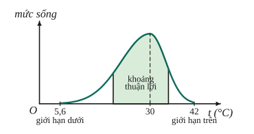
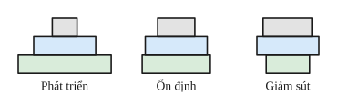
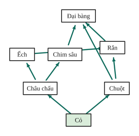
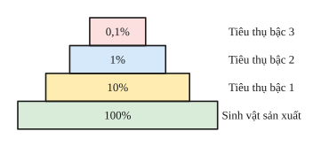

# Chủ đề 6. Sinh thái học và tiến hóa

> **Level Cơ bản** (mục I, các bài gắn nhãn *Cơ bản*) bám sát SGK KHTN 8 – 9. **Level Nâng cao** (mục II, các bài gắn nhãn *Nâng cao*) dành cho ôn thi học sinh giỏi và thi vào lớp 10 chuyên Sinh.

## I. Kiến thức cơ bản

### 1. Môi trường và nhân tố sinh thái
- **Môi trường sống** là nơi sinh sống của sinh vật: môi trường nước, trên cạn, trong đất, sinh vật.
- **Nhân tố sinh thái:** nhân tố **vô sinh** (ánh sáng, nhiệt độ, độ ẩm, đất, ...), nhân tố **hữu sinh** (các sinh vật khác, trong đó có con người).
- **Giới hạn sinh thái:** giới hạn chịu đựng của sinh vật đối với một nhân tố sinh thái, gồm giới hạn dưới, giới hạn trên và **khoảng thuận lợi** (sinh vật phát triển tốt nhất). Ví dụ cá rô phi ở Việt Nam sống được từ 5,6 °C đến 42 °C, thuận lợi nhất khoảng 30 °C.

### 2. Quan hệ giữa các sinh vật
- **Cùng loài:** hỗ trợ (sống thành bầy đàn) và cạnh tranh (khi thiếu thức ăn, nơi ở).
- **Khác loài:**
  - **Hỗ trợ:** cộng sinh (cả hai cùng có lợi, bắt buộc: nấm và tảo trong địa y), hội sinh (một bên có lợi, bên kia không lợi không hại: cá ép bám rùa biển), hợp tác (cùng có lợi, không bắt buộc).
  - **Đối địch:** cạnh tranh (lúa và cỏ dại), kí sinh (giun đũa trong ruột người), sinh vật ăn sinh vật khác (hổ ăn thịt hươu), ức chế cảm nhiễm (tảo giáp nở hoa gây độc cho sinh vật xung quanh).

### 3. Quần thể sinh vật
- **Quần thể** là tập hợp các cá thể **cùng loài**, sống trong một khoảng không gian xác định, ở một thời điểm nhất định, có khả năng sinh sản tạo thế hệ mới.
- Đặc trưng: **tỉ lệ giới tính**, **thành phần nhóm tuổi** (trước sinh sản, sinh sản, sau sinh sản), **mật độ** (số cá thể trên một đơn vị diện tích hoặc thể tích).
- **Tháp tuổi** có ba dạng: **phát triển** (đáy rộng), **ổn định** (đáy vừa), **giảm sút** (đáy hẹp).

### 4. Quần xã và hệ sinh thái
- **Quần xã** là tập hợp nhiều quần thể **khác loài** cùng sống trong một không gian, có quan hệ gắn bó với nhau. Đặc trưng: độ đa dạng (số loài), loài ưu thế, loài đặc trưng.
- **Hệ sinh thái** gồm quần xã và môi trường sống (sinh cảnh). Thành phần: sinh vật sản xuất (cây xanh), sinh vật tiêu thụ (động vật), sinh vật phân giải (vi khuẩn, nấm) và các chất vô sinh.
- **Chuỗi thức ăn:** dãy các loài có quan hệ dinh dưỡng, loài đứng trước là thức ăn của loài đứng sau. **Lưới thức ăn:** nhiều chuỗi thức ăn có chung mắt xích.

### 5. Dòng năng lượng và tháp sinh thái
- Năng lượng đi qua hệ sinh thái theo **một chiều**: từ Mặt Trời → sinh vật sản xuất → các bậc tiêu thụ, và bị mất dần qua mỗi bậc (hô hấp, chất thải). Trung bình chỉ khoảng **10%** năng lượng được chuyển lên bậc dinh dưỡng kế tiếp.
- Vật chất được trao đổi theo **chu trình** (chu trình carbon, chu trình nước) nhờ sinh vật phân giải trả lại chất vô cơ cho môi trường.

### 6. Con người và môi trường
Ô nhiễm môi trường (khí thải, hóa chất, rác thải nhựa, chất phóng xạ), phá rừng, săn bắt quá mức làm suy giảm đa dạng sinh học. Biện pháp: sử dụng hợp lí tài nguyên, trồng rừng, xử lí rác thải, bảo vệ các loài, phát triển năng lượng sạch.

### 7. Tiến hóa
- **Bằng chứng tiến hóa:** hóa thạch; giải phẫu so sánh (cơ quan tương đồng như chi trước của người, cánh dơi, vây cá voi); tế bào học và sinh học phân tử (mọi sinh vật có cấu tạo tế bào, dùng chung mã di truyền).
- **Học thuyết Darwin:** trong mỗi loài luôn xuất hiện **biến dị cá thể** di truyền được; sinh vật sinh ra nhiều hơn số lượng có thể sống sót; qua **chọn lọc tự nhiên**, những cá thể mang biến dị có lợi sống sót và sinh sản nhiều hơn, tích lũy dần qua các thế hệ, hình thành đặc điểm thích nghi và loài mới.
- **Sự phát sinh sự sống và loài người:** sự sống bắt nguồn từ các chất vô cơ qua quá trình tiến hóa hóa học và tiến hóa sinh học; loài người hiện đại (Homo sapiens) tiến hóa từ các dạng vượn người hóa thạch.

---

## II. Kiến thức nâng cao

### 1. Hiệu suất sinh thái
$$H = \frac{\text{năng lượng ở bậc } n + 1}{\text{năng lượng ở bậc } n}\cdot100\%.$$
Vì năng lượng giảm mạnh qua mỗi bậc (khoảng 90% bị mất), chuỗi thức ăn thường **không quá 5 – 6 mắt xích**.

### 2. Ước lượng kích thước quần thể (đánh dấu – bắt lại)
Lần 1 bắt $M$ cá thể, đánh dấu rồi thả. Lần 2 bắt $C$ cá thể, trong đó có $R$ cá thể đã đánh dấu. Coi tỉ lệ cá thể đánh dấu trong mẫu lần 2 bằng tỉ lệ trong cả quần thể:
$$\frac{R}{C} = \frac{M}{N} \implies N = \frac{M\cdot C}{R}.$$

### 3. Biến động số lượng cá thể
Kích thước sau một thời gian: $N_1 = N_0 + B - D + I - E$ (sinh, tử, nhập cư, xuất cư). Tính theo tỉ lệ phần trăm so với $N_0$.

### 4. Phân tích lưới thức ăn
- Xác định bậc dinh dưỡng của từng loài (một loài có thể thuộc nhiều bậc).
- Khi một loài bị loại bỏ: con mồi của nó tăng (ít bị ăn), các loài cạnh tranh hoặc vật ăn thịt nó có thể thay đổi theo.

### 5. Giải thích sự thích nghi theo Darwin
Lập luận theo ba bước: **biến dị có sẵn** trong quần thể (không phải do môi trường gây ra theo hướng có lợi), **chọn lọc tự nhiên** giữ lại cá thể thích nghi, **tích lũy** qua nhiều thế hệ. Ví dụ sâu kháng thuốc trừ sâu: thuốc không tạo ra đột biến kháng thuốc mà chỉ chọn lọc những cá thể vốn đã mang gene kháng.

---

## III. Bài tập

**Bài 1 (Cơ bản).** Dựa vào lưới thức ăn ở mục I.4, hãy kể tên các chuỗi thức ăn và cho biết sinh vật sản xuất, sinh vật tiêu thụ bậc 1, bậc 2, bậc 3.

**Bài 2 (Cơ bản).** Nêu đặc điểm ba dạng tháp tuổi. Quần thể có nhóm tuổi trước sinh sản chiếm tỉ lệ rất lớn sẽ có xu hướng biến động thế nào?

**Bài 3 (Cơ bản).** Cá rô phi có giới hạn nhiệt độ từ 5,6 °C đến 42 °C, cá chép từ 2 °C đến 44 °C. Loài nào có vùng phân bố rộng hơn? Giải thích.

**Bài 4 (Cơ bản).** Xác định mối quan hệ sinh thái trong các ví dụ: a) vi khuẩn sống trong nốt sần rễ cây họ Đậu; b) dây tơ hồng sống trên cây khác; c) cá ép bám vào rùa biển; d) lúa và cỏ dại trên cùng một ruộng; e) mèo bắt chuột.

**Bài 5 (Cơ bản).** Trong một chuỗi thức ăn, sinh vật sản xuất tích lũy $10^6$ kcal. Theo quy luật 10%, sinh vật tiêu thụ bậc 3 nhận được khoảng bao nhiêu năng lượng?

**Bài 6 (Cơ bản).** Trình bày nội dung chính của học thuyết chọn lọc tự nhiên của Darwin.

**Bài 7 (Nâng cao, hiệu suất sinh thái).** Trong một hệ sinh thái, năng lượng tích lũy ở sinh vật sản xuất là $2{,}1\cdot10^6$ kcal, ở sinh vật tiêu thụ bậc 1 là $1{,}2\cdot10^5$ kcal, bậc 2 là $1{,}1\cdot10^4$ kcal, bậc 3 là $5\cdot10^2$ kcal. Tính hiệu suất sinh thái giữa các bậc dinh dưỡng liên tiếp.

**Bài 8 (Nâng cao, đánh dấu bắt lại).** Để ước lượng số cá trong một hồ, người ta bắt 60 con, đánh dấu rồi thả lại. Một tuần sau bắt 80 con, thấy có 15 con được đánh dấu. Ước lượng số cá trong hồ. Phương pháp này cần những giả thiết nào?

**Bài 9 (Nâng cao, biến động quần thể).** Một quần thể có 1000 cá thể. Trong một năm, tỉ lệ sinh là 12%, tỉ lệ tử là 8%, tỉ lệ xuất cư 2%, nhập cư 1%. Tính số cá thể của quần thể sau một năm.

**Bài 10 (Nâng cao, lưới thức ăn).** Trong lưới thức ăn ở mục I.4, nếu loài rắn bị săn bắt hết thì số lượng các loài khác có thể thay đổi thế nào? Giải thích.

**Bài 11 (Nâng cao, tháp năng lượng).** Vì sao chuỗi thức ăn trong tự nhiên thường không dài quá 5 – 6 mắt xích? Vì sao nói "ăn thực vật tiết kiệm năng lượng hơn ăn thịt"?

**Bài 12 (Nâng cao, chọn lọc tự nhiên).** Khi dùng một loại thuốc trừ sâu liên tục nhiều năm, hiệu quả diệt sâu giảm dần. Giải thích hiện tượng này theo quan điểm của Darwin. Nêu biện pháp khắc phục.

---

## IV. Lời giải chi tiết

### Bài 1
Các chuỗi thức ăn trong lưới (theo hình):
- Cỏ → Châu chấu → Ếch → Rắn → Đại bàng.
- Cỏ → Châu chấu → Chim sâu → Đại bàng.
- Cỏ → Chuột → Rắn → Đại bàng.
- Cỏ → Chuột → Đại bàng.

Sinh vật sản xuất: cỏ. Tiêu thụ bậc 1: châu chấu, chuột. Bậc 2: ếch, chim sâu, rắn (trong chuỗi cỏ → chuột → rắn), đại bàng (trong chuỗi cỏ → chuột → đại bàng). Bậc 3: rắn (trong chuỗi qua ếch), đại bàng. Một loài có thể thuộc nhiều bậc dinh dưỡng.

### Bài 2
- **Phát triển:** đáy rộng (nhóm trước sinh sản đông), số lượng cá thể tăng mạnh.
- **Ổn định:** đáy vừa phải, số lượng ổn định.
- **Giảm sút:** đáy hẹp (ít cá thể non), số lượng giảm dần.

Nhóm trước sinh sản chiếm tỉ lệ lớn: tháp phát triển, quần thể có xu hướng **tăng** số lượng.

### Bài 3
Cá chép có giới hạn nhiệt độ rộng hơn (42 °C so với 36,4 °C), nên chịu được nhiều điều kiện môi trường hơn và có **vùng phân bố rộng hơn**.

### Bài 4
a) Cộng sinh. b) Kí sinh (thực vật kí sinh). c) Hội sinh. d) Cạnh tranh. e) Sinh vật ăn sinh vật khác.

### Bài 5
Tiêu thụ bậc 1: $10^5$; bậc 2: $10^4$; bậc 3: khoảng $10^3$ kcal.

### Bài 6
Xem mục I.7: biến dị cá thể di truyền được, sinh sản vượt mức, đấu tranh sinh tồn, chọn lọc tự nhiên giữ lại cá thể mang biến dị có lợi, tích lũy qua nhiều thế hệ hình thành đặc điểm thích nghi và loài mới.

### Bài 7
- Bậc 2 / bậc 1: $\frac{1{,}2\cdot10^5}{2{,}1\cdot10^6} \approx 5{,}7\%$.
- Bậc 3 / bậc 2: $\frac{1{,}1\cdot10^4}{1{,}2\cdot10^5} \approx 9{,}2\%$.
- Bậc 4 / bậc 3: $\frac{5\cdot10^2}{1{,}1\cdot10^4} \approx 4{,}5\%$.

### Bài 8
$N = \frac{60\cdot80}{15} = 320$ con.
Giả thiết: các cá thể đánh dấu hòa trộn đều trong quần thể; việc đánh dấu không ảnh hưởng tới khả năng sống và bị bắt; không có sinh, tử, nhập cư, xuất cư đáng kể giữa hai lần bắt.

### Bài 9
$N_1 = 1000\cdot(1 + 0{,}12 - 0{,}08 - 0{,}02 + 0{,}01) = 1000\cdot1{,}03 = 1030$ cá thể.

### Bài 10
- Rắn mất: ếch và chuột (con mồi của rắn) có thể **tăng** trong thời gian đầu.
- Ếch, chuột tăng thì châu chấu và cỏ có thể **giảm**.
- Đại bàng mất một nguồn thức ăn (rắn) nhưng có thêm chuột; số lượng có thể dao động. Lưới thức ăn phức tạp giúp quần xã ổn định hơn.

### Bài 11
Qua mỗi bậc dinh dưỡng chỉ khoảng 10% năng lượng được truyền lên, phần lớn bị mất qua hô hấp, chất thải; sau 5 – 6 bậc năng lượng còn quá ít, không đủ nuôi thêm một bậc nữa.
Ăn thực vật (bậc tiêu thụ 1) nhận được năng lượng trực tiếp từ sinh vật sản xuất; ăn thịt (bậc cao hơn) phải qua thêm một bậc, mất thêm khoảng 90% năng lượng.

### Bài 12
Trong quần thể sâu vốn đã có một số ít cá thể mang **đột biến kháng thuốc** (xuất hiện ngẫu nhiên, trước khi dùng thuốc). Khi phun thuốc, cá thể không kháng bị tiêu diệt, cá thể kháng sống sót và sinh sản. Qua nhiều thế hệ (chọn lọc tự nhiên), tỉ lệ sâu kháng thuốc tăng dần, thuốc mất hiệu quả.
Khắc phục: luân phiên các loại thuốc khác nhau, dùng đúng liều, kết hợp biện pháp sinh học (thiên địch), luân canh cây trồng.
