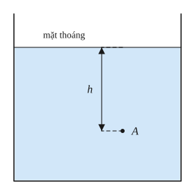
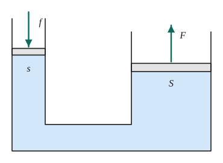
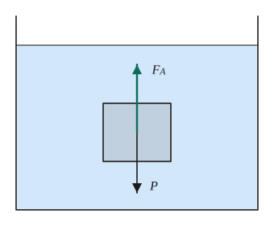
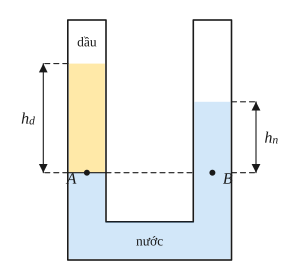
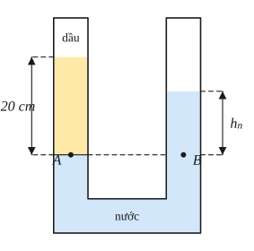
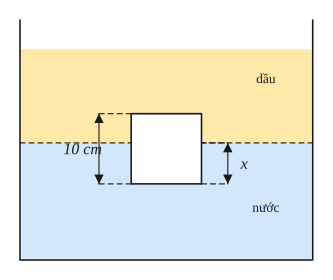

# Chủ đề 1. Khối lượng riêng, áp suất, lực đẩy Archimedes

> **Level Cơ bản** (mục I, các bài gắn nhãn *Cơ bản*) bám sát SGK KHTN 8. **Level Nâng cao** (mục II, các bài gắn nhãn *Nâng cao*) dành cho ôn thi học sinh giỏi và thi vào lớp 10 chuyên Lí.
>
> Trong chủ đề này lấy $g = 10$ N/kg, tức là vật khối lượng $m$ (kg) có trọng lượng $P = 10m$ (N).

## I. Kiến thức cơ bản

### 1. Khối lượng riêng và trọng lượng riêng
- **Khối lượng riêng** của một chất là khối lượng của một đơn vị thể tích chất đó:
$$D = \frac mV\quad(\text{kg/m}^3).$$
  Ví dụ $D_{\text{nước}} = 1000$ kg/m³ $= 1$ g/cm³: 1 lít nước nặng 1 kg.
- **Trọng lượng riêng:** $d = \frac PV = 10D$ (N/m³). Ví dụ $d_{\text{nước}} = 10\,000$ N/m³.
- **Đổi đơn vị:** $1\text{ g/cm}^3 = 1000\text{ kg/m}^3$; $1\text{ lít} = 1\text{ dm}^3 = 10^{-3}\text{ m}^3$; $1\text{ cm}^3 = 10^{-6}\text{ m}^3$.
- Khối lượng riêng giúp **nhận biết chất**: một khối có $D = 2700$ kg/m³ có thể là nhôm.

| Chất | $D$ (kg/m³) | Chất | $D$ (kg/m³) |
|---|---|---|---|
| Nước | 1000 | Sắt, thép | 7800 |
| Dầu hỏa | 800 | Đồng | 8900 |
| Nước đá | 900 | Nhôm | 2700 |
| Thủy ngân | 13 600 | Không khí (0 °C) | 1,29 |

### 2. Áp lực và áp suất
- **Áp lực** là lực ép có phương **vuông góc** với mặt bị ép.
- **Áp suất** là độ lớn của áp lực trên một đơn vị diện tích bị ép:
$$p = \frac FS \quad(\text{Pa} = \text{N/m}^2).$$
- **Vì sao dao sắc dễ cắt, móng nhà phải rộng?** Cùng một lực, diện tích càng nhỏ thì áp suất càng lớn (dao sắc, đinh nhọn); muốn giảm áp suất thì tăng diện tích (móng nhà, bánh xe tăng có xích).

### 3. Áp suất chất lỏng
$$p = d\cdot h,$$
trong đó $h$ là **độ sâu** tính từ mặt thoáng chất lỏng tới điểm xét, $d$ là trọng lượng riêng chất lỏng.

**Vì sao?** Xét một cột chất lỏng tiết diện $S$, cao $h$ phía trên điểm đang xét. Trọng lượng cột đó là $P = d\cdot V = d\cdot S\cdot h$, đè lên diện tích $S$, nên áp suất $p = \frac PS = dh$.

**Hệ quả:**
- Áp suất chất lỏng chỉ phụ thuộc **độ sâu** và **loại chất lỏng**, không phụ thuộc hình dạng bình.
- Chất lỏng gây áp suất theo **mọi phương** lên đáy bình, thành bình và các vật trong lòng nó.
- Các điểm ở **cùng độ sâu** trong cùng một chất lỏng đứng yên có **áp suất bằng nhau**.

### 4. Bình thông nhau, máy nén thủy lực
- **Bình thông nhau** chứa cùng một chất lỏng đứng yên thì mực chất lỏng ở các nhánh **cao bằng nhau** (vì áp suất tại hai điểm cùng độ cao ở đáy phải bằng nhau). Ứng dụng: ấm nước (vòi cao bằng miệng ấm), ống đo mực chất lỏng, hệ thống cấp nước.
- **Máy nén thủy lực:** áp suất tác dụng lên chất lỏng được truyền nguyên vẹn đi mọi hướng. Hai pittông tiết diện $s$ (nhỏ) và $S$ (lớn):
$$\frac{F}{f} = \frac{S}{s}.$$
  Lực nhỏ $f$ trên pittông nhỏ tạo ra lực lớn $F$ trên pittông lớn (dùng để nâng ô tô, ép dầu). Đổi lại, pittông lớn chỉ dịch chuyển một đoạn nhỏ hơn: $S\cdot H = s\cdot h$ (thể tích chất lỏng dịch chuyển như nhau).

### 5. Áp suất khí quyển
- Không khí có trọng lượng nên gây áp suất lên mọi vật trên Trái Đất theo mọi phương.
- **Thí nghiệm Torricelli:** áp suất khí quyển ở mặt biển bằng áp suất của cột thủy ngân cao **76 cm**: $p_0 = 0{,}76\cdot136\,000 \approx 1{,}013\cdot10^5$ Pa (gọi là 1 atm, hay 760 mmHg).
- Càng lên cao, áp suất khí quyển càng giảm (khoảng 1 mmHg cho mỗi 12 m gần mặt đất).

### 6. Lực đẩy Archimedes
Một vật nhúng trong chất lỏng bị chất lỏng đẩy thẳng đứng từ dưới lên với lực
$$F_A = d\cdot V,$$
trong đó $d$ là trọng lượng riêng của **chất lỏng**, $V$ là thể tích **phần chất lỏng bị vật chiếm chỗ** (thể tích phần chìm).

**Vì sao có lực đẩy?** Mặt dưới của vật ở sâu hơn mặt trên, nên chịu áp suất lớn hơn. Với khối hộp có đáy $S$, cao $a$, nằm ngang: lực đẩy lên ở đáy là $d(h + a)S$, lực ép xuống ở mặt trên là $dhS$; hiệu của chúng là $daS = dV$.

### 7. Sự nổi
Thả một vật **đặc** vào chất lỏng (so sánh trọng lượng $P$ với lực đẩy khi vật chìm hoàn toàn):
- $P > F_A$ ($d_{\text{vật}} > d_{\text{lỏng}}$): vật **chìm** xuống.
- $P = F_A$ ($d_{\text{vật}} = d_{\text{lỏng}}$): vật **lơ lửng**.
- $P < F_A$ ($d_{\text{vật}} < d_{\text{lỏng}}$): vật **nổi** lên; khi nổi cân bằng trên mặt thoáng thì $F_A = P$, tức là $d_{\text{lỏng}}\cdot V_{\text{chìm}} = d_{\text{vật}}\cdot V$, suy ra
$$\frac{V_{\text{chìm}}}{V} = \frac{D_{\text{vật}}}{D_{\text{lỏng}}}.$$
  Ví dụ nước đá ($D = 900$) nổi trên nước với 90% thể tích chìm, đó là lí do chỉ thấy "phần nổi của tảng băng".
- Tàu thép nổi được vì vỏ tàu rỗng: **khối lượng riêng trung bình** của cả con tàu (gồm cả không khí bên trong) nhỏ hơn của nước.

---

## II. Kiến thức nâng cao

### 1. Khối lượng riêng của hỗn hợp, hợp kim
Coi thể tích hỗn hợp bằng tổng thể tích các thành phần: $m = m_1 + m_2$, $V = \frac{m_1}{D_1} + \frac{m_2}{D_2}$, nên
$$D_{\text{hh}} = \frac{m_1 + m_2}{\frac{m_1}{D_1} + \frac{m_2}{D_2}}.$$
Biết $m$, $V$ của hợp kim và $D_1$, $D_2$ thì lập hệ hai phương trình để tìm khối lượng mỗi kim loại (bài toán "vương miện của Archimedes").

### 2. Bình thông nhau chứa nhiều chất lỏng
- Chọn **mặt phân cách** giữa hai chất lỏng làm mặt so sánh; hai điểm ở **cùng độ cao trong cùng một chất lỏng liên tục** thì áp suất bằng nhau.
- Ví dụ ống chữ U chứa nước, đổ dầu vào một nhánh cao $h_d$: tại mặt phân cách dầu – nước, $d_d h_d = d_n h_n$, với $h_n$ là độ cao cột nước nhánh kia tính từ mặt phân cách. Chênh lệch mặt thoáng hai nhánh là $h_d - h_n$.
- **Lưu ý:** áp suất khí quyển tác dụng lên cả hai mặt thoáng nên triệt tiêu, không cần tính.

### 3. Vật nổi ở mặt phân cách hai chất lỏng
Vật nằm giữa hai lớp chất lỏng (nhẹ ở trên, nặng ở dưới) chịu lực đẩy của **cả hai**:
$$P = d_1V_1 + d_2V_2,$$
với $V_1$, $V_2$ là thể tích phần vật nằm trong mỗi chất lỏng.

### 4. Dùng lực kế để đo khối lượng riêng
Treo vật vào lực kế: trong không khí chỉ $P$, nhúng chìm trong nước chỉ $P_1$. Khi đó $F_A = P - P_1 = d_nV$, nên
$$V = \frac{P - P_1}{d_n}, \qquad D_{\text{vật}} = \frac{P}{P - P_1}\cdot D_n.$$
Nhúng tiếp vào chất lỏng X lực kế chỉ $P_2$ thì $\frac{D_X}{D_n} = \frac{P - P_2}{P - P_1}$.

### 5. Mực nước khi nước đá tan
Cục đá nổi trên nước: phần chìm chiếm thể tích $V_{\text{chìm}} = \frac{m}{D_n}$ (vì $F_A = P$). Khi tan, nước đá thành nước có đúng khối lượng $m$, chiếm thể tích $\frac{m}{D_n}$, **bằng** thể tích phần chìm trước đó. Vậy **mực nước không đổi**.
- Nếu trong cục đá có một hòn sỏi (chìm khi đá tan), mực nước **hạ xuống**; nếu có bọt khí hoặc miếng gỗ nổi, mực nước không đổi.

### 6. Lực đẩy Archimedes trong chất khí
Không khí cũng tác dụng lực đẩy $F_A = d_{kk}V$. Khí cầu bay lên được khi $F_A$ lớn hơn tổng trọng lượng vỏ, khí bên trong và tải. **Tải trọng tối đa:**
$$P_{\text{tải}} = V(d_{kk} - d_{\text{khí}}) - P_{\text{vỏ}}.$$

### 7. Phương pháp chung
1. Vẽ hình, biểu diễn tất cả các lực tác dụng lên vật (trọng lực, lực đẩy, lực căng dây, phản lực).
2. Viết điều kiện cân bằng (tổng lực hướng lên bằng tổng lực hướng xuống) hoặc điều kiện bằng nhau của áp suất tại hai điểm.
3. Đổi đơn vị về hệ SI trước khi thay số.

---

## III. Bài tập

**Bài 1 (Cơ bản).** Một khối kim loại có khối lượng 540 g và thể tích 200 cm³. Tính khối lượng riêng của khối kim loại theo đơn vị kg/m³. Khối đó có thể làm bằng kim loại gì?

**Bài 2 (Cơ bản).** Một người có khối lượng 50 kg, diện tích tiếp xúc của mỗi bàn chân với mặt đất là $125\text{ cm}^2$. Tính áp suất người đó tác dụng lên mặt đất khi đứng bằng hai chân và khi đứng co một chân.

**Bài 3 (Cơ bản).** Một thợ lặn lặn xuống độ sâu 20 m dưới mặt nước biển. Biết trọng lượng riêng của nước biển là $10\,300$ N/m³. Tính áp suất do nước biển gây ra ở độ sâu đó. Nếu cửa kính của bộ quần áo lặn có diện tích $200\text{ cm}^2$ thì áp lực của nước lên cửa kính là bao nhiêu?

**Bài 4 (Cơ bản).** Một máy nén thủy lực có tiết diện pittông lớn gấp 100 lần tiết diện pittông nhỏ. Muốn nâng một ô tô có trọng lượng $15\,000$ N đặt trên pittông lớn thì phải tác dụng lên pittông nhỏ một lực bằng bao nhiêu?

**Bài 5 (Cơ bản).** Treo một vật vào lực kế, lực kế chỉ 7,8 N. Nhúng chìm hoàn toàn vật trong nước, lực kế chỉ 6,8 N. Tính lực đẩy Archimedes, thể tích và khối lượng riêng của vật.

**Bài 6 (Cơ bản).** Thả một khối gỗ có khối lượng riêng 600 kg/m³ vào nước. Khối gỗ nổi hay chìm? Phần thể tích chìm trong nước chiếm bao nhiêu phần trăm thể tích khối gỗ?

**Bài 7 (Nâng cao, hợp kim).** Một hợp kim vàng – bạc có khối lượng 512 g và thể tích 32 cm³. Biết khối lượng riêng của vàng là 19,3 g/cm³, của bạc là 10,5 g/cm³, và thể tích hợp kim bằng tổng thể tích các kim loại thành phần. Tính khối lượng vàng và bạc trong hợp kim.

**Bài 8 (Nâng cao, ống chữ U).** Một ống chữ U chứa nước. Đổ vào nhánh trái một cột dầu cao 20 cm (dầu không trộn lẫn với nước). Biết trọng lượng riêng của nước và dầu lần lượt là $10\,000$ N/m³ và $8000$ N/m³. Tính độ chênh lệch giữa mặt thoáng hai nhánh.

**Bài 9 (Nâng cao, hai chất lỏng).** Một khối lập phương cạnh 10 cm, khối lượng riêng 900 kg/m³, nổi ở mặt phân cách giữa lớp dầu (ở trên, $D = 800$ kg/m³) và lớp nước (ở dưới). Biết khối lập phương nằm hoàn toàn trong hai chất lỏng và mặt đáy nằm ngang. Tính chiều cao phần khối lập phương nằm trong nước.

**Bài 10 (Nâng cao, nước đá tan).** Một cục nước đá đang nổi trong cốc nước.
a) Chứng minh khi cục đá tan hết thì mực nước trong cốc không đổi.
b) Nếu trong cục đá có một viên sỏi nhỏ thì khi đá tan hết, mực nước thay đổi thế nào? Giải thích.

**Bài 11 (Nâng cao, lực kế).** Treo một vật vào lực kế: ở ngoài không khí lực kế chỉ 12 N; nhúng chìm vật trong nước lực kế chỉ 8 N; nhúng chìm vật trong chất lỏng X lực kế chỉ 8,8 N. Tính khối lượng riêng của vật và của chất lỏng X.

**Bài 12 (Nâng cao, khí cầu).** Một khí cầu có thể tích $100\text{ m}^3$ chứa khí hydrogen. Trọng lượng của vỏ khí cầu và giỏ là 400 N. Biết trọng lượng riêng của không khí là 12,9 N/m³, của hydrogen là 0,9 N/m³. Khí cầu có thể kéo lên tối đa một vật nặng bao nhiêu (bỏ qua thể tích của vật)?

---

## IV. Lời giải chi tiết

### Bài 1
$D = \frac mV = \frac{540}{200} = 2{,}7$ g/cm³ $= 2700$ kg/m³. Đây là khối lượng riêng của **nhôm**.

### Bài 2
- Trọng lượng: $P = 10\cdot50 = 500$ N.
- Hai chân: $S = 2\cdot125 = 250\text{ cm}^2 = 0{,}025\text{ m}^2$, $\ p = \frac{500}{0{,}025} = 20\,000$ Pa.
- Một chân: $S = 0{,}0125\text{ m}^2$, $\ p = 40\,000$ Pa (gấp đôi).

### Bài 3
$p = dh = 10\,300\cdot20 = 206\,000$ Pa. Áp lực lên cửa kính: $F = pS = 206\,000\cdot0{,}02 = 4120$ N (tương đương sức nặng của vật khoảng 412 kg).

### Bài 4
$\frac{F}{f} = \frac{S}{s} = 100$, nên $f = \frac{15\,000}{100} = 150$ N.

### Bài 5
- $F_A = 7{,}8 - 6{,}8 = 1$ N.
- $V = \frac{F_A}{d_n} = \frac{1}{10\,000} = 10^{-4}\text{ m}^3 = 100\text{ cm}^3$.
- $m = \frac{7{,}8}{10} = 0{,}78$ kg, nên $D = \frac{0{,}78}{10^{-4}} = 7800$ kg/m³ (vật bằng thép).

### Bài 6
$D_{\text{gỗ}} = 600 < D_n = 1000$ nên khối gỗ **nổi**. Khi nổi cân bằng: $\frac{V_{\text{chìm}}}{V} = \frac{D_{\text{gỗ}}}{D_n} = \frac{600}{1000} = 60\%$.

### Bài 7
Gọi $m_1$, $m_2$ (g) là khối lượng vàng và bạc:
$$m_1 + m_2 = 512, \qquad \frac{m_1}{19{,}3} + \frac{m_2}{10{,}5} = 32.$$
Từ phương trình đầu, $m_2 = 512 - m_1$. Thay vào: $\frac{m_1}{19{,}3} + \frac{512 - m_1}{10{,}5} = 32$. Nhân hai vế với $19{,}3\cdot10{,}5 = 202{,}65$:
$$10{,}5m_1 + 19{,}3(512 - m_1) = 6484{,}8 \iff 8{,}8m_1 = 3396{,}8 \iff m_1 = 386\text{ g}.$$
Vậy vàng 386 g (20 cm³), bạc $512 - 386 = 126$ g (12 cm³). Kiểm tra: $20 + 12 = 32$ cm³.

### Bài 8
Gọi $A$ là mặt phân cách dầu – nước ở nhánh trái, $B$ là điểm ở nhánh phải cùng độ cao với $A$ (cùng nằm trong nước liên tục), nên $p_A = p_B$:
$$d_d\cdot h_d = d_n\cdot h_n \iff 8000\cdot20 = 10\,000\cdot h_n \iff h_n = 16\text{ cm},$$
với $h_n$ là độ cao mặt nước nhánh phải so với $B$. Mặt thoáng dầu (nhánh trái) cao hơn mặt nước (nhánh phải): $\Delta h = 20 - 16 = 4$ cm.

### Bài 9
Gọi $x$ (cm) là chiều cao phần nằm trong nước, $10 - x$ là phần nằm trong dầu. Tiết diện $S$. Điều kiện cân bằng $P = F_{A1} + F_{A2}$:
$$10\,D\cdot S\cdot0{,}1 = 10\,D_n\cdot S\cdot\frac{x}{100} + 10\,D_d\cdot S\cdot\frac{10 - x}{100}.$$
Rút gọn: $900\cdot10 = 1000x + 800(10 - x) \iff 9000 = 8000 + 200x \iff x = 5$ cm.

### Bài 10
**a)** Cục đá khối lượng $m$ nổi nên $F_A = P$: $10D_nV_{\text{chìm}} = 10m$, suy ra $V_{\text{chìm}} = \frac{m}{D_n}$. Khi tan hết, nước tạo thành có khối lượng $m$ và thể tích $\frac{m}{D_n} = V_{\text{chìm}}$: lượng nước này vừa lấp đúng chỗ phần chìm cũ. Mực nước không đổi.

**b)** Gọi khối lượng sỏi là $m_s$, khối lượng riêng $D_s > D_n$. Lúc đầu cả khối (đá + sỏi) nổi: $V_{\text{chìm}} = \frac{m + m_s}{D_n}$. Khi đá tan: nước từ đá chiếm $\frac{m}{D_n}$, sỏi chìm xuống đáy chiếm $\frac{m_s}{D_s} < \frac{m_s}{D_n}$. Tổng thể tích chiếm chỗ **giảm**, nên **mực nước hạ xuống**.

### Bài 11
- Trong nước: $F_{A} = 12 - 8 = 4$ N, nên $V = \frac{4}{10\,000} = 4\cdot10^{-4}$ m³. $D_{\text{vật}} = \frac{1{,}2}{4\cdot10^{-4}} = 3000$ kg/m³.
- Trong X: $F'_A = 12 - 8{,}8 = 3{,}2$ N, nên $d_X = \frac{3{,}2}{4\cdot10^{-4}} = 8000$ N/m³, $D_X = 800$ kg/m³.

(Nhanh hơn: $\frac{D_X}{D_n} = \frac{3{,}2}{4} = 0{,}8$.)

### Bài 12
Lực đẩy của không khí: $F_A = 12{,}9\cdot100 = 1290$ N. Trọng lượng khí hydrogen: $0{,}9\cdot100 = 90$ N. Tải trọng tối đa:
$$P_{\text{tải}} = 1290 - 90 - 400 = 800\text{ N},$$
tức là kéo được vật nặng tối đa khoảng 80 kg.
