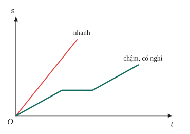
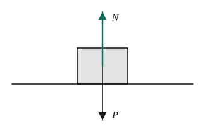
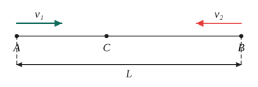
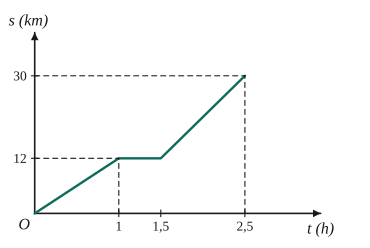
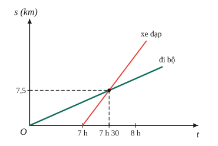

# Chủ đề 2. Chuyển động, tốc độ và lực

> **Level Cơ bản** (mục I, các bài gắn nhãn *Cơ bản*) bám sát SGK KHTN 7 – 8. **Level Nâng cao** (mục II, các bài gắn nhãn *Nâng cao*) dành cho ôn thi học sinh giỏi và thi vào lớp 10 chuyên Lí.

## I. Kiến thức cơ bản

### 1. Chuyển động và tính tương đối
- Một vật **chuyển động** khi vị trí của nó thay đổi theo thời gian **so với vật mốc**.
- Chuyển động có **tính tương đối**: hành khách ngồi trên tàu đứng yên so với toa tàu nhưng chuyển động so với nhà ga. Vì vậy luôn phải nói rõ vật mốc.

### 2. Tốc độ
$$v = \frac st,$$
với $s$ là quãng đường đi được trong thời gian $t$. Đơn vị: m/s hoặc km/h.
- **Đổi đơn vị:** $1\text{ m/s} = 3{,}6\text{ km/h}$, vì $1\text{ m/s} = \frac{0{,}001\text{ km}}{\frac{1}{3600}\text{ h}} = 3{,}6\text{ km/h}$. Ví dụ $36\text{ km/h} = 10\text{ m/s}$.
- Từ công thức suy ra $s = vt$ và $t = \frac sv$.

### 3. Tốc độ trung bình
Với chuyển động có tốc độ thay đổi:
$$v_{tb} = \frac{\text{tổng quãng đường}}{\text{tổng thời gian}} = \frac{s_1 + s_2 + \dots}{t_1 + t_2 + \dots}.$$
**Lỗi hay gặp:** lấy trung bình cộng các tốc độ $\frac{v_1 + v_2}{2}$. Điều này chỉ đúng khi hai giai đoạn kéo dài **cùng một thời gian**.

### 4. Đồ thị quãng đường – thời gian
- Trục hoành là thời gian $t$, trục tung là quãng đường $s$.
- Chuyển động **đều** (tốc độ không đổi): đồ thị là **đoạn thẳng**; đoạn thẳng càng dốc thì tốc độ càng lớn. Tốc độ bằng $\frac{\Delta s}{\Delta t}$ đọc trên đồ thị.
- Đoạn **nằm ngang**: vật đứng yên.

### 5. Lực và biểu diễn lực
- **Lực** là tác dụng đẩy hoặc kéo của vật này lên vật khác. Lực có thể làm vật **thay đổi tốc độ, đổi hướng chuyển động** hoặc **biến dạng**. Đơn vị: newton (N).
- Lực được biểu diễn bằng **mũi tên**: gốc ở điểm đặt, phương và chiều là phương chiều của lực, độ dài tỉ lệ với độ lớn theo một tỉ xích cho trước.
- **Trọng lực** là lực hút của Trái Đất, phương thẳng đứng, chiều hướng xuống; độ lớn (trọng lượng) $P = 10m$.

### 6. Hai lực cân bằng và quán tính
- **Hai lực cân bằng:** cùng đặt lên một vật, cùng độ lớn, cùng phương, **ngược chiều**.
- Dưới tác dụng của các lực cân bằng, vật đang đứng yên sẽ **đứng yên**, vật đang chuyển động sẽ **chuyển động thẳng đều** mãi.
- **Quán tính:** mọi vật đều có xu hướng giữ nguyên tốc độ và hướng chuyển động; khi có lực tác dụng, vật **không thể thay đổi tốc độ đột ngột**. Ví dụ xe phanh gấp thì hành khách ngả người về phía trước.

### 7. Lực ma sát
- **Ma sát trượt** (vật trượt trên mặt vật khác), **ma sát lăn** (vật lăn, nhỏ hơn nhiều ma sát trượt), **ma sát nghỉ** (giữ vật đứng yên khi có lực tác dụng).
- Ma sát có thể **có hại** (mòn xích, tốn năng lượng: tra dầu mỡ, dùng ổ bi) hoặc **có ích** (đi lại, phanh xe: làm mặt lốp có rãnh, rắc cát lên đường trơn).
- Khi kéo vật chuyển động **đều** trên mặt ngang, lực kéo cân bằng với lực ma sát, nên lực ma sát bằng số chỉ lực kế.

---

## II. Kiến thức nâng cao

### 1. Hai vật chuyển động trên cùng một đường thẳng
Chọn gốc tọa độ và gốc thời gian, viết **vị trí** của mỗi vật theo thời gian: $x = x_0 \pm vt$ (dấu "+" nếu chuyển động theo chiều dương). Hai vật **gặp nhau** khi $x_1 = x_2$.
- **Ngược chiều**, cách nhau $L$: khoảng cách giảm với tốc độ $v_1 + v_2$, gặp nhau sau $t = \frac{L}{v_1 + v_2}$.
- **Cùng chiều**, vật sau nhanh hơn: khoảng cách giảm với tốc độ $v_1 - v_2$, đuổi kịp sau $t = \frac{L}{v_1 - v_2}$.

### 2. Tốc độ trung bình trên hai nửa
- **Nửa quãng đường** đầu tốc độ $v_1$, nửa sau $v_2$: $v_{tb} = \frac{2v_1v_2}{v_1 + v_2}$ (trung bình điều hòa).
- **Nửa thời gian** đầu tốc độ $v_1$, nửa sau $v_2$: $v_{tb} = \frac{v_1 + v_2}{2}$ (trung bình cộng).
- Vì $\frac{v_1 + v_2}{2} \ge \frac{2v_1v_2}{v_1 + v_2}$ (bất đẳng thức AM-HM, xem Toán chủ đề 7), đi "nửa thời gian" luôn có tốc độ trung bình không nhỏ hơn đi "nửa quãng đường".

### 3. Công thức cộng vận tốc (cùng phương)
- Thuyền trên dòng nước: tốc độ thuyền so với nước $v$, tốc độ dòng nước $u$. Đi **xuôi** dòng: $v + u$; đi **ngược** dòng: $v - u$ (so với bờ).
- Vật trôi tự do theo dòng (bèo, phao) có tốc độ $u$ bằng tốc độ dòng nước.
- Tương tự: người đi trên thang cuốn, người đi trên tàu đang chạy.

### 4. Chuyển động tròn đều của kim đồng hồ
Kim phút quay $360°$/giờ, kim giờ quay $30°$/giờ. Coi như hai vật chạy cùng chiều trên đường tròn: tốc độ "đuổi" là $330°$/giờ. Hai kim trùng nhau lần tiếp theo sau $\frac{360}{330} = \frac{12}{11}$ giờ.

### 5. Đọc và vẽ đồ thị nhiều chuyển động
- Vẽ đồ thị vị trí – thời gian của các vật trên cùng một hệ trục: **giao điểm** của hai đồ thị cho thời điểm và vị trí gặp nhau.
- Đồ thị đi xuống (vị trí giảm) ứng với chuyển động ngược chiều dương.

### 6. Lực ma sát và lực cản
Khi xe chạy **đều**, lực kéo của động cơ cân bằng với tổng lực cản (ma sát, sức cản không khí). Muốn xe tăng tốc thì lực kéo phải lớn hơn lực cản.

---

## III. Bài tập

**Bài 1 (Cơ bản).** Đổi $36$ km/h và $54$ km/h ra m/s. Một người đi bộ được 3 km trong 20 phút; tính tốc độ của người đó theo km/h và m/s.

**Bài 2 (Cơ bản).** Một ô tô đi 60 km đầu với tốc độ 40 km/h, rồi đi tiếp 60 km với tốc độ 60 km/h. Tính tốc độ trung bình của ô tô trên cả quãng đường. Vì sao kết quả không phải là 50 km/h?

**Bài 3 (Cơ bản).** Đồ thị quãng đường – thời gian của một người đi xe đạp như hình. Tính tốc độ của người đó trên từng giai đoạn và tốc độ trung bình trên cả quãng đường.

**Bài 4 (Cơ bản).** Biểu diễn trọng lực của một vật có khối lượng 2 kg với tỉ xích 1 cm ứng với 10 N. Nêu rõ điểm đặt, phương, chiều và độ dài mũi tên.

**Bài 5 (Cơ bản).** Dùng lực kế kéo một khúc gỗ chuyển động đều trên mặt bàn nằm ngang, lực kế chỉ 15 N. Lực ma sát tác dụng lên khúc gỗ bằng bao nhiêu? Nếu kéo với lực 20 N thì khúc gỗ chuyển động thế nào?

**Bài 6 (Cơ bản).** Giải thích các hiện tượng: a) ô tô đang chạy phanh gấp, hành khách bị ngả người về phía trước; b) muốn tra cán búa chặt hơn, người ta gõ mạnh đuôi cán xuống đất.

**Bài 7 (Nâng cao, gặp nhau).** Hai địa điểm A và B cách nhau 120 km. Lúc 7 giờ, một xe đi từ A về B với tốc độ 40 km/h, cùng lúc một xe đi từ B về A với tốc độ 60 km/h.
a) Hai xe gặp nhau lúc mấy giờ, ở đâu?
b) Nếu xe thứ hai cũng đi theo hướng từ A sang B (chiều từ A đến B, xuất phát tại B) với tốc độ 40 km/h còn xe từ A đi với tốc độ 60 km/h thì sau bao lâu xe từ A đuổi kịp?

**Bài 8 (Nâng cao, tốc độ trung bình).** Một người đi xe đạp trên quãng đường AB.
a) Nửa quãng đường đầu đi với tốc độ 30 km/h, nửa sau với 60 km/h. Tính tốc độ trung bình.
b) Nửa thời gian đầu đi với 30 km/h, nửa thời gian sau với 60 km/h. Tính tốc độ trung bình.
c) Chứng minh trong mọi trường hợp $v_1 \ne v_2$, kết quả câu b luôn lớn hơn câu a.

**Bài 9 (Nâng cao, dòng nước).** Một ca nô đi xuôi dòng từ A đến B mất 2 giờ, đi ngược dòng từ B về A mất 3 giờ. Biết AB = 60 km và tốc độ của ca nô so với nước không đổi. Tính tốc độ của ca nô so với nước và tốc độ dòng nước. Một cụm bèo trôi tự do từ A đến B mất bao lâu?

**Bài 10 (Nâng cao, thang cuốn).** Một người đứng yên trên thang cuốn đang chạy thì lên hết thang trong 1 phút. Nếu thang đứng yên, người đó đi bộ lên hết thang trong 3 phút. Hỏi nếu người đó vẫn đi bộ như vậy trên thang đang chạy thì lên hết thang trong bao lâu?

**Bài 11 (Nâng cao, kim đồng hồ).** Lúc 12 giờ, kim giờ và kim phút trùng nhau. Hỏi sau đó ít nhất bao lâu hai kim lại trùng nhau? Trong một ngày (24 giờ) hai kim trùng nhau bao nhiêu lần?

**Bài 12 (Nâng cao, đồ thị).** Lúc 6 giờ, một người đi bộ xuất phát từ A với tốc độ 5 km/h. Lúc 7 giờ, một người đi xe đạp xuất phát từ A, đi cùng chiều với tốc độ 15 km/h. Vẽ đồ thị quãng đường – thời gian của hai người trên cùng một hệ trục, và xác định thời điểm, vị trí người đi xe đạp đuổi kịp người đi bộ.

---

## IV. Lời giải chi tiết

### Bài 1
- $36$ km/h $= \frac{36}{3{,}6} = 10$ m/s; $\ 54$ km/h $= 15$ m/s.
- $v = \frac{3\text{ km}}{\frac13\text{ h}} = 9$ km/h $= 2{,}5$ m/s.

### Bài 2
$t_1 = \frac{60}{40} = 1{,}5$ h; $\ t_2 = \frac{60}{60} = 1$ h. Vậy $v_{tb} = \frac{60 + 60}{1{,}5 + 1} = 48$ km/h.
Kết quả nhỏ hơn 50 km/h vì xe đi chậm **trong thời gian dài hơn** (1,5 h) so với khi đi nhanh (1 h); tốc độ trung bình nghiêng về giai đoạn kéo dài hơn.

### Bài 3
Đọc đồ thị:
- Từ 0 đến 1 h: đi được 12 km, $v_1 = 12$ km/h.
- Từ 1 h đến 1,5 h: đồ thị nằm ngang, người đó **nghỉ**, $v_2 = 0$.
- Từ 1,5 h đến 2,5 h: đi thêm $30 - 12 = 18$ km, $v_3 = 18$ km/h.

Tốc độ trung bình: $v_{tb} = \frac{30}{2{,}5} = 12$ km/h (tính cả thời gian nghỉ).

### Bài 4
$P = 10\cdot2 = 20$ N. Mũi tên có **điểm đặt** tại trọng tâm vật, **phương** thẳng đứng, **chiều** từ trên xuống, **độ dài** $\frac{20}{10}\cdot1 = 2$ cm.

### Bài 5
Khúc gỗ chuyển động đều nên lực kéo và lực ma sát trượt cân bằng: $F_{ms} = 15$ N.
Kéo với 20 N (lực ma sát trượt vẫn khoảng 15 N): lực kéo lớn hơn lực cản, khúc gỗ chuyển động **nhanh dần**.

### Bài 6
**a)** Khi xe phanh, chân hành khách dừng lại cùng xe, nhưng phần thân trên do **quán tính** vẫn giữ tốc độ cũ, nên bị ngả về phía trước.

**b)** Khi gõ, cán búa bị dừng lại đột ngột khi chạm đất, còn đầu búa do quán tính vẫn tiếp tục chuyển động xuống, nên ngập sâu vào cán.

### Bài 7
**a)** Chọn gốc tại A, chiều dương từ A đến B, gốc thời gian lúc 7 giờ. Vị trí: $x_1 = 40t$, $x_2 = 120 - 60t$. Gặp nhau khi $40t = 120 - 60t$, tức là $t = 1{,}2$ h $= 1$ giờ 12 phút.
Hai xe gặp nhau lúc **8 giờ 12 phút**, tại điểm cách A **48 km**.

**b)** Xe từ A: $x_1 = 60t$; xe từ B: $x_2 = 120 + 40t$. Đuổi kịp khi $60t = 120 + 40t$, tức là $t = 6$ h (khi đó cách A 360 km).

### Bài 8
Gọi $v_1 = 30$, $v_2 = 60$ km/h.

**a)** Mỗi nửa dài $\frac s2$: $t = \frac{s}{2v_1} + \frac{s}{2v_2}$, nên $v_{tb} = \frac{s}{t} = \frac{2v_1v_2}{v_1 + v_2} = \frac{2\cdot30\cdot60}{90} = 40$ km/h.

**b)** Mỗi nửa thời gian $\frac t2$: $s = v_1\frac t2 + v_2\frac t2$, nên $v_{tb} = \frac{v_1 + v_2}{2} = 45$ km/h.

**c)** $\frac{v_1 + v_2}{2} - \frac{2v_1v_2}{v_1 + v_2} = \frac{(v_1 + v_2)^2 - 4v_1v_2}{2(v_1 + v_2)} = \frac{(v_1 - v_2)^2}{2(v_1 + v_2)} > 0$ khi $v_1 \ne v_2$.

### Bài 9
Xuôi dòng: $v + u = \frac{60}{2} = 30$ km/h. Ngược dòng: $v - u = \frac{60}{3} = 20$ km/h.
Giải ra $v = 25$ km/h (ca nô so với nước), $u = 5$ km/h (dòng nước).
Bèo trôi theo dòng với tốc độ 5 km/h: $t = \frac{60}{5} = 12$ giờ.

### Bài 10
Gọi chiều dài thang là $L$. Tốc độ thang $v_1 = \frac{L}{1}$ (mỗi phút), tốc độ người $v_2 = \frac L3$. Khi người đi trên thang chạy, tốc độ so với mặt đất là $v_1 + v_2 = \frac{4L}{3}$, nên
$$t = \frac{L}{4L/3} = \frac34\text{ phút} = 45\text{ s}.$$

### Bài 11
Kim phút quay nhanh hơn kim giờ $360 - 30 = 330$ độ mỗi giờ. Hai kim trùng nhau lần tiếp theo khi kim phút "vượt" kim giờ đúng một vòng:
$$t = \frac{360}{330} = \frac{12}{11}\text{ giờ} \approx 1\text{ giờ }5\text{ phút }27\text{ giây}.$$
Trong 24 giờ: $\frac{24}{12/11} = 22$ lần.

### Bài 12
Chọn gốc tọa độ tại A, gốc thời gian lúc 6 giờ. Người đi bộ: $s_1 = 5t$; người đi xe đạp xuất phát lúc $t = 1$: $s_2 = 15(t - 1)$ với $t \ge 1$.
Đuổi kịp khi $5t = 15(t - 1) \iff t = 1{,}5$ h, tức là lúc **7 giờ 30 phút**, cách A $5\cdot1{,}5 = 7{,}5$ km. Trên đồ thị, đây là giao điểm của hai đoạn thẳng.

