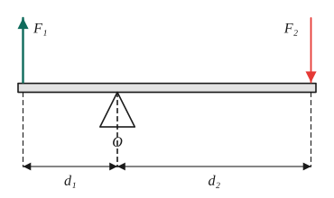
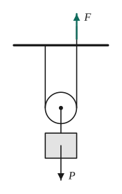
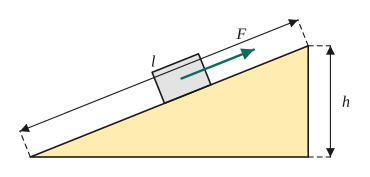
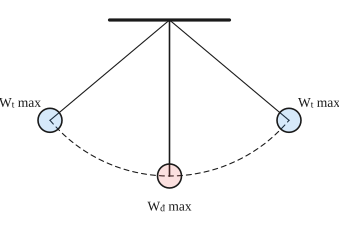
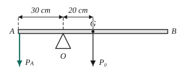

# Chủ đề 3. Moment lực, đòn bẩy, công, công suất và năng lượng cơ học

> **Level Cơ bản** (mục I, các bài gắn nhãn *Cơ bản*) bám sát SGK KHTN 8 – 9. **Level Nâng cao** (mục II, các bài gắn nhãn *Nâng cao*) dành cho ôn thi học sinh giỏi và thi vào lớp 10 chuyên Lí. Lấy $g = 10$ N/kg.

## I. Kiến thức cơ bản

### 1. Moment lực
- Lực tác dụng lên vật có trục quay cố định có thể làm vật **quay**. Tác dụng làm quay đặc trưng bởi **moment lực**:
$$M = F\cdot d,$$
  trong đó $d$ là **cánh tay đòn**: khoảng cách từ trục quay đến **giá** (đường thẳng chứa) của lực. Đơn vị: N·m.
- Cùng một lực, cánh tay đòn càng dài thì tác dụng làm quay càng lớn: vặn ốc bằng cờ lê cán dài dễ hơn, tay nắm cửa đặt xa bản lề.
- Lực có giá đi qua trục quay ($d = 0$) không làm vật quay.

### 2. Đòn bẩy
Đòn bẩy là một thanh cứng quay quanh một điểm tựa $O$. Điều kiện cân bằng (quy tắc moment):
$$F_1\cdot d_1 = F_2\cdot d_2.$$
**Vì sao?** Lực $F_1$ làm thanh quay theo một chiều, $F_2$ làm thanh quay theo chiều ngược lại; thanh cân bằng khi hai tác dụng làm quay (hai moment) bằng nhau.
- Muốn **lợi về lực** (dùng lực nhỏ nâng vật nặng) thì cánh tay đòn của lực tác dụng phải **dài hơn** cánh tay đòn của vật: $\frac{F_1}{F_2} = \frac{d_2}{d_1}$.
- **Ba loại đòn bẩy:** điểm tựa ở giữa (cái kéo, bập bênh); vật ở giữa (xe cút kít, cái mở nắp chai); lực ở giữa (cái kẹp gắp, cánh tay người: không lợi về lực nhưng lợi về đường đi).

### 3. Ròng rọc
- **Ròng rọc cố định:** chỉ đổi hướng của lực, không lợi về lực ($F = P$).
- **Ròng rọc động:** lợi hai lần về lực ($F = \frac P2$) nhưng thiệt hai lần về đường đi (kéo dây dài $2h$ để nâng vật lên $h$).

### 4. Công cơ học
Khi lực $F$ làm vật dịch chuyển một quãng đường $s$ **theo phương của lực**:
$$A = F\cdot s\quad(\text{J} = \text{N}\cdot\text{m}).$$
- Lực vuông góc với phương chuyển động **không thực hiện công** (trọng lực khi vật chuyển động trên mặt ngang, lực giữ của người xách cặp đi ngang).
- Nâng vật trọng lượng $P$ lên độ cao $h$: $A = P\cdot h$.

### 5. Công suất
$$\mathscr P = \frac At\quad(\text{W} = \text{J/s}).$$
Công suất cho biết làm việc **nhanh hay chậm**. Với vật chuyển động đều dưới lực kéo $F$ có tốc độ $v$:
$$\mathscr P = \frac{F\cdot s}{t} = F\cdot v.$$
Đơn vị khác: $1\text{ kW} = 1000$ W; mã lực (HP) $\approx 746$ W.

### 6. Định luật về công và hiệu suất
- **Định luật về công:** không một máy cơ đơn giản nào cho ta lợi về công; được lợi bao nhiêu lần về lực thì thiệt bấy nhiêu lần về đường đi.
- Với **mặt phẳng nghiêng** dài $l$, cao $h$ (không ma sát): $F\cdot l = P\cdot h$, nên $F = P\frac hl < P$.
- Thực tế có ma sát nên công toàn phần lớn hơn công có ích. **Hiệu suất:**
$$H = \frac{A_{ci}}{A_{tp}}\cdot100\%,\qquad A_{tp} = A_{ci} + A_{hp}.$$

### 7. Năng lượng cơ học
- **Động năng** (năng lượng do chuyển động): $W_đ = \frac12mv^2$. Vật nặng hơn, chạy nhanh hơn thì động năng lớn hơn; tốc độ tăng gấp đôi thì động năng tăng gấp bốn.
- **Thế năng trọng trường** (năng lượng do độ cao): $W_t = Ph = mgh$, với $h$ tính từ một mốc chọn trước (thường là mặt đất).
- **Cơ năng** $W = W_đ + W_t$. Khi bỏ qua ma sát và sức cản, **cơ năng được bảo toàn**: động năng và thế năng chuyển hóa qua lại cho nhau. Ví dụ con lắc: ở vị trí cao nhất thế năng lớn nhất, ở vị trí thấp nhất động năng lớn nhất.

---

## II. Kiến thức nâng cao

### 1. Thanh có trọng lượng
Thanh đồng chất, tiết diện đều có trọng lượng $P_0$ đặt tại **trung điểm** (trọng tâm). Khi xét cân bằng phải tính cả moment của $P_0$ đối với điểm tựa.

### 2. Điều kiện cân bằng tổng quát
Vật rắn có trục quay cố định cân bằng khi **tổng moment các lực làm vật quay theo chiều kim đồng hồ bằng tổng moment các lực làm vật quay ngược chiều kim đồng hồ**. Vật cân bằng tổng quát còn cần tổng các lực bằng 0 (lực hướng lên bằng lực hướng xuống), dùng để tính phản lực ở điểm tựa.

### 3. Hệ ròng rọc (palăng)
Palăng gồm $n$ ròng rọc động (mỗi ròng rọc treo bằng hai đoạn dây của cùng một sợi): lực kéo $F = \frac{P}{2n}$ (bỏ qua ma sát, khối lượng ròng rọc), dây phải kéo một đoạn $2n\cdot h$. Tổng quát: nếu vật được treo bởi $k$ đoạn dây cùng chịu lực căng $F$ thì $F = \frac Pk$.

### 4. Bảo toàn cơ năng để tính tốc độ
Vật rơi tự do hoặc trượt không ma sát từ độ cao $h$ (tốc độ ban đầu bằng 0): $mgh = \frac12mv^2$, nên
$$v = \sqrt{2gh},$$
không phụ thuộc khối lượng và hình dạng đường đi. Có ma sát thì phần cơ năng mất đi bằng công của lực ma sát (chuyển thành nhiệt).

### 5. Công suất của xe và lực cản
Xe chạy đều: lực kéo bằng lực cản, $\mathscr P = F_c\cdot v$. Cùng công suất, muốn lực kéo lớn (lên dốc) thì phải chạy chậm (về số thấp).

### 6. Đòn bẩy kết hợp lực đẩy Archimedes
Vật treo vào đòn bẩy rồi nhúng vào chất lỏng thì lực tác dụng lên đòn bẩy giảm đi: $P' = P - F_A = P - d_{l}V$. Cân bằng có thể bị phá vỡ nếu hai vật có thể tích khác nhau.

### 7. Hiệu suất của máy bơm, cần cẩu
$A_{ci}$ là công nâng vật (hoặc nâng nước) lên cao: $A_{ci} = Ph = 10mh$; $A_{tp} = \mathscr P\cdot t$ là điện năng hoặc công động cơ cung cấp.

---

## III. Bài tập

**Bài 1 (Cơ bản).** Dùng cờ lê có cánh tay đòn 20 cm, tác dụng lực 50 N vuông góc với cờ lê để vặn một con ốc. Tính moment lực. Nếu dùng cờ lê dài 40 cm thì chỉ cần lực bao nhiêu để có cùng moment?

**Bài 2 (Cơ bản).** Một đòn bẩy có điểm tựa O. Treo vật 60 N ở đầu A với OA = 20 cm. Phải tác dụng vào đầu B (OB = 60 cm, ở phía bên kia điểm tựa) một lực hướng xuống bằng bao nhiêu để đòn bẩy cân bằng? (Bỏ qua trọng lượng đòn bẩy.)

**Bài 3 (Cơ bản).** Một người kéo đều một thùng hàng 20 kg từ mặt đất lên độ cao 5 m trong 20 s. Tính công và công suất của người đó.

**Bài 4 (Cơ bản).** Một cần cẩu nâng một kiện hàng 2 tấn lên cao 15 m trong 30 s. Tính công suất của cần cẩu (bỏ qua hao phí).

**Bài 5 (Cơ bản).** Thả một vật khối lượng 0,5 kg rơi từ độ cao 20 m so với mặt đất. Tính thế năng ban đầu và tốc độ của vật khi chạm đất (bỏ qua sức cản không khí).

**Bài 6 (Cơ bản).** Dùng mặt phẳng nghiêng dài 4 m để đưa một vật 50 kg lên độ cao 1,2 m, lực kéo dọc mặt phẳng nghiêng là 180 N. Tính hiệu suất của mặt phẳng nghiêng và độ lớn lực ma sát.

**Bài 7 (Nâng cao, thanh có trọng lượng).** Một thanh AB đồng chất, tiết diện đều, dài 1 m, nặng 20 N, được đặt trên điểm tựa O với OA = 30 cm. Phải treo vào đầu A một vật nặng bao nhiêu để thanh cân bằng nằm ngang? Khi đó điểm tựa chịu một lực bằng bao nhiêu?

**Bài 8 (Nâng cao, palăng).** Dùng một palăng gồm hai ròng rọc động và hai ròng rọc cố định để nâng một vật nặng 400 N lên cao 2 m.
a) Bỏ qua ma sát và khối lượng ròng rọc, tính lực kéo và quãng đường dây phải kéo.
b) Thực tế lực kéo là 125 N. Tính hiệu suất của palăng.

**Bài 9 (Nâng cao, công suất xe).** Một ô tô có công suất động cơ 30 kW chạy đều trên đường nằm ngang với tốc độ 54 km/h. Tính lực kéo của động cơ và lực cản tác dụng lên xe. Nếu ô tô lên dốc với cùng công suất, cần lực kéo 3000 N thì tốc độ của xe là bao nhiêu?

**Bài 10 (Nâng cao, bảo toàn cơ năng).** Một con lắc gồm quả nặng treo vào sợi dây dài 0,8 m. Kéo quả nặng sao cho dây nằm ngang rồi thả nhẹ. Bỏ qua sức cản, tính tốc độ của quả nặng khi đi qua vị trí thấp nhất, và khi nó ở độ cao bằng một nửa độ cao ban đầu (so với vị trí thấp nhất).

**Bài 11 (Nâng cao, đòn bẩy và Archimedes).** Một thanh nhẹ AB dài 1,1 m. Đầu A treo quả cầu sắt nặng 7,8 N, đầu B treo quả cầu nhôm nặng 5,4 N; thanh cân bằng nằm ngang trên điểm tựa O.
a) Tính OA, OB.
b) Nhúng chìm cả hai quả cầu vào nước. Phải dịch điểm tựa O một đoạn bao nhiêu, về phía nào để thanh lại cân bằng? Biết khối lượng riêng của sắt, nhôm, nước lần lượt là 7800, 2700, 1000 kg/m³.

**Bài 12 (Nâng cao, máy bơm).** Một máy bơm đưa $10\text{ m}^3$ nước lên bể ở độ cao 9 m trong 30 phút. Hiệu suất của máy bơm là 75%. Tính công suất điện của máy bơm.

---

## IV. Lời giải chi tiết

### Bài 1
$M = F\cdot d = 50\cdot0{,}2 = 10$ N·m. Với cánh tay đòn 0,4 m: $F' = \frac{10}{0{,}4} = 25$ N (giảm một nửa).

### Bài 2
$P\cdot OA = F\cdot OB \iff 60\cdot20 = F\cdot60 \iff F = 20$ N.

### Bài 3
$P = 200$ N; $A = Ph = 200\cdot5 = 1000$ J; $\mathscr P = \frac{1000}{20} = 50$ W.

### Bài 4
$P = 20\,000$ N; $A = 20\,000\cdot15 = 300\,000$ J; $\mathscr P = \frac{300\,000}{30} = 10\,000$ W $= 10$ kW.

### Bài 5
$W_t = mgh = 0{,}5\cdot10\cdot20 = 100$ J. Bảo toàn cơ năng: $\frac12mv^2 = 100 \iff v^2 = 400 \iff v = 20$ m/s.

### Bài 6
- $A_{ci} = Ph = 500\cdot1{,}2 = 600$ J; $\ A_{tp} = F\cdot l = 180\cdot4 = 720$ J.
- $H = \frac{600}{720} \approx 83{,}3\%$.
- Công hao phí do ma sát $720 - 600 = 120$ J $= F_{ms}\cdot l$, nên $F_{ms} = \frac{120}{4} = 30$ N.

### Bài 7
Trọng tâm G của thanh ở trung điểm: AG = 50 cm, nên OG = 50 − 30 = 20 cm (G nằm ở phía B so với O). Trọng lượng thanh làm thanh quay về phía B, vật treo ở A làm thanh quay về phía A:
$$P_A\cdot OA = P_0\cdot OG \iff P_A\cdot30 = 20\cdot20 \iff P_A = \frac{40}{3} \approx 13{,}3\text{ N}.$$
Điểm tựa chịu lực bằng tổng trọng lượng: $20 + \frac{40}{3} \approx 33{,}3$ N.

### Bài 8
**a)** Hai ròng rọc động: vật được treo bởi 4 đoạn dây, $F = \frac{400}{4} = 100$ N; dây phải kéo $4\cdot2 = 8$ m.

**b)** $A_{ci} = 400\cdot2 = 800$ J; $\ A_{tp} = 125\cdot8 = 1000$ J; $\ H = 80\%$.

### Bài 9
$v = 54$ km/h $= 15$ m/s. $F = \frac{\mathscr P}{v} = \frac{30\,000}{15} = 2000$ N. Xe chạy đều nên lực cản $F_c = 2000$ N.
Lên dốc: $v' = \frac{30\,000}{3000} = 10$ m/s $= 36$ km/h.

### Bài 10
Độ cao ban đầu so với vị trí thấp nhất: $h = 0{,}8$ m.
- Vị trí thấp nhất: $v = \sqrt{2gh} = \sqrt{16} = 4$ m/s.
- Độ cao $\frac h2 = 0{,}4$ m: $mg\cdot0{,}8 = mg\cdot0{,}4 + \frac12mv'^2 \iff v'^2 = 8 \iff v' = 2\sqrt2 \approx 2{,}83$ m/s.

### Bài 11
**a)** $7{,}8\cdot OA = 5{,}4\cdot OB$ và $OA + OB = 1{,}1$. Suy ra $\frac{OA}{OB} = \frac{5{,}4}{7{,}8} = \frac{9}{13}$, nên $OA = 1{,}1\cdot\frac{9}{22} = 0{,}45$ m, $OB = 0{,}65$ m.

**b)** Thể tích: $V_{\text{sắt}} = \frac{0{,}78}{7800} = 10^{-4}$ m³; $V_{\text{nhôm}} = \frac{0{,}54}{2700} = 2\cdot10^{-4}$ m³. Lực đẩy Archimedes 1 N và 2 N. Trong nước, lực kéo xuống ở A và B là $7{,}8 - 1 = 6{,}8$ N và $5{,}4 - 2 = 3{,}4$ N.
Cân bằng mới: $6{,}8\cdot OA' = 3{,}4\cdot OB'$, tức là $OB' = 2OA'$, nên $OA' = \frac{1{,}1}{3} \approx 0{,}367$ m.
Phải dịch điểm tựa **về phía A** một đoạn $0{,}45 - 0{,}367 \approx 0{,}083$ m $\approx 8{,}3$ cm.

> Quả nhôm có thể tích lớn hơn nên bị đẩy lên nhiều hơn; đầu B "nhẹ đi" nhiều hơn, thanh nghiêng về phía A, cần dời điểm tựa về phía A.

### Bài 12
Khối lượng nước $m = 10\,000$ kg, $P = 100\,000$ N. $A_{ci} = Ph = 900\,000$ J. $A_{tp} = \frac{A_{ci}}{H} = 1\,200\,000$ J. Công suất: $\mathscr P = \frac{1\,200\,000}{1800} \approx 667$ W.
