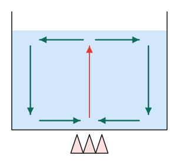
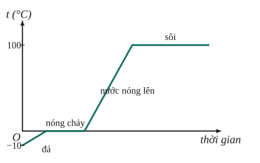

# Chủ đề 4. Nhiệt học: nhiệt năng, truyền nhiệt, phương trình cân bằng nhiệt

> **Level Cơ bản** (mục I, các bài gắn nhãn *Cơ bản*) bám sát SGK KHTN 8. **Level Nâng cao** (mục II, các bài gắn nhãn *Nâng cao*) dành cho ôn thi học sinh giỏi và thi vào lớp 10 chuyên Lí.
>
> Nhiệt dung riêng (J/(kg·K)): nước 4200, nước đá 2100, nhôm 880, đồng 380, sắt 460. Nhiệt nóng chảy của nước đá $\lambda = 3{,}4\cdot10^5$ J/kg; nhiệt hóa hơi của nước $L = 2{,}3\cdot10^6$ J/kg (dùng khi đề không cho số khác).

## I. Kiến thức cơ bản

### 1. Cấu tạo chất và chuyển động nhiệt
- Các chất được cấu tạo từ các **hạt riêng biệt** (nguyên tử, phân tử), giữa chúng có **khoảng cách**. Ví dụ trộn 50 cm³ rượu với 50 cm³ nước được ít hơn 100 cm³ hỗn hợp.
- Các hạt **chuyển động hỗn loạn không ngừng**; nhiệt độ càng cao thì chuyển động càng nhanh (chuyển động nhiệt). Bằng chứng: hiện tượng khuếch tán (giọt mực loang trong nước, nhanh hơn khi nước nóng).

### 2. Nhiệt năng và cách làm thay đổi
- **Nhiệt năng** của vật là tổng động năng của các phân tử cấu tạo nên vật. Nhiệt độ càng cao, nhiệt năng càng lớn.
- Hai cách làm thay đổi nhiệt năng: **thực hiện công** (cọ xát, nén khí) và **truyền nhiệt**.
- **Nhiệt lượng** $Q$ là phần nhiệt năng vật nhận thêm hay mất bớt trong quá trình truyền nhiệt. Đơn vị: jun (J).

### 3. Ba cách truyền nhiệt
- **Dẫn nhiệt:** nhiệt truyền từ phần này sang phần khác của vật (chủ yếu ở chất rắn). Kim loại dẫn nhiệt tốt; không khí, len, bông dẫn nhiệt kém (áo bông giữ ấm nhờ lớp không khí bên trong).
- **Đối lưu:** nhiệt truyền nhờ các **dòng chất lỏng hoặc khí** (phần nóng nhẹ hơn nổi lên, phần lạnh chìm xuống). Vì vậy đun nước phải đun từ đáy, máy lạnh đặt trên cao.
- **Bức xạ nhiệt:** nhiệt truyền bằng các tia nhiệt đi thẳng, kể cả qua chân không (nhiệt từ Mặt Trời tới Trái Đất). Vật màu sẫm, xù xì hấp thụ bức xạ tốt hơn vật màu sáng, nhẵn.

### 4. Công thức nhiệt lượng
Nhiệt lượng vật cần thu vào để nóng lên:
$$Q = mc\Delta t,$$
với $m$ (kg), $\Delta t = t_2 - t_1$ (°C hoặc K), $c$ là **nhiệt dung riêng** (J/(kg·K)): nhiệt lượng cần để 1 kg chất tăng thêm 1 °C.
- **Vì sao tỉ lệ với $m$ và $\Delta t$?** Gấp đôi khối lượng thì cần gấp đôi nhiệt lượng để tăng cùng nhiệt độ; muốn tăng gấp đôi nhiệt độ cũng cần gấp đôi nhiệt lượng.
- Nước có $c$ rất lớn (4200), nên nóng lên và nguội đi chậm; đó là lí do khí hậu ven biển ôn hòa hơn trong đất liền.

### 5. Phương trình cân bằng nhiệt
Khi hai vật trao đổi nhiệt với nhau:
- Nhiệt truyền từ vật có nhiệt độ **cao hơn** sang vật có nhiệt độ **thấp hơn**, cho tới khi nhiệt độ hai vật bằng nhau.
- Bỏ qua hao phí ra môi trường: $Q_{\text{tỏa}} = Q_{\text{thu}}$, tức là
$$m_1c_1(t_1 - t) = m_2c_2(t - t_2),$$
  với $t$ là nhiệt độ khi cân bằng ($t_2 < t < t_1$).

### 6. Năng suất tỏa nhiệt của nhiên liệu
Nhiệt lượng tỏa ra khi đốt cháy hoàn toàn $m$ kg nhiên liệu: $Q = qm$, với $q$ (J/kg) là năng suất tỏa nhiệt (xăng $4{,}6\cdot10^7$, dầu hỏa $4{,}4\cdot10^7$, than đá $2{,}7\cdot10^7$, củi khô $10^7$).
- **Hiệu suất** của bếp: $H = \frac{Q_{\text{có ích}}}{Q_{\text{tỏa ra}}}$.
- **Động cơ nhiệt** biến một phần nhiệt năng của nhiên liệu thành cơ năng: $H = \frac{A}{Q}$ (động cơ xăng khoảng 25–35%).

### 7. Sự nở vì nhiệt
Hầu hết các chất nở ra khi nóng lên, co lại khi lạnh đi; chất khí nở nhiều hơn chất lỏng, chất lỏng nở nhiều hơn chất rắn. Ứng dụng: nhiệt kế, băng kép; đề phòng: khe hở ở đường ray, mối nối cầu. Nước là ngoại lệ: từ 0 °C đến 4 °C nước co lại, nên ở 4 °C nước có khối lượng riêng lớn nhất (đáy hồ mùa đông vẫn có nước 4 °C).

---

## II. Kiến thức nâng cao

### 1. Sự chuyển thể
- **Nóng chảy** (rắn sang lỏng) và **đông đặc** xảy ra ở nhiệt độ xác định (nước đá: 0 °C); trong suốt quá trình **nhiệt độ không đổi** dù vẫn cung cấp nhiệt. Nhiệt lượng cần: $Q = \lambda m$.
- **Sôi** (hóa hơi ở cả trong lòng chất lỏng) xảy ra ở nhiệt độ sôi (nước: 100 °C ở áp suất thường), nhiệt độ cũng không đổi. Nhiệt lượng cần: $Q = Lm$.
- Vì sao nhiệt độ không đổi? Nhiệt lượng cung cấp lúc này dùng để phá vỡ liên kết giữa các phân tử, không làm tăng động năng của chúng.

### 2. Bài toán có chuyển thể: kiểm tra trước, tính sau
Khi thả nước đá vào nước (hoặc hơi nước vào nước), **chưa biết trạng thái cuối**, phải so sánh:
1. Tính $Q_1$ = nhiệt lượng nước tỏa ra khi hạ nhiệt độ xuống 0 °C.
2. Tính $Q_2$ = nhiệt lượng cần để đưa nước đá lên 0 °C và tan hết.
3. $Q_1 > Q_2$: đá tan hết, nhiệt độ cuối $t > 0$, lập phương trình cân bằng nhiệt. $Q_1 < Q_2$ (nhưng đủ làm đá lên 0 °C): đá tan một phần, nhiệt độ cuối **0 °C**, lượng đá tan $= \frac{Q_1 - Q_{\text{làm đá lên 0 °C}}}{\lambda}$.

### 3. Nhiều vật trao đổi nhiệt
Tổng nhiệt lượng tỏa ra bằng tổng nhiệt lượng thu vào. Cách gọn: viết $\sum m_ic_i(t - t_i) = 0$ (vật thu nhiệt có số hạng dương, vật tỏa nhiệt có số hạng âm), suy ra
$$t = \frac{\sum m_ic_it_i}{\sum m_ic_i}$$
(khi không có chuyển thể). Đây là "trung bình có trọng số" của các nhiệt độ với trọng số $m_ic_i$.

### 4. Bài toán rót qua lại giữa hai bình
Sau mỗi lần rót và cân bằng, coi phần chất lỏng rót sang có nhiệt độ bằng nhiệt độ bình nó được lấy ra. Lập phương trình cân bằng nhiệt cho từng lần rót, theo thứ tự.

### 5. Hao phí nhiệt và bếp có công suất không đổi
Bếp cung cấp nhiệt đều: nhiệt lượng tỉ lệ với thời gian, $Q = \mathscr P t$. Nếu có hao phí tỉ lệ với thời gian, viết $(\mathscr P - \mathscr P_{hp})t = Q_{ci}$; hai lần đun khác nhau cho hai phương trình để tìm $\mathscr P_{hp}$.

### 6. Xác định nhiệt dung riêng bằng nhiệt lượng kế
Nhiệt lượng kế (bình cách nhiệt) khối lượng $m_k$, nhiệt dung riêng $c_k$, chứa nước; thả vật đã nung nóng vào. Phương trình: $m_vc_v(t_v - t) = (m_kc_k + m_nc_n)(t - t_0)$, từ đó tính $c_v$.

---

## III. Bài tập

**Bài 1 (Cơ bản).** Tính nhiệt lượng cần để đun nóng 2 kg nước từ 25 °C đến 100 °C.

**Bài 2 (Cơ bản).** Thả một miếng đồng khối lượng 0,5 kg đã nung nóng tới 100 °C vào 2 kg nước ở 20 °C. Tính nhiệt độ khi cân bằng nhiệt (bỏ qua sự trao đổi nhiệt với môi trường).

**Bài 3 (Cơ bản).** Một ấm nhôm khối lượng 0,4 kg chứa 1 lít nước ở 20 °C. Tính nhiệt lượng cần để đun sôi ấm nước.

**Bài 4 (Cơ bản).** Dùng bếp dầu có hiệu suất 30% để đun sôi 2 kg nước từ 20 °C. Tính khối lượng dầu cần đốt, biết năng suất tỏa nhiệt của dầu là $4{,}4\cdot10^7$ J/kg.

**Bài 5 (Cơ bản).** Giải thích: a) vì sao về mùa đông mặc nhiều áo mỏng ấm hơn một áo dày; b) vì sao ống khói nhà máy được làm rất cao; c) vì sao về mùa hè nên mặc áo màu sáng.

**Bài 6 (Cơ bản).** Cần pha bao nhiêu kg nước sôi (100 °C) với bao nhiêu kg nước ở 20 °C để được 10 kg nước ở 40 °C?

**Bài 7 (Nâng cao, chuyển thể).** Tính nhiệt lượng cần cung cấp để 2 kg nước đá ở −10 °C biến hoàn toàn thành hơi ở 100 °C. Vẽ phác đồ thị nhiệt độ theo nhiệt lượng cung cấp.

**Bài 8 (Nâng cao, thả nước đá).** Thả $m$ kg nước đá ở 0 °C vào 2 kg nước ở 30 °C (bỏ qua trao đổi nhiệt với bình và môi trường). Tìm nhiệt độ cuối cùng và lượng nước đá còn lại trong hai trường hợp: a) $m = 0{,}5$ kg; b) $m = 1{,}5$ kg.

**Bài 9 (Nâng cao, rót qua lại).** Bình 1 chứa 2 kg nước ở 20 °C, bình 2 chứa 4 kg nước ở 60 °C. Rót 0,5 kg nước từ bình 1 sang bình 2, khi cân bằng lại rót 0,5 kg nước từ bình 2 về bình 1. Tính nhiệt độ mỗi bình sau cùng (bỏ qua mọi hao phí).

**Bài 10 (Nâng cao, nhiệt lượng kế).** Một nhiệt lượng kế bằng đồng khối lượng 0,1 kg chứa 0,5 kg nước ở 15 °C. Thả vào đó một miếng kim loại 0,2 kg đã nung tới 100 °C, nhiệt độ khi cân bằng là 17 °C. Tính nhiệt dung riêng của kim loại.

**Bài 11 (Nâng cao, bếp có công suất không đổi).** Dùng một bếp cung cấp nhiệt đều để đun 1 kg nước. Từ 20 °C đến khi bắt đầu sôi mất 10 phút. Hỏi cần thêm bao lâu để toàn bộ lượng nước đó hóa hơi? (Bỏ qua hao phí.)

**Bài 12 (Nâng cao, động cơ nhiệt).** Một ô tô chạy 100 km với lực kéo trung bình 1000 N, tiêu thụ hết 7 kg xăng. Tính hiệu suất động cơ, biết năng suất tỏa nhiệt của xăng là $4{,}6\cdot10^7$ J/kg.

---

## IV. Lời giải chi tiết

### Bài 1
$Q = mc\Delta t = 2\cdot4200\cdot(100 - 25) = 630\,000$ J.

### Bài 2
$0{,}5\cdot380\cdot(100 - t) = 2\cdot4200\cdot(t - 20) \iff 19\,000 - 190t = 8400t - 168\,000 \iff 8590t = 187\,000$, nên $t \approx 21{,}8$ °C.

> Nhiệt độ chỉ tăng chưa tới 2 °C vì nước có nhiệt dung riêng và khối lượng lớn hơn nhiều so với đồng.

### Bài 3
Cả ấm và nước cùng tăng từ 20 °C lên 100 °C:
$Q = (m_{nh}c_{nh} + m_nc_n)\Delta t = (0{,}4\cdot880 + 1\cdot4200)\cdot80 = 4552\cdot80 = 364\,160$ J.

### Bài 4
$Q_{ci} = 2\cdot4200\cdot80 = 672\,000$ J; $\ Q_{tp} = \frac{672\,000}{0{,}3} = 2\,240\,000$ J. Khối lượng dầu: $m = \frac{2{,}24\cdot10^6}{4{,}4\cdot10^7} \approx 0{,}051$ kg $\approx 51$ g.

### Bài 5
**a)** Giữa các lớp áo mỏng có các lớp không khí, mà không khí dẫn nhiệt rất kém, nên giữ nhiệt tốt hơn.
**b)** Ống khói cao tạo sự chênh lệch nhiệt độ giữa đáy và đỉnh lớn, làm **đối lưu** mạnh, khói thoát nhanh (và đưa khói độc lên cao, xa khu dân cư).
**c)** Áo màu sáng **hấp thụ ít bức xạ nhiệt** của Mặt Trời hơn áo màu sẫm.

### Bài 6
Gọi $m_1$ là khối lượng nước sôi, $m_2$ là nước 20 °C: $m_1 + m_2 = 10$ và $m_1\cdot c\cdot(100 - 40) = m_2\cdot c\cdot(40 - 20)$, tức là $60m_1 = 20m_2$, $m_2 = 3m_1$.
Vậy $m_1 = 2{,}5$ kg, $m_2 = 7{,}5$ kg.

### Bài 7
- Đá từ −10 °C lên 0 °C: $Q_1 = 2\cdot2100\cdot10 = 42\,000$ J.
- Đá tan hết ở 0 °C: $Q_2 = \lambda m = 3{,}4\cdot10^5\cdot2 = 680\,000$ J.
- Nước từ 0 °C lên 100 °C: $Q_3 = 2\cdot4200\cdot100 = 840\,000$ J.
- Nước hóa hơi hết ở 100 °C: $Q_4 = Lm = 2{,}3\cdot10^6\cdot2 = 4\,600\,000$ J.

Tổng: $Q = 6\,162\,000$ J $\approx 6{,}16\cdot10^6$ J. Đồ thị gồm 4 đoạn: đoạn dốc lên (−10 → 0 °C), đoạn nằm ngang ở 0 °C (nóng chảy), đoạn dốc lên (0 → 100 °C, thoải hơn đoạn đầu vì $c_{\text{nước}} > c_{\text{đá}}$), đoạn nằm ngang dài ở 100 °C (hóa hơi, cần nhiều nhiệt nhất).

### Bài 8
Nhiệt lượng 2 kg nước tỏa ra khi hạ từ 30 °C xuống 0 °C: $Q_1 = 2\cdot4200\cdot30 = 252\,000$ J.

**a)** $m = 0{,}5$ kg: làm tan hết đá cần $Q_2 = 3{,}4\cdot10^5\cdot0{,}5 = 170\,000$ J $< Q_1$, nên đá tan hết. Phương trình cân bằng nhiệt (nước từ đá tan nóng lên từ 0 đến $t$):
$$170\,000 + 0{,}5\cdot4200\cdot t = 2\cdot4200\cdot(30 - t) \iff 10\,500t = 82\,000 \iff t \approx 7{,}8\ °C.$$

**b)** $m = 1{,}5$ kg: làm tan hết cần $510\,000$ J $> Q_1$. Đá chỉ tan một phần, nhiệt độ cuối **0 °C**. Lượng đá tan: $\frac{252\,000}{340\,000} \approx 0{,}74$ kg; còn lại khoảng $1{,}5 - 0{,}74 = 0{,}76$ kg đá.

### Bài 9
**Lần 1:** 0,5 kg nước 20 °C rót vào 4 kg nước 60 °C:
$t_2 = \frac{4\cdot60 + 0{,}5\cdot20}{4{,}5} = \frac{250}{4{,}5} = \frac{500}{9} \approx 55{,}6$ °C.

**Lần 2:** 0,5 kg nước ở $\frac{500}{9}$ °C rót về bình 1 (còn 1,5 kg ở 20 °C):
$t_1 = \frac{1{,}5\cdot20 + 0{,}5\cdot\frac{500}{9}}{2} = \frac{30 + \frac{250}{9}}{2} = \frac{260}{9} \approx 28{,}9$ °C.

Sau cùng: bình 1 khoảng **28,9 °C**, bình 2 khoảng **55,6 °C**.

### Bài 10
Nhiệt thu vào của nhiệt lượng kế và nước: $(0{,}1\cdot380 + 0{,}5\cdot4200)(17 - 15) = 2138\cdot2 = 4276$ J.
Nhiệt tỏa ra của kim loại: $0{,}2\cdot c\cdot(100 - 17) = 16{,}6c$.
Vậy $c = \frac{4276}{16{,}6} \approx 258$ J/(kg·K).

### Bài 11
Nhiệt lượng làm 1 kg nước nóng từ 20 °C lên 100 °C: $Q_1 = 1\cdot4200\cdot80 = 336\,000$ J trong 600 s, nên bếp cung cấp $\mathscr P = 560$ W.
Nhiệt lượng hóa hơi hết: $Q_2 = 2{,}3\cdot10^6$ J, cần thời gian $t = \frac{2{,}3\cdot10^6}{560} \approx 4107$ s $\approx 68{,}5$ phút.

### Bài 12
Công có ích: $A = F\cdot s = 1000\cdot100\,000 = 10^8$ J. Nhiệt lượng xăng tỏa ra: $Q = qm = 4{,}6\cdot10^7\cdot7 = 3{,}22\cdot10^8$ J.
$H = \frac{10^8}{3{,}22\cdot10^8} \approx 31\%$.
