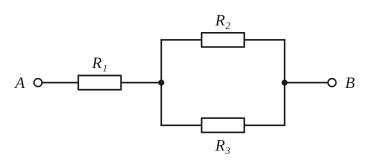
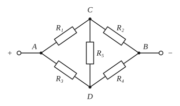
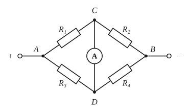
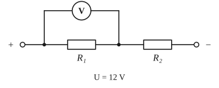
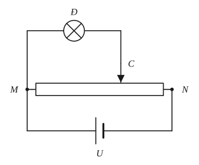
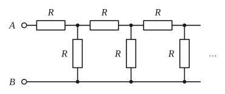

# Chủ đề 5. Điện học: định luật Ohm, mạch điện, công suất điện

> **Level Cơ bản** (mục I, các bài gắn nhãn *Cơ bản*) bám sát SGK KHTN 9. **Level Nâng cao** (mục II, các bài gắn nhãn *Nâng cao*) dành cho ôn thi học sinh giỏi và thi vào lớp 10 chuyên Lí.

## I. Kiến thức cơ bản

### 1. Dòng điện, cường độ dòng điện, hiệu điện thế
- **Dòng điện** là dòng các hạt mang điện dịch chuyển có hướng. Trong kim loại, hạt mang điện là các **electron tự do**.
- **Chiều quy ước** của dòng điện: đi từ cực dương, qua dây dẫn và các dụng cụ, tới cực âm của nguồn. Chiều này **ngược** với chiều chuyển động của electron (vì người ta quy ước chiều dòng điện trước khi biết electron mang điện âm).
- **Cường độ dòng điện** $I$ cho biết dòng điện mạnh hay yếu: đó là lượng điện tích đi qua tiết diện dây trong 1 giây, $I = \frac qt$. Đơn vị: ampe (A); $1\text{ mA} = 10^{-3}\text{ A}$. Đo bằng **ampe kế mắc nối tiếp** với đoạn mạch cần đo (để toàn bộ dòng điện đi qua ampe kế).
- **Hiệu điện thế** $U$ giữa hai điểm là đại lượng "đẩy" dòng điện đi qua đoạn mạch. Đơn vị: vôn (V). Đo bằng **vôn kế mắc song song** với đoạn mạch cần đo.

> **Hình dung bằng dòng nước:** hiệu điện thế giống độ chênh lệch mực nước giữa hai bể, cường độ dòng điện giống lưu lượng nước chảy qua ống, còn điện trở giống độ hẹp của ống.

### 2. Định luật Ohm
$$I = \frac UR.$$
Cường độ dòng điện qua một dây dẫn tỉ lệ thuận với hiệu điện thế đặt vào hai đầu dây và tỉ lệ nghịch với điện trở của dây.
- **Điện trở** $R = \frac UI$ đặc trưng cho mức độ cản trở dòng điện của dây dẫn. Đơn vị: ôm ($\Omega$); $1\text{ k}\Omega = 1000\ \Omega$.
- Với một dây dẫn cho trước (nhiệt độ không đổi), $R$ là hằng số: tăng $U$ gấp đôi thì $I$ tăng gấp đôi. Vì vậy đồ thị $I$ theo $U$ là **một đường thẳng đi qua gốc tọa độ**; dây có điện trở càng lớn thì đường thẳng càng thoải.
- **Lỗi hay gặp:** từ $R = \frac UI$ kết luận "điện trở tỉ lệ thuận với hiệu điện thế" là **sai**. Công thức này chỉ dùng để **tính** $R$; bản thân $R$ phụ thuộc vào dây dẫn (vật liệu, chiều dài, tiết diện), không phụ thuộc $U$ hay $I$.

### 3. Điện trở của dây dẫn
$$R = \rho\frac{l}{S},$$
trong đó $l$ là chiều dài (m), $S$ là tiết diện ($\text{m}^2$), $\rho$ là **điện trở suất** của vật liệu ($\Omega\cdot\text{m}$).

**Vì sao $R$ tỉ lệ với $l$ và tỉ lệ nghịch với $S$?**
- Dây dài gấp đôi giống như hai đoạn dây giống nhau **mắc nối tiếp**, nên điện trở gấp đôi (xem mục 4).
- Dây có tiết diện gấp đôi giống như hai dây giống nhau **mắc song song**, dòng điện có "hai làn đường", nên điện trở giảm một nửa (xem mục 5).

| Vật liệu | $\rho$ ($\Omega\cdot\text{m}$) ở 20 °C |
|---|---|
| Bạc | $1{,}6\cdot10^{-8}$ |
| Đồng | $1{,}7\cdot10^{-8}$ |
| Nhôm | $2{,}8\cdot10^{-8}$ |
| Sắt | $12\cdot10^{-8}$ |
| Nicrom | $1{,}1\cdot10^{-6}$ |

- Kim loại có $\rho$ nhỏ (đồng, nhôm) dùng làm **dây dẫn**; hợp kim có $\rho$ lớn (nicrom) dùng làm **dây đốt nóng**, biến trở.
- Dây tròn đường kính $d$ có tiết diện $S = \frac{\pi d^2}{4}$. Đổi đơn vị: $1\text{ mm}^2 = 10^{-6}\text{ m}^2$.
- **Biến trở** là điện trở có thể thay đổi trị số (thay đổi chiều dài phần dây có dòng điện chạy qua), dùng để điều chỉnh cường độ dòng điện.

### 4. Đoạn mạch nối tiếp
Với $R_1$ nối tiếp $R_2$:
$$I = I_1 = I_2, \qquad U = U_1 + U_2, \qquad R_{\text{tđ}} = R_1 + R_2, \qquad \frac{U_1}{U_2} = \frac{R_1}{R_2}.$$
**Vì sao?**
- Dòng điện chỉ có một đường đi, điện tích không bị "ứ lại" ở đâu cả, nên cường độ như nhau tại mọi điểm.
- Hiệu điện thế cộng dồn dọc theo đường đi (giống độ cao: leo hai đoạn dốc thì tổng độ cao bằng tổng hai đoạn).
- $R_{\text{tđ}} = \frac UI = \frac{U_1 + U_2}{I} = R_1 + R_2$.
- $U_1 = IR_1$, $U_2 = IR_2$, nên **hiệu điện thế chia theo tỉ lệ thuận với điện trở**: điện trở nào lớn thì "giữ" nhiều hiệu điện thế hơn.

### 5. Đoạn mạch song song
Với $R_1$ song song $R_2$:
$$U = U_1 = U_2, \qquad I = I_1 + I_2, \qquad \frac{1}{R_{\text{tđ}}} = \frac1{R_1} + \frac1{R_2}, \qquad \frac{I_1}{I_2} = \frac{R_2}{R_1}.$$
**Vì sao?**
- Hai đầu các nhánh nối chung vào hai điểm, nên hiệu điện thế các nhánh bằng nhau.
- Dòng điện chia ra các nhánh rồi nhập lại, tổng không đổi.
- $\frac{1}{R_{\text{tđ}}} = \frac IU = \frac{I_1 + I_2}{U} = \frac1{R_1} + \frac1{R_2}$.
- $I_1 = \frac U{R_1}$, $I_2 = \frac{U}{R_2}$: **dòng điện chia theo tỉ lệ nghịch với điện trở**, nhánh nào điện trở nhỏ thì dòng lớn.

**Hệ quả hay dùng:**
- Hai điện trở: $R_{\text{tđ}} = \frac{R_1R_2}{R_1 + R_2}$.
- $n$ điện trở giống nhau $R$ mắc song song: $R_{\text{tđ}} = \frac Rn$.
- Điện trở tương đương của đoạn mạch song song **nhỏ hơn** mỗi điện trở thành phần (thêm nhánh là thêm đường cho dòng điện).

### 6. Công và công suất điện, định luật Joule–Lenz
- **Công suất điện** của một đoạn mạch: $P = UI$ (W). Kết hợp với định luật Ohm:
$$P = UI = I^2R = \frac{U^2}{R}.$$
- **Công của dòng điện** (điện năng tiêu thụ) trong thời gian $t$: $A = Pt = UIt$ (J). Đơn vị thực tế: kilôoát giờ, $1\text{ kWh} = 1000\text{ W}\cdot 3600\text{ s} = 3{,}6\cdot10^6\text{ J}$; mỗi "số điện" trên công tơ là 1 kWh.
- **Số ghi trên dụng cụ** (ví dụ đèn 220 V – 100 W) là hiệu điện thế định mức và công suất định mức: khi dùng đúng 220 V thì đèn tiêu thụ đúng 100 W. Từ đó tính được $R = \frac{U_{đm}^2}{P_{đm}}$ và $I_{đm} = \frac{P_{đm}}{U_{đm}}$.
- **Định luật Joule–Lenz:** nhiệt lượng tỏa ra trên dây dẫn có điện trở $R$ khi có dòng điện $I$ chạy qua trong thời gian $t$ là
$$Q = I^2Rt.$$
  *Vì sao?* Với dây dẫn chỉ tỏa nhiệt (bàn là, bếp điện), toàn bộ điện năng chuyển thành nhiệt: $Q = A = UIt$, mà $U = IR$, nên $Q = I^2Rt$. Đơn vị calo: $1\text{ J} \approx 0{,}24\text{ cal}$.
- **Hiệu suất:** $H = \frac{A_{\text{có ích}}}{A_{\text{toàn phần}}}$. Ví dụ ấm điện: phần có ích là nhiệt làm nóng nước $Q = mc\Delta t$.

> **So sánh độ sáng của đèn:**
> - Mắc **nối tiếp** (cùng $I$): $P = I^2R$, đèn có **điện trở lớn hơn** sáng hơn.
> - Mắc **song song** (cùng $U$): $P = \frac{U^2}{R}$, đèn có **điện trở nhỏ hơn** sáng hơn.

### 7. Sử dụng an toàn và tiết kiệm điện
- Chỉ làm thí nghiệm với hiệu điện thế dưới 40 V; dây dẫn phải có vỏ cách điện; lắp cầu chì hoặc aptomat để ngắt mạch khi dòng điện quá lớn (đoản mạch, quá tải); nối đất vỏ kim loại của thiết bị.
- Tiết kiệm điện: dùng thiết bị có hiệu suất cao (đèn LED thay đèn sợi đốt), tắt thiết bị khi không dùng, chỉ dùng trong thời gian cần thiết.

---

## II. Kiến thức nâng cao

### 1. Phân tích mạch: điểm cùng điện thế và vẽ lại mạch
- **Dây nối và ampe kế lý tưởng** có điện trở bằng 0, nên hai đầu của chúng có **cùng điện thế**; ta có thể **chập** hai điểm đó thành một khi vẽ lại mạch (nhưng phải nhớ ampe kế vẫn đo dòng điện qua chính nó).
- **Vôn kế lý tưởng** có điện trở vô cùng lớn, không có dòng điện qua; khi tính dòng điện ta **bỏ vôn kế ra** khỏi mạch. Số chỉ vôn kế là hiệu điện thế giữa hai điểm nó mắc vào.
- **Quy trình:** đặt tên các nút (điểm nối từ ba dây trở lên), chập các nút được nối bằng dây không điện trở, rồi xác định từng điện trở nối giữa hai nút nào và vẽ lại mạch thành các đoạn nối tiếp, song song.
- **Cộng hiệu điện thế theo đường đi:** $U_{AB} = U_{AC} + U_{CB}$ với mọi điểm $C$, trong đó $U_{XY} = V_X - V_Y$ có thể âm. Đây là công cụ tính số chỉ vôn kế mắc giữa hai điểm bất kỳ.

### 2. Định luật nút và phương pháp điện thế nút
- **Định luật nút:** tại một nút, tổng cường độ các dòng điện đi vào bằng tổng cường độ các dòng điện đi ra (điện tích không tích lũy tại nút).
- **Phương pháp điện thế nút** giải được mọi mạch điện trở:
  1. Chọn một nút làm mốc điện thế 0 (thường là cực âm), các nút khác có điện thế ẩn $V_1, V_2, \dots$
  2. Dòng điện qua điện trở $R$ nối hai nút $X, Y$ là $\frac{V_X - V_Y}{R}$ (chiều từ $X$ sang $Y$; nếu ra số âm thì dòng chạy ngược lại).
  3. Viết định luật nút cho mỗi nút chưa biết điện thế, được hệ phương trình bậc nhất.

### 3. Mạch cầu
Mạch cầu gồm 4 điện trở $R_1$ ($A$–$C$), $R_2$ ($C$–$B$), $R_3$ ($A$–$D$), $R_4$ ($D$–$B$) và một điện trở $R_5$ nối hai điểm $C$, $D$.
- **Cầu cân bằng:** nếu $\frac{R_1}{R_2} = \frac{R_3}{R_4}$ thì $V_C = V_D$, dòng qua $R_5$ bằng 0; có thể bỏ $R_5$ (hoặc chập $C$ với $D$) khi tính toán.
  *Vì sao?* Khi bỏ $R_5$, nhánh $ACB$ chia hiệu điện thế theo tỉ lệ $R_1 : R_2$, nhánh $ADB$ theo tỉ lệ $R_3 : R_4$. Hai tỉ lệ bằng nhau thì $U_{AC} = U_{AD}$, tức là $V_C = V_D$; nối $R_5$ vào cũng không có dòng chạy qua.
- **Cầu không cân bằng:** dùng phương pháp điện thế nút (hai ẩn $V_C$, $V_D$), hoặc phép biến đổi tam giác – sao.
- **Biến đổi tam giác thành sao** (nâng cao): ba điện trở $R_{12}, R_{23}, R_{31}$ nối ba điểm thành tam giác tương đương với ba điện trở nối từ một điểm chung $O$ đến ba điểm đó:
$$R_1 = \frac{R_{12}R_{31}}{R_{12} + R_{23} + R_{31}}, \quad R_2 = \frac{R_{12}R_{23}}{R_{12} + R_{23} + R_{31}}, \quad R_3 = \frac{R_{23}R_{31}}{R_{12} + R_{23} + R_{31}}.$$

### 4. Ampe kế và vôn kế không lý tưởng
- Ampe kế có điện trở $R_A$ thì coi như **một điện trở $R_A$** mắc trong mạch; số chỉ là dòng điện qua nó.
- Vôn kế có điện trở $R_V$ thì coi như **một điện trở $R_V$**; số chỉ là hiệu điện thế giữa hai đầu nó, bằng $I_V R_V$.
- Vôn kế có $R_V$ không đủ lớn sẽ làm **giảm** hiệu điện thế ở đoạn mạch nó đo (vì mắc song song làm giảm điện trở đoạn đó), nên số chỉ nhỏ hơn giá trị thật.

### 5. Nguồn có điện trở trong và bài toán công suất cực đại
Nguồn điện có hiệu điện thế $U$ không đổi mắc nối tiếp với điện trở $r$ (điện trở trong, hoặc điện trở dây nối), cung cấp điện cho mạch ngoài $R$:
$$I = \frac{U}{R + r}, \qquad P_R = I^2R = \frac{U^2R}{(R + r)^2}.$$
**Công suất trên $R$ lớn nhất khi $R = r$**, và $P_{\max} = \frac{U^2}{4r}$.
*Chứng minh (dùng AM-GM, xem Toán chủ đề 7):* $\frac{(R + r)^2}{R} = R + 2r + \frac{r^2}{R} \ge 2r + 2\sqrt{R\cdot\frac{r^2}{R}} = 4r$, dấu "=" khi $R = \frac{r^2}{R}$, tức là $R = r$. Do đó $P_R \le \frac{U^2}{4r}$.

*Hệ quả:* với một giá trị $P < P_{\max}$, có hai giá trị $R_1, R_2$ cho cùng công suất và $R_1R_2 = r^2$ (theo định lý Viète cho phương trình $PR^2 + (2Pr - U^2)R + Pr^2 = 0$).

### 6. Biến trở và chiết áp
- **Biến trở mắc nối tiếp** dùng để điều chỉnh dòng điện qua dụng cụ.
- **Mắc kiểu chiết áp (phân áp):** hai đầu biến trở nối với nguồn, dụng cụ mắc giữa một đầu và con chạy, nên song song với một phần biến trở. Gọi phần đó là $x$, ta có đoạn mạch ($x$ song song dụng cụ) nối tiếp với phần còn lại $R_0 - x$. Lập phương trình theo $x$.

### 7. Mạch vô hạn
Nếu mạch gồm vô số mắt giống nhau nối tiếp nhau, bỏ đi một mắt đầu tiên thì phần còn lại **vẫn là mạch vô hạn như cũ**, có cùng điện trở tương đương $x$. Điều đó cho một phương trình theo $x$.

### 8. Kết hợp với nhiệt học
- Ấm, bếp điện: $H\cdot\frac{U^2}{R}t = mc\Delta t$ (bỏ qua sự thay đổi điện trở theo nhiệt độ).
- **Hai dây đốt nóng** cùng đun một lượng nước, hiệu điện thế không đổi: nhiệt lượng cần $Q = \frac{U^2}{R}t$ không đổi, nên **thời gian đun tỉ lệ thuận với điện trở**. Từ đó: mắc nối tiếp $t = t_1 + t_2$, mắc song song $\frac1t = \frac1{t_1} + \frac{1}{t_2}$.

---

## III. Bài tập

**Bài 1 (Cơ bản).** Một dây nicrom dài 10 m, tiết diện $0{,}5\text{ mm}^2$, điện trở suất $1{,}1\cdot10^{-6}\ \Omega\cdot\text{m}$. Tính điện trở của dây. Đặt vào hai đầu dây hiệu điện thế 22 V thì cường độ dòng điện qua dây bằng bao nhiêu?

**Bài 2 (Cơ bản).** Cho $R_1 = 10\ \Omega$ mắc nối tiếp $R_2 = 15\ \Omega$, hiệu điện thế hai đầu đoạn mạch là 12 V. Tính điện trở tương đương, cường độ dòng điện và hiệu điện thế hai đầu mỗi điện trở.

**Bài 3 (Cơ bản).** Cho $R_1 = 6\ \Omega$ mắc song song $R_2 = 12\ \Omega$, hiệu điện thế hai đầu đoạn mạch là 12 V. Tính điện trở tương đương và cường độ dòng điện qua mỗi điện trở, qua mạch chính.

**Bài 4 (Cơ bản).** Cho mạch điện như hình: $R_1 = 4\ \Omega$ mắc nối tiếp với cụm ($R_2 = 6\ \Omega$ song song $R_3 = 12\ \Omega$), $U_{AB} = 12$ V. Tính điện trở tương đương, cường độ dòng điện qua mỗi điện trở.

**Bài 5 (Cơ bản).** Một bóng đèn ghi 220 V – 100 W.
a) Tính điện trở và cường độ dòng điện định mức của đèn.
b) Mỗi ngày đèn được dùng 5 giờ ở đúng hiệu điện thế 220 V. Tính điện năng đèn tiêu thụ trong 30 ngày và tiền điện phải trả, giả sử giá 2 000 đồng/kWh.

**Bài 6 (Cơ bản).** Hai bóng đèn $Đ_1$ (6 V – 3 W) và $Đ_2$ (6 V – 6 W) được mắc nối tiếp vào hiệu điện thế 12 V. Hai đèn có sáng bình thường không? Đèn nào sáng hơn? Có nên mắc như vậy không?

**Bài 7 (Cơ bản).** Một ấm điện ghi 220 V – 1000 W được dùng ở hiệu điện thế 220 V để đun sôi 2 lít nước từ 20 °C. Biết hiệu suất của ấm là 80%, nhiệt dung riêng của nước là 4200 J/(kg·K). Tính thời gian đun sôi nước.

**Bài 8 (Cơ bản).** Một dây đồng và một dây nhôm có cùng chiều dài và cùng điện trở. Biết điện trở suất của đồng và nhôm lần lượt là $1{,}7\cdot10^{-8}$ và $2{,}8\cdot10^{-8}\ \Omega\cdot\text{m}$, khối lượng riêng lần lượt là 8900 và 2700 kg/m³. So sánh tiết diện và khối lượng của hai dây. Vì sao đường dây tải điện thường dùng dây nhôm?

**Bài 9 (Nâng cao, mạch cầu cân bằng).** Cho mạch cầu như hình: $R_1 = 2\ \Omega$, $R_2 = 4\ \Omega$, $R_3 = 3\ \Omega$, $R_4 = 6\ \Omega$, $R_5 = 5\ \Omega$, $U_{AB} = 12$ V. Tính cường độ dòng điện qua $R_5$ và điện trở tương đương của mạch.

**Bài 10 (Nâng cao, mạch cầu không cân bằng).** Cho mạch cầu như hình Bài 9 nhưng với $R_1 = R_4 = 1\ \Omega$, $R_2 = R_3 = 2\ \Omega$, $R_5 = 1\ \Omega$, $U_{AB} = 14$ V. Tính cường độ dòng điện qua từng điện trở (chỉ rõ chiều dòng qua $R_5$) và điện trở tương đương.

**Bài 11 (Nâng cao, ampe kế lý tưởng).** Cho mạch điện như hình: $R_1 = 2\ \Omega$ nối $A$ với $C$, $R_2 = 6\ \Omega$ nối $C$ với $B$, $R_3 = 3\ \Omega$ nối $A$ với $D$, $R_4 = 4\ \Omega$ nối $D$ với $B$, ampe kế lý tưởng nối $C$ với $D$; $U_{AB} = 18$ V. Tìm số chỉ của ampe kế và chiều dòng điện qua ampe kế.

**Bài 12 (Nâng cao, vôn kế không lý tưởng).** Hai điện trở $R_1 = R_2 = 2\text{ k}\Omega$ mắc nối tiếp vào hiệu điện thế không đổi 12 V. Dùng một vôn kế có điện trở $R_V$ để đo hiệu điện thế hai đầu $R_1$ (hình vẽ).
a) Với $R_V = 2\text{ k}\Omega$, vôn kế chỉ bao nhiêu?
b) Điện trở của vôn kế tối thiểu phải bằng bao nhiêu để số chỉ sai lệch so với giá trị thật (khi chưa mắc vôn kế) không quá 5%?

**Bài 13 (Nâng cao, công suất cực đại).** Một nguồn có hiệu điện thế không đổi $U = 12$ V mắc nối tiếp với điện trở $r = 2\ \Omega$ rồi cung cấp điện cho một biến trở $R$.
a) Tìm $R$ để công suất tiêu thụ trên biến trở lớn nhất. Tính công suất lớn nhất đó.
b) Tìm $R$ để công suất trên biến trở bằng 16 W.

**Bài 14 (Nâng cao, chiết áp).** Một biến trở có điện trở toàn phần $R_0 = 18\ \Omega$ được mắc vào hiệu điện thế không đổi $U = 12$ V. Một bóng đèn 6 V – 3 W được mắc giữa đầu $M$ của biến trở và con chạy $C$ (hình vẽ). Tìm điện trở phần $MC$ của biến trở để đèn sáng bình thường. Khi đó hiệu suất sử dụng điện (tỉ số giữa công suất của đèn và công suất của cả mạch) bằng bao nhiêu?

**Bài 15 (Nâng cao, mạch vô hạn).** Một mạch điện gồm vô số mắt giống nhau như hình, mỗi điện trở đều bằng $R = 2\ \Omega$. Tính điện trở tương đương giữa hai điểm $A$ và $B$.

**Bài 16 (Nâng cao, điện – nhiệt).** Một ấm điện có hai dây đốt nóng $R_1$ và $R_2$. Nếu chỉ dùng dây $R_1$ thì nước trong ấm sôi sau 10 phút; nếu chỉ dùng dây $R_2$ thì nước sôi sau 15 phút. Hỏi nếu dùng cả hai dây mắc nối tiếp, hoặc mắc song song, thì sau bao lâu nước sôi? Coi hiệu điện thế không đổi, bỏ qua hao phí nhiệt và sự thay đổi điện trở theo nhiệt độ.

---

## IV. Lời giải chi tiết

### Bài 1
Đổi $S = 0{,}5\text{ mm}^2 = 0{,}5\cdot10^{-6}\text{ m}^2$.
$$R = \rho\frac lS = 1{,}1\cdot10^{-6}\cdot\frac{10}{0{,}5\cdot10^{-6}} = 22\ \Omega, \qquad I = \frac UR = \frac{22}{22} = 1\text{ A}.$$

> Lỗi hay gặp: quên đổi $\text{mm}^2$ sang $\text{m}^2$ (nhân $10^{-6}$).

### Bài 2
- $R_{\text{tđ}} = R_1 + R_2 = 25\ \Omega$.
- $I = \frac{U}{R_{\text{tđ}}} = \frac{12}{25} = 0{,}48$ A, và $I_1 = I_2 = 0{,}48$ A.
- $U_1 = IR_1 = 4{,}8$ V; $U_2 = IR_2 = 7{,}2$ V. Kiểm tra: $4{,}8 + 7{,}2 = 12$ V.

### Bài 3
- $R_{\text{tđ}} = \frac{R_1R_2}{R_1 + R_2} = \frac{6\cdot12}{18} = 4\ \Omega$.
- $I_1 = \frac{U}{R_1} = 2$ A; $I_2 = \frac{U}{R_2} = 1$ A; $I = I_1 + I_2 = 3$ A. Kiểm tra: $\frac{U}{R_{\text{tđ}}} = \frac{12}{4} = 3$ A.

### Bài 4
- $R_{23} = \frac{6\cdot 12}{6 + 12} = 4\ \Omega$, nên $R_{\text{tđ}} = R_1 + R_{23} = 8\ \Omega$.
- $I = I_1 = \frac{12}{8} = 1{,}5$ A.
- $U_{23} = I\cdot R_{23} = 6$ V, nên $I_2 = \frac{6}{6} = 1$ A và $I_3 = \frac{6}{12} = 0{,}5$ A. Kiểm tra: $I_2 + I_3 = 1{,}5$ A.

### Bài 5
**a)** $R = \frac{U_{đm}^2}{P_{đm}} = \frac{220^2}{100} = 484\ \Omega$; $\ I_{đm} = \frac{P_{đm}}{U_{đm}} = \frac{100}{220} = \frac{5}{11} \approx 0{,}45$ A.

**b)** Thời gian dùng: $5\cdot30 = 150$ giờ. Điện năng: $A = Pt = 0{,}1\text{ kW}\cdot150\text{ h} = 15$ kWh. Tiền điện: $15\cdot2000 = 30\,000$ đồng.

> Dùng đơn vị kW và giờ thì điện năng tính ra ngay bằng kWh, không cần đổi sang jun.

### Bài 6
- Điện trở: $R_1 = \frac{6^2}{3} = 12\ \Omega$, $R_2 = \frac{6^2}{6} = 6\ \Omega$. Dòng định mức: $I_{đm1} = 0{,}5$ A, $I_{đm2} = 1$ A.
- Khi mắc nối tiếp: $I = \frac{12}{12 + 6} = \frac23$ A $\approx 0{,}67$ A.
- $I > I_{đm1}$: đèn $Đ_1$ sáng **quá mức** (hiệu điện thế trên nó $U_1 = \frac23\cdot12 = 8$ V $> 6$ V), dễ cháy. $I < I_{đm2}$: đèn $Đ_2$ sáng **yếu hơn** bình thường ($U_2 = 4$ V).
- Cùng dòng điện, đèn có điện trở lớn hơn ($Đ_1$) có công suất $I^2R$ lớn hơn nên sáng hơn: $P_1 = \frac49\cdot12 \approx 5{,}3$ W, $P_2 = \frac49\cdot6 \approx 2{,}7$ W.

**Kết luận:** không nên mắc như vậy. Hai đèn có cùng hiệu điện thế định mức 6 V chỉ sáng bình thường khi mắc **song song** vào nguồn 6 V; mắc nối tiếp vào 12 V chỉ đúng khi hai đèn **giống hệt nhau**.

### Bài 7
- 2 lít nước có khối lượng 2 kg. Nhiệt lượng có ích: $Q = mc\Delta t = 2\cdot4200\cdot(100 - 20) = 672\,000$ J.
- Điện năng ấm tiêu thụ: $A = \frac{Q}{H} = \frac{672\,000}{0{,}8} = 840\,000$ J.
- Ấm dùng đúng 220 V nên $P = 1000$ W. Thời gian: $t = \frac AP = 840$ s $= 14$ phút.

### Bài 8
- Cùng $R$ và $l$: $\rho_{\text{Cu}}\frac{l}{S_{\text{Cu}}} = \rho_{\text{Al}}\frac{l}{S_{\text{Al}}}$, nên $\frac{S_{\text{Al}}}{S_{\text{Cu}}} = \frac{\rho_{\text{Al}}}{\rho_{\text{Cu}}} = \frac{2{,}8}{1{,}7} \approx 1{,}65$. Dây nhôm phải to hơn khoảng 1,65 lần.
- Khối lượng $m = D\cdot S\cdot l$: $\frac{m_{\text{Al}}}{m_{\text{Cu}}} = \frac{D_{\text{Al}}}{D_{\text{Cu}}}\cdot\frac{S_{\text{Al}}}{S_{\text{Cu}}} = \frac{2700}{8900}\cdot\frac{2{,}8}{1{,}7} \approx 0{,}5$.

Với cùng điện trở, **dây nhôm chỉ nặng khoảng một nửa dây đồng** (và nhôm rẻ hơn), nên đường dây tải điện dài, treo trên cột thường dùng dây nhôm (có lõi thép để chịu lực).

### Bài 9
Ta có $\frac{R_1}{R_2} = \frac24 = \frac12$ và $\frac{R_3}{R_4} = \frac36 = \frac12$. Mạch cầu **cân bằng**, nên $V_C = V_D$ và $I_5 = 0$.
Bỏ $R_5$, mạch gồm hai nhánh song song: $R_{12} = 6\ \Omega$ và $R_{34} = 9\ \Omega$:
$$R_{\text{tđ}} = \frac{6\cdot9}{6 + 9} = 3{,}6\ \Omega, \qquad I = \frac{12}{3{,}6} = \frac{10}{3}\text{ A} \approx 3{,}33\text{ A}.$$
Dòng qua nhánh trên $\frac{12}{6} = 2$ A, nhánh dưới $\frac{12}{9} = \frac43$ A.

### Bài 10
$\frac{R_1}{R_2} = \frac12 \ne \frac{R_3}{R_4} = 2$: cầu **không cân bằng**. Chọn $V_B = 0$, $V_A = 14$ V, ẩn là $V_C$, $V_D$.
- Nút $C$: dòng vào qua $R_1$ bằng dòng ra qua $R_2$ và $R_5$:
$$\frac{14 - V_C}{1} = \frac{V_C}{2} + \frac{V_C - V_D}{1}.$$
- Nút $D$: dòng vào qua $R_3$ và $R_5$ bằng dòng ra qua $R_4$:
$$\frac{14 - V_D}{2} + \frac{V_C - V_D}{1} = \frac{V_D}{1}.$$

Rút gọn: $5V_C - 2V_D = 28$ và $-2V_C + 5V_D = 14$. Giải ra $V_C = 8$ V, $V_D = 6$ V.
- $I_1 = \frac{14 - 8}{1} = 6$ A; $I_2 = \frac82 = 4$ A; $I_3 = \frac{14 - 6}{2} = 4$ A; $I_4 = \frac61 = 6$ A.
- $I_5 = \frac{8 - 6}{1} = 2$ A, chạy **từ $C$ sang $D$**.
- Kiểm tra nút $C$: $6 = 4 + 2$; nút $D$: $4 + 2 = 6$.
- Dòng mạch chính $I = I_1 + I_3 = 10$ A, nên $R_{\text{tđ}} = \frac{14}{10} = 1{,}4\ \Omega$.

> **Nhận xét:** mạch có tính đối xứng ($R_1 = R_4$, $R_2 = R_3$) nên $V_D = 14 - V_C$; dùng điều này có thể giải nhanh với một ẩn.

### Bài 11
Ampe kế lý tưởng nên **chập $C$ với $D$**. Mạch trở thành $(R_1 \parallel R_3)$ nối tiếp $(R_2 \parallel R_4)$:
- $R_{13} = \frac{2\cdot3}{5} = 1{,}2\ \Omega$; $R_{24} = \frac{6\cdot4}{10} = 2{,}4\ \Omega$; $R_{\text{tđ}} = 3{,}6\ \Omega$; $I = \frac{18}{3{,}6} = 5$ A.
- $U_{AC} = 5\cdot1{,}2 = 6$ V, nên $I_1 = 3$ A, $I_3 = 2$ A. $U_{CB} = 12$ V, nên $I_2 = 2$ A, $I_4 = 3$ A.

Tại nút $C$ (của mạch ban đầu): dòng vào $I_1 = 3$ A, dòng ra qua $R_2$ chỉ có $2$ A, nên dòng qua ampe kế là $I_A = 3 - 2 = 1$ A, chạy **từ $C$ sang $D$**. Kiểm tra tại $D$: $I_3 + I_A = 2 + 1 = 3 = I_4$.

**Ampe kế chỉ 1 A.**

> Sau khi chập để tính toán, phải **trở về mạch ban đầu** và dùng định luật nút để tìm dòng qua ampe kế. Số chỉ ampe kế **không** phải là dòng qua $R_1$ hay $R_2$.

### Bài 12
**a)** Giá trị thật (chưa mắc vôn kế): $U_1 = 6$ V. Khi mắc vôn kế: $R_{1V} = \frac{2\cdot2}{2 + 2} = 1\text{ k}\Omega$, mạch có $R_{\text{tđ}} = 1 + 2 = 3\text{ k}\Omega$. Vôn kế chỉ
$$U_V = 12\cdot\frac{1}{3} = 4\text{ V}$$
(sai lệch tới $33\%$ so với 6 V).

**b)** Gọi $x = \frac{2R_V}{2 + R_V}$ (kΩ) là điện trở của cụm $R_1$ song song vôn kế. Số chỉ $U_V = \frac{12x}{x + 2}$. Yêu cầu $U_V \ge 0{,}95\cdot6 = 5{,}7$ V:
$$12x \ge 5{,}7x + 11{,}4 \iff x \ge \frac{38}{21}.$$
$$\frac{2R_V}{2 + R_V} \ge \frac{38}{21} \iff 42R_V \ge 76 + 38R_V \iff R_V \ge 19\text{ k}\Omega.$$
Vôn kế phải có điện trở ít nhất **19 kΩ**, gần 10 lần điện trở cần đo.

### Bài 13
**a)** $P = \frac{U^2R}{(R + r)^2} = \frac{144R}{(R + 2)^2}$. Vì $\frac{(R + 2)^2}{R} = R + 4 + \frac4R \ge 4 + 2\sqrt4 = 8$ (AM-GM), nên $P \le \frac{144}{8} = 18$ W, dấu "=" khi $R = \frac4R$, tức là $R = 2\ \Omega = r$.

**b)** $\frac{144R}{(R + 2)^2} = 16 \iff 9R = (R + 2)^2 \iff R^2 - 5R + 4 = 0 \iff R = 1\ \Omega$ hoặc $R = 4\ \Omega$.
Nhận xét: $1\cdot4 = 4 = r^2$, đúng với hệ quả ở mục II.5.

### Bài 14
Đèn: $R_đ = \frac{6^2}{3} = 12\ \Omega$, $I_đ = 0{,}5$ A. Gọi $x$ là điện trở phần $MC$ ($0 < x < 18$). Mạch gồm (đèn song song $x$) nối tiếp với phần $CN$ có điện trở $18 - x$.
Đèn sáng bình thường thì $U_{MC} = 6$ V, nên $U_{CN} = 12 - 6 = 6$ V. Dòng điện qua phần $CN$ bằng tổng dòng qua đèn và qua phần $MC$:
$$\frac{6}{18 - x} = 0{,}5 + \frac6x = \frac{x + 12}{2x}.$$
Quy đồng: $12x = (x + 12)(18 - x) = -x^2 + 6x + 216 \iff x^2 + 6x - 216 = 0$.
$\Delta' = 9 + 216 = 225$, nên $x = -3 + 15 = 12\ \Omega$ (loại nghiệm $x = -18$).
Thử lại: $U_{CN} = 6$ V trên $6\ \Omega$ cho dòng 1 A; đèn 0,5 A cộng phần $MC$ $\frac{6}{12} = 0{,}5$ A, cũng bằng 1 A.

**Phần $MC$ có điện trở $12\ \Omega$.** Khi đó dòng mạch chính $I = \frac{6}{18 - 12} = 1$ A, công suất cả mạch $P = UI = 12$ W, hiệu suất $H = \frac{3}{12} = 25\%$.

> Bài này cho thấy cách mắc chiết áp tốn nhiều điện năng (chỉ 25% dùng cho đèn). Đổi lại, nó điều chỉnh được hiệu điện thế trên đèn từ 0 đến giá trị lớn nhất.

### Bài 15
Gọi $x$ là điện trở tương đương cần tìm. Mạch gồm mắt đầu tiên (một điện trở $R$ nối tiếp trên đường $A$, và một điện trở $R$ mắc ngang) rồi đến **phần còn lại**, mà phần còn lại cũng là một mạch vô hạn giống hệt, có điện trở $x$. Phần còn lại mắc song song với điện trở ngang, rồi cụm đó nối tiếp với điện trở $R$ đầu tiên:
$$x = R + \frac{Rx}{R + x} \iff x(R + x) = R(R + x) + Rx \iff x^2 - Rx - R^2 = 0.$$
Nghiệm dương: $x = \frac{1 + \sqrt5}{2}R$. Với $R = 2\ \Omega$: $x = 1 + \sqrt5 \approx 3{,}24\ \Omega$.

### Bài 16
Nhiệt lượng cần để đun sôi nước là $Q$, không đổi. Bỏ qua hao phí: $Q = \frac{U^2}{R}t$, nên $R = \frac{U^2}{Q}t$, tức là **điện trở tỉ lệ thuận với thời gian đun**. Đặt $R_1 = k\cdot10$, $R_2 = k\cdot15$ (thời gian tính bằng phút).
- **Nối tiếp:** $R_{nt} = R_1 + R_2 = k\cdot25$, nên $t_{nt} = 25$ phút.
- **Song song:** $R_{ss} = \frac{R_1R_2}{R_1 + R_2} = k\cdot\frac{10\cdot15}{25} = k\cdot6$, nên $t_{ss} = 6$ phút.

> Muốn đun nhanh thì mắc **song song** (điện trở nhỏ, công suất $\frac{U^2}{R}$ lớn).
