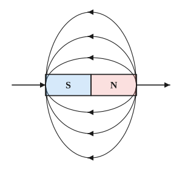
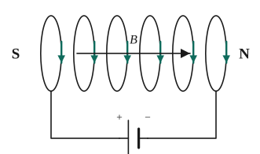
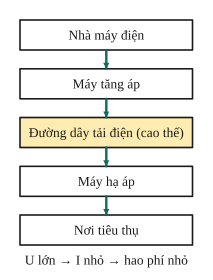
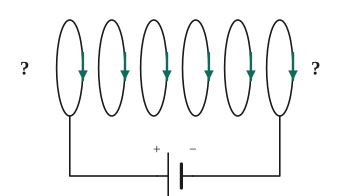
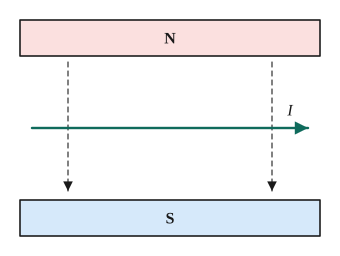

# Chủ đề 6. Điện từ: nam châm, cảm ứng điện từ, dòng điện xoay chiều, truyền tải điện

> **Level Cơ bản** (mục I, các bài gắn nhãn *Cơ bản*) bám sát SGK KHTN 9. **Level Nâng cao** (mục II, các bài gắn nhãn *Nâng cao*) dành cho ôn thi học sinh giỏi và thi vào lớp 10 chuyên Lí.

## I. Kiến thức cơ bản

### 1. Nam châm và từ trường
- Nam châm có hai cực: **cực Bắc (N)** và **cực Nam (S)**; hai cực cùng tên đẩy nhau, khác tên hút nhau. Không thể tách riêng một cực (bẻ đôi nam châm được hai nam châm nhỏ).
- Không gian xung quanh nam châm (và quanh dòng điện) có **từ trường**: nó tác dụng lực lên kim nam châm đặt trong đó.
- **Đường sức từ** biểu diễn từ trường: bên ngoài nam châm, đường sức đi **ra từ cực Bắc, vào cực Nam**. Nơi đường sức dày thì từ trường mạnh. Chiều đường sức là chiều từ cực Nam sang cực Bắc của kim nam châm đặt tại đó.
- Trái Đất là một nam châm khổng lồ; la bàn chỉ hướng Bắc – Nam địa lí (gần đúng).

### 2. Từ trường của ống dây có dòng điện
- Ống dây có dòng điện chạy qua giống như một nam châm thẳng.
- **Quy tắc nắm tay phải:** nắm bàn tay phải sao cho bốn ngón tay hướng theo chiều dòng điện chạy qua các vòng dây, thì **ngón cái choãi ra chỉ chiều đường sức từ trong lòng ống dây** (tức là chỉ về cực Bắc của ống dây).
- **Nam châm điện:** ống dây có lõi sắt non; có thể bật, tắt và thay đổi độ mạnh (tăng dòng điện hoặc số vòng dây). Ứng dụng: chuông điện, rơle, cần cẩu điện, loa.

### 3. Lực điện từ và động cơ điện
- Dây dẫn có dòng điện đặt trong từ trường (không song song với đường sức) chịu **lực điện từ**.
- **Quy tắc bàn tay trái:** đặt bàn tay trái sao cho các đường sức từ hướng vào lòng bàn tay, chiều từ cổ tay đến ngón tay giữa hướng theo chiều dòng điện, thì **ngón cái choãi ra 90° chỉ chiều lực điện từ**.
- **Động cơ điện một chiều:** khung dây có dòng điện đặt trong từ trường quay dưới tác dụng của lực điện từ; biến **điện năng thành cơ năng**. Bộ góp điện (cổ góp) đổi chiều dòng điện trong khung mỗi nửa vòng để khung quay liên tục.

### 4. Hiện tượng cảm ứng điện từ
- **Điều kiện xuất hiện dòng điện cảm ứng** trong cuộn dây kín: **số đường sức từ xuyên qua tiết diện cuộn dây biến thiên** (tăng hoặc giảm).
- Ví dụ: đưa nam châm lại gần hoặc ra xa cuộn dây, quay nam châm trước cuộn dây, đóng ngắt dòng điện trong cuộn dây bên cạnh. Nam châm **đứng yên** so với cuộn dây thì **không có** dòng cảm ứng.
- Khi số đường sức tăng thì dòng cảm ứng chạy theo một chiều, khi giảm thì chạy theo chiều ngược lại.

### 5. Dòng điện xoay chiều và máy phát điện
- **Dòng điện xoay chiều** luân phiên đổi chiều. Ở Việt Nam, dòng điện lưới có tần số **50 Hz** (đổi chiều 100 lần mỗi giây), hiệu điện thế hiệu dụng 220 V.
- **Máy phát điện xoay chiều:** cho cuộn dây quay trong từ trường hoặc nam châm quay trước cuộn dây, số đường sức qua cuộn dây biến thiên liên tục, tạo dòng điện xoay chiều; biến **cơ năng thành điện năng**.
- Tác dụng của dòng điện xoay chiều: nhiệt, quang, từ (lực từ đổi chiều theo dòng điện), sinh lí.

### 6. Truyền tải điện năng đi xa và máy biến áp
- Khi truyền công suất $\mathscr P$ với hiệu điện thế $U$ trên đường dây điện trở $R$, dòng điện $I = \frac{\mathscr P}{U}$, công suất hao phí do tỏa nhiệt:
$$\mathscr P_{hp} = I^2R = \frac{\mathscr P^2R}{U^2}.$$
- Cách giảm hao phí hiệu quả nhất: **tăng hiệu điện thế** $U$ (tăng $U$ lên $n$ lần thì hao phí giảm $n^2$ lần). Giảm $R$ đòi hỏi dây to, nặng, tốn kém.
- **Máy biến áp** gồm hai cuộn dây có số vòng $n_1$, $n_2$ quấn trên một lõi sắt. Đặt hiệu điện thế xoay chiều $U_1$ vào cuộn sơ cấp thì cuộn thứ cấp có
$$\frac{U_1}{U_2} = \frac{n_1}{n_2}.$$
  $n_2 > n_1$: máy **tăng áp** (đặt ở nhà máy điện); $n_2 < n_1$: máy **hạ áp** (đặt ở nơi tiêu thụ).
- Máy biến áp **chỉ hoạt động với dòng điện xoay chiều** (cần từ trường biến thiên trong lõi sắt).

---

## II. Kiến thức nâng cao

### 1. Xác định chiều bằng các quy tắc
Mỗi bài cho hai trong ba yếu tố (chiều dòng điện, chiều đường sức, chiều lực hoặc cực từ), yêu cầu tìm yếu tố còn lại. Quy ước ký hiệu: $\odot$ là chiều đi **ra** khỏi mặt phẳng hình vẽ, $\otimes$ là chiều đi **vào**.

### 2. Máy biến áp lý tưởng
Bỏ qua hao phí: công suất hai cuộn bằng nhau, $U_1I_1 = U_2I_2$, nên
$$\frac{I_1}{I_2} = \frac{U_2}{U_1} = \frac{n_2}{n_1}.$$
Cuộn có hiệu điện thế cao thì dòng điện nhỏ (nên cuộn cao áp quấn dây nhỏ, cuộn hạ áp quấn dây to).

### 3. Hiệu suất truyền tải và độ giảm thế
- Hiệu suất: $H = \frac{\mathscr P - \mathscr P_{hp}}{\mathscr P} = 1 - \frac{\mathscr PR}{U^2}$.
- **Độ giảm thế** trên đường dây: $\Delta U = IR$; hiệu điện thế ở nơi tiêu thụ là $U - \Delta U$.
- Đường dây gồm **hai dây** (đi và về): chiều dài dây dẫn gấp đôi khoảng cách truyền tải, $R = \rho\frac{2L}{S}$.

### 4. Chọn hiệu điện thế hoặc tiết diện dây
Từ yêu cầu hao phí không vượt quá một tỉ lệ cho trước, lập bất phương trình theo $U$ hoặc theo $S$:
$$\frac{\mathscr P R}{U^2} \le k \iff U \ge \sqrt{\frac{\mathscr PR}{k}}.$$

### 5. Tần số và số lần đổi chiều
Máy phát có nam châm quay $n$ vòng/giây với một cặp cực thì dòng điện có tần số $f = n$ (Hz); mỗi chu kì dòng điện đổi chiều 2 lần, nên đổi chiều $2f$ lần mỗi giây.

---

## III. Bài tập

**Bài 1 (Cơ bản).** Cho ống dây có dòng điện chạy qua như hình. Dùng quy tắc nắm tay phải xác định cực Bắc, cực Nam của ống dây. Kim nam châm đặt ở đầu bên phải ống dây sẽ định hướng thế nào?

**Bài 2 (Cơ bản).** Một đoạn dây dẫn nằm ngang giữa hai cực của nam châm chữ U (cực N ở trên, cực S ở dưới), dòng điện trong dây chạy từ trái sang phải trên hình. Dùng quy tắc bàn tay trái xác định chiều lực điện từ tác dụng lên đoạn dây.

**Bài 3 (Cơ bản).** Trong các trường hợp sau, trường hợp nào xuất hiện dòng điện cảm ứng trong cuộn dây kín? Giải thích.
a) Nam châm đặt yên trong lòng cuộn dây.
b) Đưa nam châm từ ngoài vào trong lòng cuộn dây.
c) Cho nam châm và cuộn dây cùng chuyển động thẳng với cùng vận tốc.
d) Quay nam châm quanh trục vuông góc với trục cuộn dây, trước đầu cuộn dây.

**Bài 4 (Cơ bản).** Một máy biến áp có cuộn sơ cấp 500 vòng, cuộn thứ cấp 10 000 vòng. Đặt vào cuộn sơ cấp hiệu điện thế xoay chiều 1000 V. Tính hiệu điện thế ở cuộn thứ cấp. Đây là máy tăng áp hay hạ áp?

**Bài 5 (Cơ bản).** Truyền tải công suất 100 kW trên đường dây có điện trở tổng cộng 10 Ω. Tính công suất hao phí nếu hiệu điện thế truyền tải là a) 10 kV; b) 1 kV. Nhận xét.

**Bài 6 (Cơ bản).** Cần một máy biến áp để hạ hiệu điện thế 220 V xuống 11 V cho một thiết bị. Cuộn sơ cấp có 4000 vòng. Cuộn thứ cấp phải có bao nhiêu vòng?

**Bài 7 (Nâng cao, hao phí).** Ở hai đầu đường dây tải điện, nếu tăng hiệu điện thế từ 5 kV lên 25 kV (giữ nguyên công suất truyền đi và dây dẫn) thì công suất hao phí thay đổi thế nào? Muốn giảm hao phí như vậy bằng cách thay dây cùng chất liệu thì tiết diện dây phải tăng bao nhiêu lần, khối lượng dây tăng bao nhiêu lần?

**Bài 8 (Nâng cao, hiệu suất truyền tải).** Một nhà máy truyền đi công suất 200 kW với hiệu điện thế 5 kV, đường dây có điện trở tổng 5 Ω. Tính cường độ dòng điện, công suất hao phí, hiệu suất truyền tải và hiệu điện thế ở nơi tiêu thụ.

**Bài 9 (Nâng cao, chọn hiệu điện thế).** Cần truyền công suất 1 MW trên đường dây có điện trở 10 Ω. Hiệu điện thế truyền tải tối thiểu phải bằng bao nhiêu để hao phí không vượt quá 1% công suất truyền đi?

**Bài 10 (Nâng cao, máy biến áp lý tưởng).** Một máy biến áp lý tưởng có cuộn sơ cấp 1100 vòng mắc vào mạng điện 220 V. Cuộn thứ cấp nối với một bóng đèn 12 V – 24 W và đèn sáng bình thường. Tính số vòng cuộn thứ cấp và cường độ dòng điện trong mỗi cuộn dây.

**Bài 11 (Nâng cao, máy phát).** Rôto của một máy phát điện xoay chiều có một cặp cực, quay đều 3000 vòng/phút. Tính tần số dòng điện và số lần dòng điện đổi chiều trong 1 giây. Giải thích vì sao bóng đèn sợi đốt dùng điện xoay chiều 50 Hz không bị nhấp nháy với mắt người.

**Bài 12 (Nâng cao, chọn tiết diện dây).** Một đường dây tải điện dài 10 km (gồm hai dây đồng đi và về) cần có điện trở tổng không quá 5 Ω. Biết điện trở suất của đồng là $1{,}7\cdot10^{-8}\ \Omega\cdot\text{m}$. Tính tiết diện tối thiểu của mỗi dây.

---

## IV. Lời giải chi tiết

### Bài 1
Nắm bàn tay phải sao cho bốn ngón tay hướng theo chiều dòng điện trong các vòng dây như hình; ngón cái chỉ sang **phải**. Vậy đầu bên phải của ống dây là **cực Bắc (N)**, đầu bên trái là cực Nam (S).
Kim nam châm đặt ở đầu bên phải sẽ quay **cực Nam** của nó về phía ống dây (hai cực khác tên hút nhau), cực Bắc của kim hướng ra xa ống dây.

### Bài 2
Đường sức từ đi từ cực N xuống cực S: hướng **từ trên xuống**. Đặt bàn tay trái sao cho đường sức đi vào lòng bàn tay (lòng bàn tay ngửa lên), chiều từ cổ tay đến ngón giữa hướng sang phải (chiều dòng điện). Khi đó ngón cái choãi ra chỉ **vuông góc với mặt phẳng hình vẽ, hướng ra xa người đọc**: lực điện từ có chiều **đi vào** mặt phẳng hình vẽ ($\otimes$).

> Tự kiểm tra: đổi chiều dòng điện **hoặc** đổi chỗ hai cực nam châm thì lực đổi chiều; đổi cả hai thì lực giữ nguyên chiều.

### Bài 3
- a) **Không:** số đường sức qua cuộn dây không đổi.
- b) **Có:** số đường sức qua cuộn dây tăng.
- c) **Không:** vị trí tương đối của nam châm và cuộn dây không đổi, số đường sức không đổi.
- d) **Có:** khi quay, số đường sức qua cuộn dây liên tục tăng giảm, tạo dòng điện xoay chiều (nguyên tắc máy phát điện).

### Bài 4
$U_2 = U_1\frac{n_2}{n_1} = 1000\cdot\frac{10\,000}{500} = 20\,000$ V. Vì $n_2 > n_1$ nên đây là máy **tăng áp**.

### Bài 5
**a)** $I = \frac{100\,000}{10\,000} = 10$ A; $\ \mathscr P_{hp} = 10^2\cdot10 = 1000$ W (bằng 1% công suất truyền đi).

**b)** $I = 100$ A; $\ \mathscr P_{hp} = 100^2\cdot10 = 100\,000$ W: toàn bộ công suất bị mất trên đường dây!

**Nhận xét:** giảm $U$ đi 10 lần thì hao phí tăng 100 lần. Vì vậy phải truyền tải điện ở hiệu điện thế cao.

### Bài 6
$n_2 = n_1\frac{U_2}{U_1} = 4000\cdot\frac{11}{220} = 200$ vòng.

### Bài 7
$\mathscr P_{hp} = \frac{\mathscr P^2R}{U^2}$: $U$ tăng 5 lần thì hao phí **giảm 25 lần**.
Nếu giữ $U$, muốn hao phí giảm 25 lần thì $R$ phải giảm 25 lần, tức là tiết diện tăng **25 lần** ($R = \rho\frac lS$); khối lượng dây ($m = D\cdot S\cdot l$) cũng tăng **25 lần**, rất tốn kém và nặng. Vì vậy tăng hiệu điện thế là cách tối ưu.

### Bài 8
- $I = \frac{200\,000}{5000} = 40$ A.
- $\mathscr P_{hp} = 40^2\cdot5 = 8000$ W $= 8$ kW.
- $H = \frac{200 - 8}{200} = 96\%$.
- $\Delta U = IR = 200$ V, nên hiệu điện thế nơi tiêu thụ là $5000 - 200 = 4800$ V.

### Bài 9
$\frac{\mathscr P^2R}{U^2} \le 0{,}01\mathscr P \iff U^2 \ge 100\mathscr PR = 100\cdot10^6\cdot10 = 10^9 \iff U \ge \sqrt{10^9} \approx 31\,623$ V.
Hiệu điện thế tối thiểu khoảng **31,6 kV**.

### Bài 10
- $n_2 = 1100\cdot\frac{12}{220} = 60$ vòng.
- Đèn sáng bình thường: $I_2 = \frac{24}{12} = 2$ A.
- Lý tưởng: $U_1I_1 = U_2I_2 = 24$ W, nên $I_1 = \frac{24}{220} \approx 0{,}11$ A.

### Bài 11
$3000$ vòng/phút $= 50$ vòng/giây, nên $f = 50$ Hz; dòng điện đổi chiều $2\cdot50 = 100$ lần mỗi giây.
Dây tóc đèn có quán tính nhiệt (không kịp nguội trong khoảng thời gian rất ngắn khi dòng điện qua 0), và mắt người có hiện tượng **lưu ảnh** khoảng $\frac1{10}$ s, nên không thấy đèn nhấp nháy.

### Bài 12
Tổng chiều dài dây: $l = 2\cdot10 = 20$ km $= 2\cdot10^4$ m.
$R = \rho\frac lS \le 5 \iff S \ge \frac{1{,}7\cdot10^{-8}\cdot2\cdot10^4}{5} = 6{,}8\cdot10^{-5}\text{ m}^2 = 68\text{ mm}^2$.
