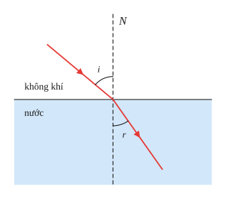
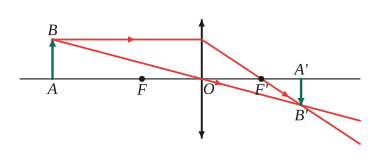
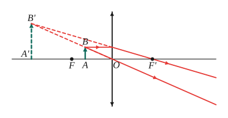
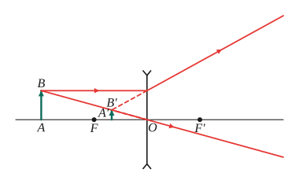
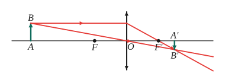
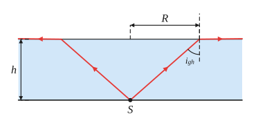
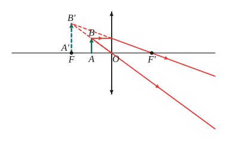
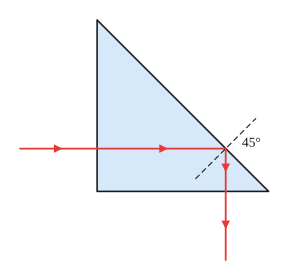

# Chủ đề 7. Quang học: khúc xạ, thấu kính, sự tạo ảnh, mắt

> **Level Cơ bản** (mục I, các bài gắn nhãn *Cơ bản*) bám sát SGK KHTN 9. **Level Nâng cao** (mục II, các bài gắn nhãn *Nâng cao*) dành cho ôn thi học sinh giỏi và thi vào lớp 10 chuyên Lí.
>
> Quy ước trong chủ đề: $d$ là khoảng cách từ vật đến thấu kính, $d'$ là khoảng cách từ ảnh đến thấu kính, $f$ là tiêu cự; $h$, $h'$ là chiều cao vật và ảnh.

## I. Kiến thức cơ bản

### 1. Phản xạ ánh sáng và gương phẳng (nhắc lại)
- **Định luật phản xạ:** tia phản xạ nằm trong mặt phẳng tới, góc phản xạ bằng góc tới ($i' = i$).
- **Ảnh qua gương phẳng:** ảnh ảo, lớn bằng vật, đối xứng với vật qua mặt gương.

### 2. Khúc xạ ánh sáng
- **Hiện tượng khúc xạ:** tia sáng truyền xiên góc từ môi trường trong suốt này sang môi trường trong suốt khác thì **bị gãy khúc** tại mặt phân cách.
- Tia sáng đi từ không khí vào nước (hoặc thủy tinh): **góc khúc xạ nhỏ hơn góc tới** ($r < i$), tia khúc xạ lệch lại gần pháp tuyến. Đi theo chiều ngược lại thì $r > i$.
- Tia tới vuông góc với mặt phân cách ($i = 0$) thì truyền thẳng.
- **Chiết suất** $n$ của môi trường cho biết ánh sáng bị "bẻ" mạnh hay yếu (nước $n \approx 1{,}33$, thủy tinh $n \approx 1{,}5$). Ánh sáng từ không khí vào môi trường chiết suất $n$:
$$\sin i = n\sin r.$$
- Hệ quả: nhìn vật dưới nước thấy vật **nông hơn** thực tế; chiếc đũa nhúng xiên vào cốc nước trông như bị gãy.

### 3. Phản xạ toàn phần và lăng kính
- Ánh sáng đi từ môi trường chiết suất lớn sang môi trường chiết suất nhỏ (từ nước ra không khí), khi góc tới lớn hơn **góc giới hạn** $i_{gh}$ thì **toàn bộ** ánh sáng bị phản xạ trở lại, không có tia khúc xạ: $\sin i_{gh} = \frac1n$.
- Ứng dụng: cáp quang, lăng kính phản xạ toàn phần trong ống nhòm.
- **Lăng kính** làm lệch tia sáng về phía đáy. Ánh sáng trắng qua lăng kính bị **tán sắc** thành dải màu từ đỏ đến tím (tia tím lệch nhiều nhất), chứng tỏ ánh sáng trắng là hỗn hợp nhiều ánh sáng màu.

### 4. Thấu kính và ba tia sáng đặc biệt
- **Thấu kính hội tụ** (rìa mỏng hơn phần giữa) hội tụ chùm tia song song; **thấu kính phân kì** (rìa dày hơn phần giữa) làm chùm tia song song loe rộng ra.
- Mỗi thấu kính có quang tâm $O$, trục chính, hai tiêu điểm $F$, $F'$ đối xứng qua $O$, tiêu cự $f = OF$.
- **Ba tia đặc biệt** (dùng để dựng ảnh):
  1. Tia qua **quang tâm** truyền thẳng.
  2. Tia **song song trục chính** cho tia ló đi qua tiêu điểm $F'$ (hội tụ) hoặc có đường kéo dài đi qua tiêu điểm $F$ (phân kì).
  3. Tia đi qua tiêu điểm $F$ (hoặc hướng tới $F'$ với thấu kính phân kì) cho tia ló song song trục chính.

### 5. Ảnh qua thấu kính hội tụ
| Vị trí vật | Tính chất ảnh |
|---|---|
| $d > 2f$ | Ảnh thật, ngược chiều, nhỏ hơn vật ($f < d' < 2f$) |
| $d = 2f$ | Ảnh thật, ngược chiều, bằng vật ($d' = 2f$) |
| $f < d < 2f$ | Ảnh thật, ngược chiều, lớn hơn vật ($d' > 2f$) |
| $d = f$ | Không có ảnh (tia ló song song) |
| $d < f$ | Ảnh ảo, cùng chiều, lớn hơn vật (kính lúp) |

### 6. Ảnh qua thấu kính phân kì
Vật thật luôn cho **ảnh ảo, cùng chiều, nhỏ hơn vật**, nằm trong khoảng tiêu cự ($d' < f$).

### 7. Công thức thấu kính
$$\frac1f = \frac1d + \frac1{d'}\ (\text{ảnh thật}),\qquad \frac1f = \frac1d - \frac1{d'}\ (\text{ảnh ảo, TK hội tụ}),\qquad \frac{h'}{h} = \frac{d'}{d}.$$
Với thấu kính phân kì: $\frac1f = \frac1{d'} - \frac1d$. Các công thức này được chứng minh bằng **tam giác đồng dạng** (xem Bài 7).

### 8. Mắt và các dụng cụ quang học
- Mắt giống máy ảnh: **thể thủy tinh** là thấu kính hội tụ (tiêu cự thay đổi được nhờ cơ vòng), **màng lưới** là nơi hiện ảnh. Mắt nhìn rõ vật trong khoảng từ điểm cực cận $C_c$ đến điểm cực viễn $C_v$.
- **Mắt cận** nhìn rõ vật gần, không nhìn rõ vật xa ($C_v$ gần mắt); khắc phục bằng **kính phân kì** có tiêu cự $f = OC_v$ (đeo sát mắt).
- **Mắt lão** (viễn) nhìn rõ vật xa, không nhìn rõ vật gần; khắc phục bằng **kính hội tụ**.
- **Kính lúp** là thấu kính hội tụ tiêu cự ngắn, số bội giác $G = \frac{25}{f}$ ($f$ tính bằng cm). Vật đặt trong khoảng tiêu cự cho ảnh ảo lớn hơn vật.

---

## II. Kiến thức nâng cao

### 1. Chứng minh các công thức thấu kính
Dùng hai cặp tam giác đồng dạng tạo bởi tia qua quang tâm (cho $\frac{h'}{h} = \frac{d'}{d}$) và tia song song trục chính (cho $\frac{h'}{h} = \frac{d' - f}{f}$ với ảnh thật). Kết hợp hai tỉ số rồi biến đổi được công thức. Đề thi chuyên thường yêu cầu chứng minh lại trước khi dùng.

### 2. Khoảng cách vật – màn
Vật và màn cố định cách nhau $L$; thấu kính hội tụ đặt giữa để thu ảnh rõ trên màn thì $d + d' = L$, $\frac1d + \frac{1}{d'} = \frac1f$. Suy ra
$$d^2 - Ld + Lf = 0.$$
Có vị trí đặt thấu kính khi $\Delta = L^2 - 4Lf \ge 0$, tức là **$L \ge 4f$**; khi $L > 4f$ có hai vị trí (đối xứng: $d_1 = d_2'$).

### 3. Dịch chuyển vật và ảnh
Với thấu kính hội tụ và ảnh thật, vật và ảnh luôn **dịch chuyển cùng chiều**: vật lại gần thấu kính thì ảnh ra xa. Lập công thức cho hai vị trí rồi lấy hiệu.

### 4. Độ phóng đại cho trước
Biết ảnh cao gấp $k$ lần vật: ảnh thật thì $d' = kd$; ảnh ảo thì $d' = kd$ nhưng dùng công thức ảnh ảo. Thay vào công thức thấu kính để tìm $d$.

### 5. Phản xạ toàn phần và vùng sáng
Nguồn sáng điểm ở độ sâu $h$ dưới mặt nước: chỉ các tia có góc tới nhỏ hơn $i_{gh}$ mới ló ra không khí, nên vùng sáng trên mặt nước là hình tròn bán kính
$$R = h\tan i_{gh}, \qquad \sin i_{gh} = \frac{1}{n}.$$

### 6. Gương phẳng: kích thước gương tối thiểu
Người cao $H$ muốn nhìn thấy toàn bộ ảnh của mình trong gương phẳng treo thẳng đứng thì gương phải cao ít nhất $\frac H2$, mép dưới cách sàn bằng một nửa khoảng cách từ mắt tới sàn (không phụ thuộc khoảng cách người – gương). Chứng minh bằng đường trung bình của tam giác.

---

## III. Bài tập

**Bài 1 (Cơ bản).** Chiếu một tia sáng từ không khí vào nước với góc tới 60°. Biết chiết suất của nước là $\frac43$. Tính góc khúc xạ và vẽ đường truyền của tia sáng.

**Bài 2 (Cơ bản).** Vật sáng AB cao 1 cm đặt vuông góc với trục chính của một thấu kính hội tụ có tiêu cự 12 cm, cách thấu kính 36 cm. Dựng ảnh, nêu tính chất ảnh, tính khoảng cách từ ảnh đến thấu kính và chiều cao của ảnh.

**Bài 3 (Cơ bản).** Vật AB đặt cách thấu kính hội tụ (tiêu cự 12 cm) một khoảng 6 cm. Dựng ảnh, nêu tính chất và tính vị trí, độ cao của ảnh so với vật.

**Bài 4 (Cơ bản).** Vật AB đặt cách thấu kính phân kì (tiêu cự 12 cm) một khoảng 24 cm. Dựng ảnh, nêu tính chất và tính vị trí, độ cao ảnh so với vật.

**Bài 5 (Cơ bản).** a) Một kính lúp có tiêu cự 5 cm. Tính số bội giác. b) Một người cận thị có điểm cực viễn cách mắt 50 cm. Người đó phải đeo kính gì, tiêu cự bao nhiêu (kính đeo sát mắt)?

**Bài 6 (Cơ bản).** Một người cao 1,6 m, mắt cách đỉnh đầu 10 cm, đứng trước một gương phẳng treo thẳng đứng. Gương phải cao ít nhất bao nhiêu và mép dưới của gương phải cách sàn bao nhiêu để người đó nhìn thấy toàn bộ ảnh của mình?

**Bài 7 (Nâng cao, chứng minh công thức).** Vật AB đặt vuông góc với trục chính của thấu kính hội tụ, ngoài khoảng tiêu cự, cho ảnh thật A'B'. Bằng kiến thức hình học, chứng minh $\frac1f = \frac1d + \frac{1}{d'}$ và $\frac{h'}{h} = \frac{d'}{d}$.

**Bài 8 (Nâng cao, vật – màn).** Một vật sáng và một màn ảnh đặt cố định cách nhau 90 cm. Đặt một thấu kính hội tụ tiêu cự 20 cm trong khoảng giữa vật và màn. Tìm các vị trí đặt thấu kính để thu được ảnh rõ nét trên màn. Nếu khoảng cách vật – màn là 70 cm thì có thu được ảnh trên màn không?

**Bài 9 (Nâng cao, dịch chuyển vật).** Một vật đặt cách thấu kính hội tụ (tiêu cự 10 cm) 30 cm. Dịch vật lại gần thấu kính thêm 10 cm. Ảnh dịch chuyển bao nhiêu, theo chiều nào? Độ lớn ảnh thay đổi thế nào?

**Bài 10 (Nâng cao, phản xạ toàn phần).** Thủy tinh có chiết suất 1,5.
a) Tính góc giới hạn phản xạ toàn phần khi ánh sáng đi từ thủy tinh ra không khí.
b) Giải thích vì sao tia sáng chiếu vuông góc vào một mặt bên của lăng kính thủy tinh có tiết diện là tam giác vuông cân thì bị phản xạ toàn phần ở mặt huyền và ló ra theo phương vuông góc với tia tới.

**Bài 11 (Nâng cao, vùng sáng).** Một bóng đèn nhỏ đặt ở đáy một bể nước sâu 1 m. Biết chiết suất của nước là $\frac43$. Tính bán kính vùng sáng trên mặt nước (vùng có ánh sáng từ đèn ló ra ngoài).

**Bài 12 (Nâng cao, độ phóng đại).** Đặt vật trước thấu kính hội tụ tiêu cự 12 cm thì thu được ảnh ảo cao gấp 3 lần vật. Tính khoảng cách từ vật và từ ảnh đến thấu kính.

---

## IV. Lời giải chi tiết

### Bài 1
$\sin r = \frac{\sin60°}{4/3} = \frac{3\sqrt3}{8} \approx 0{,}65$, nên $r \approx 40{,}5°$.
Tia khúc xạ lệch lại gần pháp tuyến ($r < i$), nằm ở phía bên kia pháp tuyến so với tia tới.

### Bài 2
Dựng ảnh bằng hai tia: tia từ B song song trục chính, ló qua $F'$; tia từ B qua quang tâm truyền thẳng. Giao điểm là $B'$.
$d = 36 > 2f = 24$: ảnh **thật, ngược chiều, nhỏ hơn vật**.
$$\frac1{d'} = \frac1{12} - \frac1{36} = \frac{2}{36} \implies d' = 18\text{ cm}; \qquad h' = h\cdot\frac{d'}{d} = 1\cdot\frac{18}{36} = 0{,}5\text{ cm}.$$

### Bài 3
$d = 6 < f = 12$: ảnh **ảo, cùng chiều, lớn hơn vật**, cùng phía với vật.
$$\frac1{d'} = \frac1d - \frac1f = \frac16 - \frac1{12} = \frac1{12} \implies d' = 12\text{ cm}; \qquad \frac{h'}{h} = \frac{12}{6} = 2.$$
Ảnh cách thấu kính 12 cm và cao gấp đôi vật.

### Bài 4
Thấu kính phân kì: ảnh **ảo, cùng chiều, nhỏ hơn vật**.
$$\frac1{d'} = \frac1f + \frac1d = \frac1{12} + \frac1{24} = \frac{3}{24} \implies d' = 8\text{ cm}; \qquad \frac{h'}{h} = \frac{8}{24} = \frac13.$$

### Bài 5
**a)** $G = \frac{25}{5} = 5$ (ghi 5x).
**b)** Mắt cận phải đeo **kính phân kì** có tiêu cự $f = OC_v = 50$ cm: kính cho ảnh ảo của vật ở xa tại điểm cực viễn, mắt nhìn rõ.

### Bài 6
Gọi đỉnh đầu là $Đ$, mắt là $M$, chân là $C$, ảnh của chúng qua gương là $Đ'$, $M'$, $C'$. Để thấy đỉnh đầu, tia từ $Đ'$ tới mắt phải đi qua gương; điểm trên gương nằm ở trung điểm theo phương thẳng đứng giữa $Đ$ và $M$ (đường trung bình của tam giác $MĐĐ'$). Tương tự với chân.
- Chiều cao gương tối thiểu: $\frac{ĐC}{2} = \frac{1{,}6}{2} = 0{,}8$ m.
- Mép dưới cách sàn: $\frac{MC}{2} = \frac{1{,}6 - 0{,}1}{2} = 0{,}75$ m.

### Bài 7
Gọi $O$ là quang tâm, $F'$ là tiêu điểm ảnh, $I$ là điểm tia sáng từ B song song trục chính gặp thấu kính ($OI = AB = h$).
- $\triangle OAB \sim \triangle OA'B'$ (g.g, tia BB' qua quang tâm): $\frac{A'B'}{AB} = \frac{OA'}{OA}$, tức là $\frac{h'}{h} = \frac{d'}{d}$. $\quad(1)$
- $\triangle F'OI \sim \triangle F'A'B'$ (g.g, tia IB' qua $F'$): $\frac{A'B'}{OI} = \frac{F'A'}{OF'}$, tức là $\frac{h'}{h} = \frac{d' - f}{f}$. $\quad(2)$

Từ (1), (2): $\frac{d'}{d} = \frac{d' - f}{f} \iff d'f = dd' - df$. Chia hai vế cho $dd'f$: $\frac1d = \frac1f - \frac1{d'}$, tức là $\frac1f = \frac1d + \frac1{d'}$.

### Bài 8
$d + d' = 90$ và $\frac1d + \frac{1}{90 - d} = \frac1{20}$, suy ra $20\cdot90 = d(90 - d)$, tức là $d^2 - 90d + 1800 = 0$. Giải ra $d = 30$ cm hoặc $d = 60$ cm.
Có **hai vị trí**: thấu kính cách vật 30 cm (ảnh lớn gấp 2 lần vật) hoặc 60 cm (ảnh bằng nửa vật).
Với $L = 70$ cm: điều kiện $L \ge 4f = 80$ cm không thỏa mãn ($\Delta = 4900 - 5600 < 0$), nên **không** thu được ảnh trên màn ở bất kỳ vị trí nào.

### Bài 9
- Lúc đầu $d_1 = 30$: $\frac{1}{d_1'} = \frac1{10} - \frac1{30} = \frac{1}{15}$, $d_1' = 15$ cm; $\frac{h_1'}{h} = \frac12$.
- Sau đó $d_2 = 20$: $d_2' = 20$ cm; $\frac{h_2'}{h} = 1$.

Ảnh dịch chuyển **ra xa thấu kính** thêm 5 cm (cùng chiều với vật), độ cao ảnh tăng từ nửa vật lên bằng vật (tăng gấp đôi).

### Bài 10
**a)** $\sin i_{gh} = \frac{1}{1{,}5} = \frac23$, nên $i_{gh} \approx 41{,}8°$.

**b)** Tia sáng vào vuông góc mặt bên nên truyền thẳng, tới mặt huyền với góc tới $45° > 41{,}8°$, bị **phản xạ toàn phần**. Tia phản xạ quay đi $90°$, tới mặt bên kia theo phương vuông góc nên ló ra thẳng. Kết quả tia ló vuông góc với tia tới. Lăng kính như vậy phản xạ tốt hơn gương (không mất ánh sáng), được dùng trong ống nhòm, kính tiềm vọng.

### Bài 11
$\sin i_{gh} = \frac{3}{4}$, nên $\cos i_{gh} = \frac{\sqrt7}{4}$ và $\tan i_{gh} = \frac{3}{\sqrt7}$.
Bán kính vùng sáng: $R = h\tan i_{gh} = \frac{3}{\sqrt7} \approx 1{,}13$ m.

### Bài 12
Ảnh ảo qua thấu kính hội tụ: $\frac1f = \frac1d - \frac{1}{d'}$ với $d' = 3d$:
$$\frac{1}{12} = \frac1d - \frac{1}{3d} = \frac{2}{3d} \implies d = 8\text{ cm}, \quad d' = 24\text{ cm}.$$
